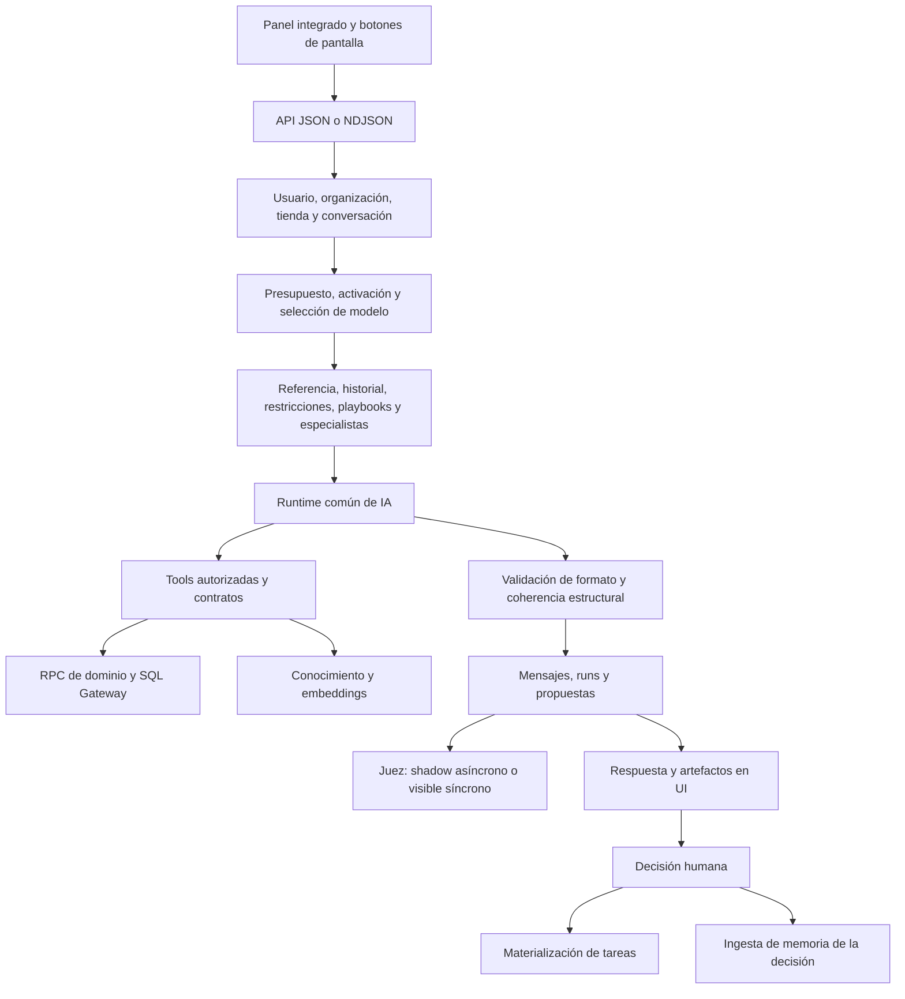

# Auditoría integral del copiloto E-NORA

**Fecha:** 13 de octubre de 2026 · Europe/Madrid.  
**Objeto:** A09 Consultor IA, su interfaz integrada y los servicios compartidos que condicionan sus respuestas, herramientas, propuestas, coste y evaluación.  
**Base:** `main`, commit `d7a1917c2aeeddc55ad34302db88a45ec08fcd31`, más el árbol de trabajo local existente.  
**Entregable:** auditoría y plan de mejoras. Las recomendaciones de este documento no equivalen a cambios implementados.

## 1. Dictamen ejecutivo

E-NORA ya hace bastante más que un chat: consulta datos de negocio, recibe referencias de pantalla, recupera conocimiento, utiliza diagnósticos de especialistas, genera informes y propone tareas con revisión humana. Asumo un SaaS con varias organizaciones, usuarios concurrentes y consultores que cambian de cliente y tienda durante su trabajo.

La base arquitectónica es aprovechable. El siguiente salto de calidad depende principalmente de **coherencia, evidencia durable, recuperación de errores y medición real de utilidad**. Añadir más modelos o herramientas antes de corregir estos puntos ampliaría las posibilidades de fallo.

Se documentan **20 hallazgos priorizados: 10 P1 y 10 P2**. No se ha confirmado un incidente P0 ni una fuga entre organizaciones. Sí se han identificado caminos de código que pierden restricciones por tienda, permiten consultar varias tiendas desde un hilo supuestamente acotado, anuncian un modelo distinto del efectivo y dejan propuestas aprobadas antes de completar su ejecución.

Lo primero que corregiría como CTO:

1. Aplicar el alcance de tienda también al SQL y a las restricciones críticas.
2. Unificar selección, ejecución y comunicación del modelo efectivo.
3. Reparar `meta_spend_detail` y verificar catálogo → contrato → executor.
4. Hacer recuperables las decisiones y los turnos ante fallos parciales.
5. Conservar la respuesta completa y su evidencia al reabrir conversaciones.
6. Proteger el estado del frontend frente a respuestas tardías de otro alcance.

**Potencial:** convertirse en una consola de decisiones para e-commerce: detectar una oportunidad, demostrarla, comparar alternativas, preparar la acción, obtener aprobación, verificar el resultado y aprender de ese resultado. La ventaja competitiva sería la precisión sobre el negocio de cada cliente y la capacidad de ejecutar con control. No existe evidencia en esta auditoría para afirmar que ya es «el mejor» del mercado.

## 2. Alcance, método y límites

### 2.1 Qué se revisó

- Descubrimiento mediante `codebase-memory-mcp`, trazado del turno y lectura del código local en los puntos relevantes.
- Panel web, historial, compositor, streaming, contexto, saldo, navegación, feedback y propuestas.
- Entrada HTTP JSON y NDJSON, permisos, aislamiento por conversación y tienda.
- Router de proveedores, presupuesto, persistencia y registro de herramientas.
- Catálogo completo de 75 tools y presencia de sus contratos ejecutables.
- SQL Gateway, recuperación documental, restricciones, contexto de especialistas y snapshot.
- Ciclo de aprobación/materialización, informes PDF y enlaces privados.
- Infraestructura de juez/evaluación y resultados históricos, contrastados con código actual donde procede.
- Interfaz real de la sesión ya abierta en `http://localhost:3001/dashboard?tab=todo`, escritorio y viewport móvil de **390 × 844**. Se restauró el viewport original.
- Pruebas locales, TypeScript y guardas del repositorio.

Las referencias de líneas se corresponden al árbol local inspeccionado y pueden desplazarse con los cambios en curso. El grafo se usó para localizar símbolos; el contenido actual de los archivos prevalece sobre métricas y posiciones del índice.

### 2.2 Qué significa cada tipo de evidencia

| Etiqueta | Significado |
|---|---|
| Confirmado en código | El flujo y sus condiciones se pueden identificar en la implementación local. |
| Observado en interfaz | Se vio en la sesión local autenticada, sin generar un nuevo turno. |
| Verificado por prueba | Se ejecutó la comprobación indicada durante esta auditoría. |
| Riesgo condicionado | El problema requiere concurrencia, fallo de dependencia u otra condición descrita; no se provocó sobre clientes. |
| Propuesta futura | Capacidad o mejora recomendada, todavía sin acreditar implementación. |

### 2.3 Límites de la auditoría

No se ejecutaron nuevas inferencias con datos de clientes, envíos de email/WhatsApp, publicaciones, aprobaciones ni cambios de base de datos. No se consultó el estado de migraciones de producción. Los nombres de migraciones, incluso los fechados después de esta auditoría, **no prueban despliegue**.

No se leyó cada archivo del monorepo: se profundizó en los caminos del copiloto y sus dependencias de mayor impacto. No se certificó el conjunto de conectores, agentes especialistas o controles legales. No se midieron p95/p99 bajo carga, Core Web Vitals, lectores de pantalla reales, teclado virtual de iOS/Android ni disponibilidad actual de cada identificador de modelo en cada cuenta de proveedor.

Los 20 hallazgos son el registro principal de problemas. El catálogo de mejoras posterior amplía producto y experiencia; no convierte hipótesis o capacidades futuras en bugs confirmados.

## 3. Arquitectura y flujo actual



El streaming empieza durante la generación, antes de la persistencia final y del dictamen del juez. El juez analiza calidad; su existencia no convierte el streaming en una barrera de publicación. La aprobación humana usa otro endpoint y sí es una frontera separada para materializar tareas.

### 3.1 Capacidades actuales y madurez

| Área | Situación acreditada | Límite actual |
|---|---|---|
| Conversación contextual | Ruta, cliente/tienda, periodo y referencias estructuradas | La vista del navegador orienta; no certifica cifras. |
| Gráficos | Evidencia determinista para gasto y ROAS diarios de Meta | El contrato de puntos no cubre todavía series Shopify/Klaviyo. |
| Datos de negocio | Tools de dominio, SQL de lectura y cobertura | El SQL no recibe alcance de tienda; varias tools fijan su propia ventana. |
| Conocimiento | Búsqueda híbrida y reranking opcional | Falta trazabilidad completa de chunks recuperados y abstención calibrada. |
| Especialistas | Contexto reciente aprobado/publicado, acotado por alcance | Es información con fecha; no garantiza vigencia para cualquier pregunta. |
| Acciones | Propuestas pendientes de aprobación; tareas tras decidir | Materialización no atómica; UI no edita propuestas individuales. |
| Informes | Siete plantillas y bucket privado con enlaces temporales | Preview obligatorio descrito en prompt, no convertido en precondición del executor. |
| Memoria | Ingesta de decisiones humanas existente | `memory_recall` sigue planificada; no hay memoria conversacional ilimitada. |
| Evaluación | Contratos, tests, rúbricas, snapshots y juez | No hay certificación integral de utilidad/calibración del copiloto. |
| Proveedores | Adaptadores Anthropic/OpenAI y fallback | El router y la elección visible del copiloto discrepan. |

### 3.2 Lo que conviene conservar

- El servidor fija la organización y valida conversación por usuario; una conexión seleccionada inválida falla cerrada.
- Las herramientas se filtran por catálogo, activación, permisos y conectores. Las planificadas no se presentan como executors disponibles.
- El SQL tiene validación AST, allowlist, rol de lectura, límites de filas, coste y timeout en las migraciones inspeccionadas.
- Las acciones de navegación se resuelven contra destinos conocidos.
- Datos visibles y evidencia verificada están diferenciados explícitamente en el contexto.
- La atribución de Meta/Klaviyo se distingue de ventas de tienda; no debe sumarse.
- La salida pasa por contratos y comprobaciones estructurales; los costes desconocidos se representan como desconocidos.
- El panel comparte espacio en escritorio y usa drawer en móvil. Tiene etiquetas accesibles y log de conversación.
- Las propuestas llevan motivo, evidencia, esfuerzo y coste externo cuando está disponible.
- El juez distingue `shadow` y `visible`; el modo asíncrono evita añadir su latencia ordinaria a la respuesta.
- Los informes se alojan en un bucket privado; la API construye la ruta bajo la organización autorizada y firma enlaces de una hora.

## 4. Registro de hallazgos

**Prioridades:** P1 = corregir antes de ampliar exposición/autonomía; P2 = corregir en la siguiente fase. La prioridad expresa impacto del escenario descrito, no un incidente observado en producción.

### Debe corregirse

### H01 · P1 · Las restricciones críticas locales de una tienda no llegan a A09

**Evidencia:** `runConsultantChatTurn` en [ai-runtime.ts](../apps/api/src/ai-runtime.ts) llama a `loadCriticalClientConstraints(supabase, organizationId, null)` al construir el contexto. El helper, alrededor de la línea 4752, conserva únicamente restricciones globales o cuyo `store_id` coincide con el argumento; además descarta el error de la consulta.

**Caso:** una tienda tiene «no aumentar inversión mientras el margen esté bajo X». El chat resuelve correctamente esa tienda, pero carga restricciones con `null`; la restricción local queda fuera. Si falla la lectura, el contexto se parece a «ninguna restricción activa».

**Corrección mínima:** pasar `knowledgeStoreId` y devolver un estado explícito ante fallo. Para preguntas que dependan de restricciones críticas, bloquear la recomendación de acción si no se verifican.

**Aceptación:** restricciones globales + tienda A incluidas; tienda B excluida; fallo de consulta distinguible de vacío. Sin corregirlo, el asistente puede recomendar acciones incompatibles con condiciones pactadas.

### H02 · P1 · El SQL de un chat por tienda puede consultar otras tiendas de la misma organización

**Evidencia:** `buildAgentTools.sql_select` llama a `executeGatewayQuery(supabase, runId, organizationId, query)`; [sql-gateway.ts](../apps/api/src/sql-gateway.ts), línea 284, no acepta `storeId`. La definición inspeccionada de `agent_sql_gateway` solo fija `app.gateway_org_id`, no una tienda.

**Caso:** el usuario está en tienda A y el modelo consulta `sum(net_sales)` sin filtrar `store_id`. El gateway protege la organización, pero no impide agregar A+B. El hilo y varias tools de dominio sí están acotados a A: sus resultados pueden discrepar.

**Corrección mínima:** en chats por tienda, desactivar `sql_select` hasta que el gateway pueda imponerla, o incorporar un alcance obligatorio en la capa SQL y en todas las vistas relevantes. No confiar en que el modelo añada el filtro.

**Aceptación:** dos tiendas con importes distintos; una consulta sin predicado devuelve solo A o se rechaza. Esto es un problema de alcance dentro de la organización; esta auditoría no acredita fuga entre tenants.

### H03 · P1 · El modelo elegido y el modo reducido pueden ser sustituidos por el router

**Evidencia:** A09 resuelve `resolveCopilotModel` y pasa `modelOverride`. En `runAgentTurnWithFallbackCore`, alrededor de la línea 1269, se vuelve a asignar `selectedModelOverride` desde `clientConfig.model_id` o el defecto del agente; para A09 el defecto es `gpt-6-luna`. La respuesta `data.model` usa `modeloElegido`, no `turn.model`.

**Caso:** el usuario selecciona Opus, o el saldo agotado resuelve Haiku. El router puede ejecutar el modelo configurado para la organización y el payload sigue anunciando el seleccionado por la política previa.

**Corrección mínima:** definir una precedencia única y comprobable: disponibilidad/activación, plan, restricción por saldo, elección explícita y fallback. Devolver modelo y proveedor efectivos, con motivo del cambio. Hacer que toda ruta consuma la misma decisión.

**Aceptación:** matriz Sonnet/Opus/agotado, configuración de organización presente/ausente y proveedor disponible/caído. La UI y el run deben coincidir. No se ha verificado la disponibilidad comercial actual de cada ID: este hallazgo trata la discrepancia interna.

### H04 · P1 · `meta_spend_detail` está marcada operativa pero no tiene contrato

**Evidencia:** el inventario ejecutado exportando `TOOL_REGISTRY`/`TOOL_CONTRACTS` encuentra la tool como `implemented_partial`, sin entrada en `TOOL_CONTRACTS`. Está registrada en `buildAgentTools` alrededor de la línea 2929. `parseToolInput` rechaza cuando `contract?.inputSchema.safeParse` no produce éxito.

**Caso:** el modelo invoca `meta_spend_detail` para comparar gasto por campaña y serie diaria. La lectura no llega al executor porque se rechaza la entrada incluso con `{}`.

**Corrección mínima:** añadir los contratos reales de entrada/salida y su prueba funcional; una guarda debe exigir contrato a toda tool habilitada. No basta probar que su nombre existe.

**Aceptación:** invocation → validación → RPC simulado → validación de respuesta → recibo. Sin corregirlo, una capacidad anunciada falla sistemáticamente.

### H05 · P1 · Se marca «aprobada» antes de completar las tareas

**Evidencia:** `decideAgentOutput`, alrededor de la línea 20899, cambia primero `agent_outputs.status` desde `pending_approval`; después inserta `agent_approvals` y materializa cada tarea. El error del insert de aprobación no se inspecciona en ese punto. Un `taskError` puede no crear tarea y no revertir la decisión.

**Caso:** se aprueban tres tareas; una escritura falla. La salida ya está aprobada y el reintento normal no encuentra una salida pendiente. También puede existir una decisión sin fila de aprobación.

**Corrección mínima:** para tareas propias, transacción que persista decisión y materialización; si el lote necesita ejecución asíncrona, estados `approved → executing → completed/partial/failed` y clave única por propuesta/ítem. Solo las notificaciones deben ser best effort.

**Aceptación:** fallo en el segundo ítem, decisión concurrente y reintento producen resultado recuperable, sin duplicados y con auditoría consistente. Sin corregirlo, «aprobar» puede ocultar trabajo perdido.

### H06 · P1 · Reabrir una conversación pierde evidencia y estructura; la confianza se inventa por defecto

**Evidencia:** A09 guarda en `ai_messages` texto y metadata selectiva. Sin propuestas no guarda el `chatOutput` completo en `agent_outputs`. `getConsultantChatMessages`, alrededor de la línea 20533, no reconstruye fuentes, warnings, confianza, hallazgos, recomendación y siguiente acción. `CopilotPanel.loadConversation`, línea 515, tampoco los mapea. El render muestra «Confianza media» cuando `confidence` no existe.

**Observación:** la conversación recuperada de la sesión local contenía compras atribuidas, ROAS y coste por compra, pero la ficha de evidencia mostraba «Sin evidencia». Esto acredita pérdida de presentación/trazabilidad; no demuestra que el turno original se generara sin fuentes.

**Caso adicional:** las `ui_actions` se guardan en metadata, pero el historial solo las devuelve dentro de la rama que tiene un `agent_output`; una respuesta sin propuesta puede perder navegación al recargar.

**Corrección mínima:** persistir el output completo de todos los turnos con versión de contrato, y devolverlo con un contrato compartido. Mostrar «Confianza no disponible» para registros antiguos sin ese dato.

**Aceptación:** respuesta recién recibida y respuesta reabierta son equivalentes en contenido, fuentes, warnings, confianza, acciones, informes y propuesta. Esta pérdida perjudica la función central: poder revisar por qué se tomó una decisión.

### H07 · P1 · Una respuesta tardía puede entrar en el cliente o hilo nuevo del frontend

**Evidencia:** `CopilotPanel.ask`, líneas 638–742, actualiza estado al terminar sin validar un ID de alcance/turno ni cancelar su fetch. El efecto de cambio de cliente/tienda limpia mensajes, pero la petición anterior conserva setters activos. `loadConversation` tampoco tiene generación de petición propia. «Nueva conversación» limpia el estado sin deshabilitarse durante el envío.

**Caso:** se pregunta sobre A y se cambia a B antes de recibir `done`; la respuesta de A puede añadirse a los mensajes actuales y reintroducir su conversación. Dos cargas de historial que terminan en orden inverso pueden mostrar la selección equivocada.

**Corrección mínima:** `requestId` y clave `(org, store, conversation)` capturados al iniciar; descartar callbacks de otra generación. Añadir cancelación/gestión de segundo plano según la política elegida. Usar IDs de mensaje, no posición de array, para decisiones y feedback.

**Aceptación:** A→B con respuesta A retrasada, hilos X→Y con respuestas invertidas y nueva conversación durante stream. El frontend no mezcla resultados aunque el backend siga aislando correctamente.

### H08 · P1 · El turno no tiene identidad idempotente ni cierre durable único

**Evidencia:** los cuerpos HTTP solo llevan mensaje, conversación, vista, modelo y referencia. A09 inserta la pregunta antes de generar; luego mensaje asistente, propuesta y cierre del run por operaciones separadas. El insert de snapshot y la actualización final del run no inspeccionan todos sus errores. Si el primer turno falla después de crear conversación, el error no devuelve su identidad para recuperarla.

**Caso:** se pierde la conexión después de persistir respuesta/propuesta y el usuario repite. Puede crear otro run, cobrar otro turno o iniciar otra conversación. Un fallo de propuesta después del mensaje asistente deja el hilo en un estado parcial.

**Corrección mínima:** `client_turn_id` único por usuario/alcance y estado durable del turno; endpoint para consultar/reanudar. Finalizar mensaje, propuesta y estado de run en una transacción local. Los recibos críticos deben comprobarse; no tratar un fallo como ausencia de evidencia.

**Aceptación:** replay del mismo ID no vuelve a inferir; delta→corte se recupera; fallo de DB después de generación deja un estado explícito y reintentable. Sin corregirlo, una red mala puede duplicar gasto o perder continuidad.

### H09 · P1 · El saldo ignora errores y el control diario no reserva gasto concurrente

**Evidencia:** [copilot-saldo.ts](../apps/api/src/copilot-saldo.ts) extrae `data` de suscripción y RPC sin revisar `error`; `used ?? 0` puede representar fallo como cero. `checkOrganizationDailyBudget` verifica gasto observado antes del turno; en ese camino no hay una reserva atómica compartida.

**Caso:** falla únicamente `copilot_tokens_consumidos` y se presenta el saldo como casi íntegro. Cerca del límite diario, varias peticiones simultáneas pasan la misma comprobación antes de que todas contabilicen su consumo. Existen topes por turno, que reducen pero no eliminan esa exposición.

**Corrección mínima:** distinguir saldo desconocido de cero y no activar un modelo superior por un fallo de lectura. Reservar una estimación máxima por turno en el presupuesto común, liberar/reconciliar con uso real y aplicar TTL a reservas abandonadas.

**Aceptación:** RPC fallida, suscripción fallida, dos usuarios concurrentes, caída de proceso y consumo desconocido. No exigir que el coste sea matemáticamente cero sobre el tope: definir y medir el margen de exposición máximo.

### H10 · P1 · La redacción de telemetría no protege credenciales incrustadas en texto

**Evidencia:** [observability/index.ts](../packages/observability/src/index.ts), línea 31, incluye `redactSensitiveText`, pero `redactSensitive` devuelve sin procesar valores primitivos. `sanitizeForTelemetry` termina en ese redactor de claves; logs y campos libres pueden conservar texto `Bearer ...` o `?access_token=...` bajo claves como `message`.

**Caso verificado con dato ficticio:** se ejecutó `sanitizeForTelemetry({ message: 'Bearer TOKEN_FICTICIO' })` y conservó ese texto; con una clave `access_token` sí devolvió `[REDACTED]`. Esto demuestra un hueco de redacción, no una filtración real observada.

**Corrección mínima:** redacción por contenido en hojas string, antes del recorte cuando corresponda; pruebas con errores anidados. Para datos personales, usar allowlists de campos y almacenamiento privado con retención. Truncar no anonimiza.

**Aceptación:** tokens ficticios en message, error, stack y URLs quedan redactados; identificadores necesarios para auditoría siguen disponibles. Revisar también quién puede leer snapshots y recibos.

### Debería corregirse

### H11 · P2 · Una cita documental no se puede reconstruir con el recibo RAG actual

**Evidencia:** `search_knowledge`, líneas 4217–4310 de `ai-runtime.ts`, entrega filas al modelo, pero persiste principalmente query/audiencias/`match_count`; no IDs, versión, hash y orden de chunks utilizados. `executeKnowledgeSearch` devuelve el top-k y tiene fallback de reranker, sin umbral calibrado de relevancia en este camino.

**Caso:** una respuesta cita un documento que después se edita. El juez o el consultor no pueden comprobar qué fragmento exacto justificó la respuesta. Fuera del corpus, que exista un top-k no significa que sea evidencia relevante.

**Corrección mínima:** recibo privado con doc/chunk ID, versión/hash, orden, scores, política de audiencia y límites de contexto. Calibrar abstención con consultas etiquetadas sin evidencia; no inventar un umbral universal.

**Aceptación:** reproducir la evidencia de una respuesta tras editar el documento; rechazar cita ajena a los chunks recuperados; medir precisión y abstención con gold humano. No guardar todo el texto en logs generales.

### H12 · P2 · Varias tools no pueden seguir el periodo visible

**Evidencia:** herramientas como `shopify_customer_health` usan `insightsWindow()` sin fechas aportadas por el turno. `meta_spend_detail` usa `metaWindow()`; el JSON Schema por defecto de `registerScopedReadTool` es un objeto vacío para estas tools. `view_context.period` es orientación textual, no parámetros garantizados de consulta.

**Caso:** se pregunta por un trimestre o por el periodo visible de una pantalla y la herramienta responde con su ventana por defecto. El modelo puede combinar periodos distintos si no explica sus diferencias.

**Corrección mínima:** contrato común de fechas/tienda/moneda con defaults explícitos; propagar la ventana autorizada y devolver el periodo efectivo en cada resultado. Marcar métricas lifetime/as-of por separado.

**Aceptación:** mes cerrado, trimestre, ventana diaria, año bisiesto y rango parcial. La cifra citada tiene el mismo periodo que la pregunta o una aclaración visible.

### H13 · P2 · El streaming muestra texto provisional sin etiqueta y carece de cancelación completa

**Evidencia:** la tarjeta de `streamingAnswer` se titula Consultor IA. La ruta NDJSON, [server.ts](../apps/api/src/server.ts), línea 10965, escribe HTTP 200 antes de las validaciones del turno; errores posteriores viajan como eventos. No transmite AbortSignal al runtime al desconectarse el cliente. `activityStage` usa máximo y puede saltar a «Respuesta» al recibir deltas antes de validar.

**Caso:** se lee una cifra parcial que luego se rechaza, se pierde o se reinicia; la UI borra el texto, pero la persona ya lo vio. Cerrar el panel no implica detener gasto.

**Corrección mínima:** «Respuesta en curso · aún no validada», estado de turno separado de estado del juez, y política explícita detener/continuar en segundo plano. Propagar cancelación, plazos y backpressure. Medir error del evento final; HTTP 200 de stream no significa éxito.

**Aceptación:** delta→done, delta→error, corte, reset por retry, desconexión y juez no disponible. Conservar un resultado durable recuperable si el trabajo continúa.

### H14 · P2 · Los tests y el juez no demuestran calidad real del copiloto

**Evidencia:** [copilot-quality-evals.ts](../apps/api/src/copilot-quality-evals.ts) usa presencia literal de hechos y referencias. [Resultados del juez](RESULTADOS_E2E_JUEZ_26_2026-10-13.md) declara que ejecuciones puntuales no equivalen a certificación, y que faltan casos de referencia, adjudicaciones y holdout. Sus conteos de TEST/PROD son evidencia histórica de ese documento, no consultas nuevas de esta auditoría.

**Caso:** la respuesta contiene la cifra esperada y una referencia válida, pero atribuye causalidad injustificada o omite una limitación de periodo. Un score literal puede pasar sin demostrar utilidad.

**Corrección mínima:** conjunto A09 con preguntas reales anonimizadas, hechos atómicos, citas verificadas, restricciones, abstención, aprobación y tareas; dos revisores en casos sensibles y holdout congelado. Mantener tests estructurales como una capa adicional.

**Aceptación:** métricas por tarea, tienda, volumen, antigüedad del dato y dificultad; medir falsos positivos/negativos del juez. No mostrar al cliente «certificado» ni usar el juez como permiso de ejecución.

### H15 · P2 · El historial es limitado para buscar y no está paginado para leer

**Evidencia:** `listConsultantChatConversations` devuelve las 20 recientes. La búsqueda de la UI filtra solo ese array. `getConsultantChatMessages` lee todos los mensajes del hilo, mientras el contexto del modelo conserva únicamente `CHAT_HISTORY_MESSAGES = 10`.

**Caso:** una conversación antigua no aparece al buscar su título. Un hilo largo puede cargar mucho en UI y el modelo olvidar un acuerdo más antiguo que los diez mensajes aportados.

**Corrección mínima:** búsqueda servidor y cursor de historial; cargar el tramo reciente. Añadir resumen versionado de conversación y memoria explícita de decisiones, manteniendo mensajes originales para auditoría.

**Aceptación:** más de 20 conversaciones y un hilo largo; encontrar antiguos, cargar incrementalmente y recordar una restricción relevante sin inventar contexto omitido.

### H16 · P2 · Cerrar el panel elimina el borrador y el estado del turno en la UI

**Evidencia:** `portal-shell.tsx`, alrededor de la línea 1807, monta `CopilotPanel` de forma condicional. `input`, `streamingAnswer`, conversationId y otros estados viven dentro del componente.

**Caso:** se escribe una pregunta, se cierra para consultar datos y se reabre; se pierde el borrador. Si se cierra durante un turno, la ejecución puede seguir y su estado local desaparece.

**Corrección mínima:** conservar borrador por usuario/org/tienda en un estado superior o almacenamiento de sesión; separar sesión de chat de presentación. No compartir borradores entre clientes. Reconciliar turnos activos al reabrir.

**Aceptación:** cierre/apertura, cambio de ruta y refresh según política publicada. Una conversación guardada no sustituye la preservación del borrador.

### H17 · P2 · El autoscroll apunta al nodo que no desplaza la conversación

**Evidencia:** `scrollRef` está en el div `role=log`, línea 1050; el `overflow-y-auto` está en su padre. La inspección DOM confirmó `overflowY: visible` para el log y `auto` para su padre. El efecto llama `scrollRef.current.scrollTo`.

**Caso:** una respuesta larga extiende el chat, pero el scroll automático no actúa sobre el contenedor correcto. El usuario puede no ver el nuevo mensaje.

**Corrección mínima:** referencia al contenedor scrollable o sentinel; solo seguir el final si el usuario ya estaba cerca del final. Ofrecer «Nueva respuesta ↓» cuando esté leyendo arriba.

**Aceptación:** respuesta larga, lector situado arriba, varias deltas y reduced motion. No desplazar al usuario contra su intención.

### H18 · P2 · La metadata de tools no representa bien ejecución, parámetros ni efectos

**Evidencia:** `registerScopedReadTool` registra `{}` como input aun cuando hay fechas, cursor o entidad. `definition` asigna costes iguales por defecto. `get_shopify_product_catalog` figura con conector `core`. `generate_report` tiene permiso `read`, pero la llamada definitiva crea PDF/registro; el preview se exige por prompt, no mediante token/estado de previsualización.

**Caso:** se investiga una cifra y el recibo no permite reconstruir fechas/cursor. Un optimizador toma el coste estático como medida. Un modelo genera el informe definitivo sin preview y el backend no impone esa secuencia.

**Corrección mínima:** guardar parámetros efectivos minimizados; declarar tipo de efecto y coste medido por tool; corregir metadata de conector. Si el preview es requisito de producto, validar un `preview_id` y hash de parámetros/evidencia antes de generar.

**Aceptación:** contrato, permiso, conector, efecto y recibo corresponden al executor; diferencia explícita entre coste orientativo y observado. Generación de artefactos sigue autorizada según política sin confundirse con lectura pura.

### H19 · P2 · La suite de IA falla por una aserción sobre la forma del código

**Evidencia verificada:** `npm run test -w @e-nora/ai`: **262 tests, 261 pasan, 1 falla**; reproducido. El caso «A08 v7 diferencia cobertura del catálogo y muestra acotada al modelo», en [agent-canonical-prompts.test.ts](../packages/ai/src/agent-canonical-prompts.test.ts), exige `/\.\.\.catalogPromptContext/`. La implementación separa `documents` y `catalogSummary` para priorizar contadores.

**Caso:** un refactor que mantiene o mejora el contenido efectivo rompe el gate por no contener un texto concreto. No demuestra por sí mismo un fallo funcional de A08; sí deja la suite y CI en rojo.

**Corrección mínima:** comprobar el contexto construido y sus límites/orden, conservando las invariantes del test. No borrar la prueba ni sustituirla por una regex más permisiva.

**Aceptación:** el test falla si se pierde cobertura o se sobredimensiona la muestra y pasa con la implementación correcta.

### H20 · P2 · Hay controles de UI que prometen una acción distinta o son demasiado pequeños

**Evidencia:** [copilot-saldo.tsx](../apps/web/src/components/copilot-saldo.tsx) muestra «Ver planes» al agotar saldo, pero su handler solo cierra el popover. En móvil se midieron iconos de cabecera de 36 × 36 y ayuda de saldo de unos 90 × 16; el compositor es un `<input type=text>` de una línea.

**Caso:** un usuario intenta ampliar su plan y no llega a ningún sitio; una pregunta con lista de condiciones requiere escribir/editar en una sola línea. El control pequeño del saldo dificulta interacción táctil.

**Corrección mínima:** enlazar a una ruta de plan realmente disponible o cambiar el texto a la acción que hace; textarea autoajustable y objetivos táctiles de 44 px para controles principales. Reutilizar el catálogo HeroUI del proyecto.

**Aceptación:** CTA lleva al destino previsto, Shift+Enter añade salto, Enter/envío tiene política clara y no se envían composiciones IME incompletas. 36 px no implica automáticamente incumplimiento WCAG AA: WCAG 2.2 tiene mínimo de 24 px con excepciones; 44 px es el objetivo recomendado aquí. Referencia: [W3C, tamaño de objetivos](https://www.w3.org/WAI/WCAG22/Understanding/target-size-minimum.html).

## 5. Auditoría de UI y UX

### 5.1 Evaluación de la interfaz actual

| Dimensión | Valoración provisional /4 | Evidencia y límite |
|---|---:|---|
| Accesibilidad | 2 | Labels, log y reduced motion presentes; tamaños pequeños y botón de saldo mejorable. Falta validar lector/teclado/contraste de todos los estados. |
| Rendimiento | 2 | Streaming y carga acotada de conversaciones; lectura no paginada de mensajes y rerender de markdown por delta. Sin mediciones de campo. |
| Responsive | 3 | Rail de escritorio y drawer móvil observados; teclado virtual y zoom 200 % pendientes. |
| Theming | 2 | Tokens presentes, pero el panel fija `bg-white`, iconos nativos y escalas locales. No se acredita tema oscuro completo. |
| Integridad de implementación | 2 | Componentes compartidos, pero historial no conserva output completo y el CTA de planes no navega. |
| **Total orientativo** | **11/20** | **Mejora significativa necesaria; no es certificación de accesibilidad o rendimiento.** |

El detector Impeccable sobre `copilot-panel.tsx` devolvió `[]`. Eso únicamente significa que ese detector no encontró reglas coincidentes en el archivo; no invalida los problemas de comportamiento y DOM descritos.

En el escritorio inspeccionado el rail midió aproximadamente **374 px**. Mantiene a la vista el dashboard, pero una respuesta extensa ocupa varias pantallas y su evidencia debe poder abrirse de forma compacta. La captura inicial del drawer móvil coincidió con una transición; la captura estable posterior fue opaca y legible. No se reporta aquella transparencia transitoria como defecto.

### 5.2 Diseño de la experiencia objetivo

Conservar el tono sobrio de E-NORA y el amarillo/verde ya presente. Toda modificación se apoya en `apps/web/src/components/ui`, sin otro catálogo paralelo.

```text
┌ Consultor IA ──────────────────────────────┐
│ Cliente · tienda · periodo · datos al ...  │
│ [Conversación] [Nueva] [Historial]          │
├───────────────────────────────────────────┤
│ Conclusión breve                          │
│ Cifra/periodo → fuente verificable         │
│ Qué sabemos · qué falta                   │
│ Recomendación y motivo                    │
│ [Abrir evidencia] [Preparar acción]        │
│                                           │
│ Propuesta pendiente                       │
│ Destino · responsable · coste · alcance    │
│ [Editar] [Aprobar seleccionadas] [Rechazar] │
├───────────────────────────────────────────┤
│ Pregunta multilínea                       │
│ [Contexto]             [Detener / Enviar]  │
│ Uso disponible · modelo efectivo          │
└───────────────────────────────────────────┘
```

**Cabecera:** una línea de alcance legible, contexto desplegable y periodo inequívoco. Diferenciar «todas las tiendas» de una tienda específica. Mostrar frescura de las fuentes usadas, no solo cuándo se hizo la pregunta.

**Respuesta:** conclusión primero. Evidencia accesible por cifra y metodología en sección distinta. Warnings cerca de la recomendación que condicionan. Confianza como estado justificado por evidencia, nunca como badge rellenado por defecto.

**Trabajo en curso:** etapa efectiva, tool legible y tiempo transcurrido; detalle técnico bajo «Actividad». Evitar presentar el razonamiento interno del modelo. Mostrar hechos operativos: consultó métricas, faltó dato, creó borrador, guardó resultado.

**Propuestas:** vista previa editable de títulos/descripciones, selección por ítem, destinatario/rol autorizado, coste estimado y resultado por ítem. La API ya acepta `edits` en la decisión; el panel del copiloto puede reutilizar esa capacidad. Mostrar aprobar solo a quien puede aprobar y explicar cuándo decide el consultor.

**Recuperación:** preservar pregunta fallida, botón de reintento con el mismo ID de turno, estado guardado y opción recuperar conversación. Traducir errores de activación, proveedor, evidencia y permisos a texto de producto; códigos técnicos en detalle con ID de soporte.

**Compositor:** textarea que crece hasta un límite, Enter/Shift+Enter documentados, borrador por alcance y pegado de listas. Atajos de abrir/enfocar solo después de evitar conflictos de navegador y ofrecer equivalente táctil.

**Historial:** búsqueda completa en servidor, título editable, renombrar/archivar y fecha legible; visor de mensajes paginado. Diferenciar cerrar panel, nueva conversación y borrar/archivar. Una pregunta de una ficha debe conservar qué entidad abrió el chat.

**Enlaces:** abrir evidencia sin perder el hilo y preservar entidad/periodo cuando el usuario navega. El botón actual de acciones llama `onClose`; la sesión y el borrador deben sobrevivir.

**Móvil:** compositor sobre teclado, safe-area, acciones principales de al menos 44 px, modo de lectura de evidencia a pantalla completa y retorno al chat. Probar foco/Escape, rotación y zoom, no solo ancho CSS.

### 5.3 Backlog específico de UI/UX

| Entrega | Prioridad | Criterio de terminado |
|---|---|---|
| Output completo al reabrir | P1 | Equivalencia de datos recién recibidos/recuperados. |
| Sesión y borrador persistentes | P1/P2 | Cambio de cliente no mezcla; cerrar no pierde borrador. |
| Editor de propuesta por ítem | P2 | Editar/omitir antes de decidir; estado por resultado. |
| Etiqueta de provisionalidad y revisión | P2 | Nunca sugerir que un delta ya está verificado. |
| Textarea y reintento recuperable | P2 | Red mala no obliga a reescribir ni duplicar turnos. |
| Evidencia con navegación | P2 | Fuente, fecha, cobertura y dato exacto a un clic. |
| Historial con búsqueda y cursor | P2 | Encuentra una conversación fuera de las últimas 20. |
| Contexto visible editable | P2 | Cambiar periodo explícitamente y nueva conversación si cambia alcance. |
| Estado de proveedor/uso | P2 | Modelo efectivo, fallback y motivo comprensibles. |
| Targets/foco/zoom | P2 | Teclado, 200 %, 390 px y safe-area verificados. |
| Feedback con motivo opcional | P2 | Incorrecto, incompleto, irrelevante, acción poco útil, otro. |
| Panel de actividad compacto | P2 | Tool/resultado/latencia sin abrumar ni exponer PII. |
| Rail redimensionable con modo lectura | Futuro | Anchura guardada dentro de límites accesibles. |
| Exportar respuesta con fuentes | Futuro | Markdown/PDF conserva fecha, alcance y versión. |

Para implementar: `$impeccable harden` en estados/recuperación, `$impeccable clarify` en errores y confianza, `$impeccable adapt` en móvil y `$impeccable optimize` en listas/stream. Terminar con `$impeccable polish` y repetir la auditoría. La medición de producto decide qué cambios conservar.

## 6. Tools: diagnóstico y diseño objetivo

### 6.1 Inventario real

El registro exportado contiene **75 tools**: **45 `implemented_partial` y 30 `planned`**. De las 45 parcialmente implementadas, **44 tienen contrato y una no (`meta_spend_detail`)**. El inventario completo está al final de este documento.

Estos números corresponden al catálogo estático. No significan que A09 reciba todas las herramientas ni que todas estén disponibles para cualquier cliente: el runtime carga `allowed_tools` de la versión activa desde la base y filtra por conector/política. No se ha consultado esa configuración live en esta auditoría.

Todas las tools de escritura directa listadas están planificadas. Las propuestas estructuradas de A09 viajan en `proposed_writes`; que `propose_task` figure planificada no significa que el chat no pueda proponer una tarea. Las tools de escalado/datos faltantes preparan un resultado estructurado; la existencia del executor no demuestra por sí sola que un humano haya sido notificado o un flujo se haya completado.

### 6.2 Contrato que debe cumplir cada tool

| Parte | Requisito |
|---|---|
| Identidad | Nombre único, versión, dueño y propósito comercial. |
| Entrada | Zod/JSON Schema sincronizados; límites y campos desconocidos explícitos. |
| Alcance | Actor, organización, tienda y capacidades fijadas por servidor. |
| Periodo | Inicio/fin inclusivo o exclusivo declarado; timezone y as-of. |
| Resultado | Valores tipados, unidad, moneda, null vs cero, cobertura y límites. |
| Evidencia | Fuente, registro/consulta/versiones, fecha del dato, hash y freshness. |
| Efecto | Lectura, crear artefacto, propuesta, borrador, publicación o cambio externo. |
| Operación | Deadline, cancelación, retry seguro y rate limit del proveedor. |
| Contabilidad | Coste medido, latencia, bytes/tokens y estado de coste desconocido. |
| Reproducción | Parámetros efectivos y fixture privado minimizado. |
| Escritura | Preview, aprobación, idempotencia, precondición de versión y resultado verificable. |

No convertir cada tool en otra abstracción genérica. La interfaz debe resolver una tarea completa del usuario. La claridad del contrato y sus ejemplos mejora la selección de herramientas; los agentes abiertos añaden coste y posibilidad de errores acumulados. Referencia de diseño: [Anthropic, Building effective agents](https://www.anthropic.com/engineering/building-effective-agents).

### 6.3 Mejoras prioritarias del catálogo existente

1. **Guarda de integridad:** catálogo habilitado ↔ contrato ↔ executor ↔ test; herramienta fallida no se anuncia como disponible.
2. **Periodo común:** las tools consumen el contexto efectivo del turno; lifetime/as-of quedan diferenciados.
3. **Evidencia común:** fechas del dato y de consulta separadas, cobertura desconocida explícita y recibos de RAG/SQL verificables.
4. **Selección por intención:** conjunto pequeño por tarea, con capacidades detectadas antes de llamar; SQL como respaldo avanzado acotado.
5. **Catálogo sin sinónimos confusos:** decidir si los nombres planificados `sql_query`/`knowledge_search` aportan algo sobre `sql_select`/`search_knowledge`. No marcar código muerto sin comprobar referencias.
6. **Efectos honestos:** diferenciar lectura y creación de PDF, y estados de propuesta frente a publicación real.
7. **Dry run ejecutable:** en operaciones futuras, validar cambios/precondiciones; devolver «haría X» solo si el proveedor o el backend lo puede comprobar.
8. **Rendimiento:** fusionar llamadas de cobertura diaria en consulta agregada; el resolutor de gráfico Meta hace una consulta de cobertura por día de la ventana de siete días.

### 6.4 Nuevas tools propuestas

Nombres orientativos de producto, no declaración de herramientas ya existentes.

| Capacidad | Valor para el usuario | Dependencias y frontera |
|---|---|---|
| Resolver una métrica visible | «Explica este punto» también en Shopify/Klaviyo | Referencia tipada y dato consultado en servidor. |
| Comparar periodos de negocio | Explica qué cambió y en qué base | Periodos compatibles, moneda y descomposición determinista. |
| Descomponer margen | Une precio, descuento, COGS, gasto y mix | Motor financiero; distinguir datos completos/parciales. |
| Diagnóstico de medición | Explica desacuerdos entre plataformas | Ventanas de atribución; no suma ingresos atribuidos. |
| Obtener paquete de evidencia | Una respuesta reproducible sin muchas tools | Snapshot acotado, IDs y coste conocido. |
| Simular alternativas | «Si cambio X, qué margen/riesgo queda» | Supuestos explícitos; escenario, no predicción garantizada. |
| Leer memoria de decisiones | Evita repetir propuestas rechazadas | Autoridad, vigencia, alcance y rectificación humana. |
| Preparar experimento | Convierte hipótesis en plan medible | Muestra, guardrails, responsable y criterio de éxito. |
| Handoff a especialista | Resuelve una pregunta compleja puntual | Contrato de entrada/salida, límite de delegación y presupuesto. |
| Explicar falta de datos | Devuelve pasos concretos para desbloquear | Permisos y estado real del conector. |
| Registrar resultado medido | Cierra el ciclo de una acción aprobada | Métrica base/final, ventana y explicación de atribución. |
| Investigar fuentes externas | Fechas/eventos/novedades verificables | Búsqueda conectada, citas, freshness y datos externos no confiables. |
| Ejecutar acción aprobada | Ahorra operación repetitiva | Scopes mínimos, sandbox, preview, aprobación, idempotencia y verificación. |

No añadir Shopify/Meta/Klaviyo writes todas a la vez. Elegir una acción de bajo riesgo, reversible y de valor frecuente, demostrar su ciclo completo y después ampliar. La publicación de campañas, envíos y cambios de presupuesto necesitan condiciones específicas de producto y proveedor.

## 7. Calidad de respuesta, RAG y memoria

### 7.1 Formato de respuesta recomendado

La conversación puede ser breve; la precisión debe quedar en datos estructurados:

```text
Conclusión: el margen cayó por el mix y los descuentos.
Evidencia: cifras verificadas, periodo y fuente por afirmación.
Límites: COGS incompleto en una parte del catálogo.
Acción: revisar las dos promociones identificadas antes de cambiar inversión.
Qué cambiaría la conclusión: costes completos o nueva ventana comparable.
```

Separar hechos observados, interpretación e hipótesis. ROAS atribuido alto no demuestra incremento causado por anuncios. Una demanda observada o una correlación tampoco certifica una elasticidad. Si la ventana o la muestra no permiten concluir, la abstención útil debe decir qué dato falta y cómo obtenerlo.

### 7.2 Recuperación documental

- Medir Precision@k, Recall@k y MRR sobre consultas representativas y con relevancia humana.
- Añadir consultas sin evidencia, documentos contradictorios, versiones antiguas y mezcla de idiomas.
- Conservar cita por chunk y versión; evitar que el modelo genere URLs/IDs no recuperados.
- Usar filtros de audiencia y tienda antes y después de retrieval cuando corresponda.
- Exponer degradación del reranker/embeddings sin afirmar que se ha leído el corpus completo.
- Separar metodología documental de cifras operativas actuales.

### 7.3 Memoria de negocio

La memoria debe guardar decisiones con autor, fecha, alcance y vigencia: «cliente rechazó subir presupuesto por restricción de caja hasta fecha X». No convertir automáticamente cada frase del chat en un hecho permanente.

Propuesta de capas: últimos turnos → resumen versionado del hilo → decisiones confirmadas → evidencia histórica recuperable. El usuario debe poder inspeccionar, corregir y retirar memoria; la retirada debe invalidar sus resúmenes derivados. Mantener datos privados y metodología global separados.

### 7.4 Contexto eficiente

Actualmente el serializador tiene límites por bloque y contexto. Si se recorta historial o evidencia, el run debe registrar qué entró realmente al modelo, qué se omitió y por qué. Priorizar restricciones y pregunta actual; después evidencia relevante, resumen y fragmentos documentales.

El snapshot bruto previo a serialización es útil pero no siempre equivale al texto efectivo consumido tras truncado. Conservar manifiesto/hash del contexto efectivo y contabilización de tokens, sin multiplicar copias de datos personales.

## 8. Seguridad, privacidad y operación

### 8.1 Fronteras que deben permanecer deterministas

Organización, tienda, actor, rol, presupuesto y permisos de escritura son decisiones del backend. El modelo ayuda a interpretar datos; no concede acceso. La clave de servicio bypassa RLS, por lo que las comprobaciones manuales deben probarse por cada superficie. Referencia: [Supabase, Row Level Security](https://supabase.com/docs/guides/database/postgres/row-level-security).

La guarda local `verify` acredita cobertura estática RLS en 322 tablas; no demuestra políticas desplegadas ni aislamiento de todas las rutas live. Para cerrar esa parte hacen falta pruebas de dos tenants y dos tiendas en un entorno aislado y consultas de permisos efectivos.

### 8.2 Prompt injection

La separación de datos no confiables y la neutralización de patrones son defensas útiles. Los siete patrones actuales no cubren todas las paráfrasis, idiomas o ataques indirectos. No se concluye que un bypass semántico permita escribir: las tools y aprobaciones siguen teniendo fronteras propias.

Añadir casos adversarios en documentos, títulos de producto, cuerpos de email y resultados de tools. Medir si el agente inventa citas, divulga notas internas o intenta invocar capacidades fuera de alcance. Toda fuente externa debe conservar la misma frontera de confianza.

### 8.3 Privacidad y compartición

- Definir retención por mensajes, snapshots, recibos, artefactos y datasets; no una duración única para todo.
- Redactar/minimizar por destino: auditoría privada necesita más evidencia que logs de operación.
- Diferenciar respuesta privada del consultor y contenido que se deja en un hilo visible al cliente; no copiar notas `consultant_only` por un botón genérico sin revisar el destino.
- Los enlaces firmados de informes duran una hora y se pueden reenviar. La UI debe comunicar caducidad y alcance; compartir y descargar son capacidades diferentes.
- Añadir trazabilidad de compartición/resultado de envío y límites de abuso sin afectar la descarga autorizada.
- Probar exportación y retirada de datos, incluida memoria derivada. No se realiza aquí una certificación RGPD.

### 8.4 Fiabilidad y capacidad

Propuesta: identidad durable de turno, admisión concurrente por organización, cola para trabajos largos y consulta/reanudación. Reservas de presupuesto deben ser compartidas, no contadores en memoria de proceso.

Definir deadline total y sublímites por proveedor/tool; reintentar lecturas transitorias con backoff y detener ante errores permanentes. El fallback debe preservar contrato, permisos y contabilidad; no reejecutar efectos ya realizados. Instrumentar backpressure y desconexiones de streams.

No separar servicios por costumbre. Primero extraer de `ai-runtime.ts` los módulos de turno A09, política de modelo, construcción de contexto, catálogo ejecutable y materialización. El archivo y `CopilotPanel` mezclan demasiadas responsabilidades para revisar cambios con confianza. Separar por función de negocio, conservando contratos y tests de comportamiento.

## 9. Pruebas ejecutadas y lo que realmente demuestran

| Comprobación | Resultado | Límite |
|---|---|---|
| Guard de superficie de tests | `SAFE_TEST_SURFACE_OK` | Verifica separación del runner remoto; no aislamiento live. |
| API: 11 suites dirigidas al copiloto/RAG | **59/59** | Helpers, contratos, evidencia, scope, informes y métricas; no endpoint completo con proveedor. |
| Web: referencia de evidencia y registro de navegación | **25/25** | Referencias/destinos; no estado del componente durante streaming. |
| Paquete IA completo | **261/262**, un fallo reproducible H19 | No certificar CI en verde. |
| TypeScript `@e-nora/ai` | Pasa | Tipos no prueban semántica del router. |
| TypeScript API con `--noEmit` | Pasa | Usa dependencias/builds presentes en el workspace. |
| TypeScript web | Pasa | No verifica interacción ni rendimiento. |
| `npm run verify` | **19 guardas en verde** | Guardas estáticas; no sustituyen tests/E2E. |
| Detector UI en `copilot-panel.tsx` | `[]` | Reglas limitadas de detector. |
| Inspección navegador | Escritorio y 390 × 844 | Conversación existente; sin nuevas llamadas ni mutaciones. |

Se repitió el paquete IA únicamente para capturar el fallo y comprobar reproducibilidad. No se ejecutó build de producción ni una suite remota de mutación.

Evidencias auxiliares locales en `tmp/copilot-audit-2026-10-13/`: logs de pruebas/TypeScript/verify e inventario JSON. Ese directorio es temporal; los resultados necesarios están resumidos aquí para que el informe no dependa de conservar logs extensos.

## 10. Matriz de validación pendiente

| Flujo | Casos mínimos | Resultado que debe acreditarse |
|---|---|---|
| Autorización | Owner, manager, readonly, consultor con/sin permisos, admin | Preguntar y aprobar respetan capacidades distintas. |
| Alcance | Dos tenants y dos tiendas por tenant | Ninguna cifra/contexto cruza alcance autorizado. |
| Restricciones | Global/local, caducada, carga fallida | Acción incompatible bloqueada o explícitamente abstendida. |
| Contexto | Pregunta de sección, entidad, punto y periodo personalizado | Evidencia exacta y trazable. |
| Calidad de datos | Huecos, cero real, moneda mixta, sync obsoleto | No convierte desconocidos en hechos. |
| Modelo | Selección, plan, saldo, configuración org y fallback | Modelo efectivo idéntico en run/payload/UI. |
| Streaming | Deltas, reset, error, corte, cancelación y reconexión | Estado provisional/durable coherente y recuperable. |
| Estado UI | Cambio de cliente/tienda/hilo, cerrar, nueva conversación | Respuestas tardías no contaminan el estado actual. |
| Persistencia | Fallos en snapshot, mensaje, propuesta y cierre | Turno no se presenta como completo sin recibos críticos. |
| Acciones | Aprobación doble, fallo de ítem, edit/skip, retry | Materialización única, resultado y auditoría por ítem. |
| Presupuesto | Concurrencia y caída de proceso | Reserva reconciliada, exposición acotada. |
| RAG | Sin evidencia, cita inválida, cambio documental | Abstención y reconstrucción de chunks/versiones. |
| Juez | Error, no evaluable, desacuerdo y falso positivo | Estado honesto; no se confunde con autorización. |
| Accesibilidad | Teclado, foco, lector, zoom 200 %, reduced motion | Tarea completa sin ratón; evidencia accesible. |
| Móvil | 360/390/430 px, teclado, rotación | Escribir, leer y decidir sin elementos tapados. |
| Informes | Preview, fallo, caducidad, usuario ajeno | Sin éxito falso ni acceso no autorizado. |

## 11. Métricas para decidir si está mejorando

Los siguientes son **objetivos propuestos**, no resultados ya medidos. Fijar baseline antes de comprometer SLO comercial y segmentar por complejidad.

| Métrica | Cómo medir | Objetivo inicial de aceptación |
|---|---|---|
| Éxito de tarea | Revisión humana y evidencia del flujo | ≥85 % en dataset representativo de tareas soportadas. |
| Exactitud de cifras | Comparación con snapshot autorizado | ≥98 %; cero fallo crítico en casos financieros del gate. |
| Fidelidad de citas | Afirmación sustentada por fragmento/dato recuperado | ≥95 %; nunca fabricar fuente en el gate adversario. |
| Abstención correcta | Consultas sin datos frente a consultas resolubles | Medir precisión/recall; objetivo ≥90 % inicial. |
| Aislamiento | Suite de tenant/tienda/rol | 100 % de casos críticos bloqueados. |
| Recuperación | Cortes/retries/fallos simulados | 100 % de turnos recuperables en matriz crítica, sin duplicados. |
| Tiempo hasta primer feedback | UI/NDJSON | <1 s para estado útil de recepción; separado del primer texto. |
| Primer texto y resultado final | p50/p95 por tarea | Baseline primero; orientar consultas simples a p95 <20 s y análisis complejos <60 s. |
| Coste por tarea útil | Uso de generación + tools + embeddings + juez | Establecer presupuesto según plan; reducir sin degradar exactitud. |
| Utilidad | Feedback + revisión + tarea completada | Comparar por release; el voto solo no certifica utilidad. |
| Acciones efectivas | Aprobadas, completadas y resultado medido | Medir los tres pasos por separado. |
| Beneficio de negocio | Experimento/comparación validada | No atribuir incremento al copiloto solo por coincidencia temporal. |

Medir también tasa de tool fallida, falta de evidencia, fallback, turnos abandonados, edad de datos, recibos incompletos y overshoot de presupuesto. Nunca optimizar la tasa de aprobación sacrificando restricciones o prudencia.

## 12. Hoja de ruta de implementación

Estimaciones orientativas para un equipo pequeño con una persona técnica dedicada y apoyo de producto/revisión. Son esfuerzo, no fechas comprometidas; recalibrar después de resolver los primeros caminos y validar dependencias.

### Fase 0 · Coherencia y confianza · 1–2 semanas

H01–H07 y H10; arreglar gate H19 en paralelo. Desactivar SQL por tienda si su solución completa requiere más trabajo. Persistir output completo, proteger estado de UI y fijar una única decisión de modelo.

**Salida:** matriz de modelo/alcance verde; `meta_spend_detail` invocable; historial conserva fuentes; respuesta tardía no se mezcla; aprobar no produce estado final ficticio. CI pasa con tests de comportamiento.

### Fase 1 · Turnos recuperables y UX operativa · 2–4 semanas

H08, H09, H13, H15–H18 y H20. Identidad idempotente, recuperación, reservas, borradores, textarea, scroll correcto, búsqueda/cursor, edición de propuestas y errores de producto.

**Salida:** completar un flujo en móvil, con cambio de ruta y corte de red, sin repetir gasto ni perder trabajo. Resultado de ejecución visible por ítem.

### Fase 2 · Evidencia y evaluación de calidad · 3–6 semanas

H11, H12 y H14. Recibos privados, periodos comunes, citas por chunk, dataset A09 revisado por humanos y gates por tarea. La cobertura SQL/RAG se prueba de extremo a extremo en entorno aislado.

**Salida:** baseline publicable internamente de exactitud, abstención, coste y latencia; holdout congelado y regresiones bloqueadas. Juez calibrado antes de utilizarlo como señal visible de calidad.

### Fase 3 · Decisiones y simulaciones · 6–10 semanas adicionales

Paquetes de evidencia, comparación de alternativas, escenarios de margen/stock/campañas, memoria de decisiones y handoff selectivo a especialistas. Añadir solo tools que mejoren métricas de tareas existentes.

**Salida:** el copiloto justifica una recomendación frente a alternativas y explica qué incertidumbre cambia la decisión. No presenta escenarios como previsiones garantizadas.

### Fase 4 · Ejecución supervisada · 2–4 meses adicionales

Elegir un caso de uso reversible, probar sandbox/proveedor y definir scopes, límites, aprobación y verificación posterior. Expandir canal a canal según evidencia.

**Salida:** intención → preview → aprobación → ejecución idempotente → verificación → auditoría y recuperación. El sistema registra si no existe rollback real.

### Fase 5 · Operación proactiva por objetivos · horizonte 6–12 meses

Objetivos de negocio, cola de oportunidades, vigilancia con umbrales y revisiones programadas. Autonomía limitada por políticas del cliente, coste, acciones autorizadas y capacidad demostrada.

**Salida:** detecta cambios relevantes, propone pocas acciones justificadas y mide su resultado. Mantiene controles humanos donde el coste de equivocarse es alto.

## 13. Hasta dónde puede llegar

| Nivel | Experiencia | Condición para avanzar |
|---|---|---|
| 1. Asistente informativo | Explica datos y metodología | Cifras y fuentes verificables. Ya hay una base implementada. |
| 2. Copiloto de decisiones | Prioriza y compara acciones | Restricciones, alternativas, incertidumbre y evaluación representativa. |
| 3. Operador supervisado | Prepara y ejecuta lo aprobado | Idempotencia, permisos mínimos y verificación posterior. |
| 4. Copiloto por objetivos | Vigila, propone y revisa resultados | Memoria gobernada, políticas por cliente y beneficio medido. |
| 5. Sistema de operación e-commerce | Coordina herramientas/especialistas con autonomía limitada | Observabilidad, economía, calidad y recuperación demostradas a escala. |

La autonomía debe ganar alcance por evidencia, no por un número de agentes. Para workflows conocidos, usar pasos deterministas; delegación dinámica solo cuando la pregunta lo necesita y bajo presupuesto. No añadir un bucle de juez/reintento ilimitado: definir máximo y salida humana.

El producto puede competir especialmente en margen y caja, inventario, revisión de marketing, atribución honesta y seguimiento de compromisos. Su memoria de decisiones y la conexión entre recomendación y resultado pueden ser más difíciles de copiar que una interfaz de chat.

Antes de afirmar liderazgo comercial falta un benchmark ciego con alternativas relevantes y las mismas tareas, datos, costes y revisores. El criterio sería resolver mejor el trabajo del cliente, no producir respuestas más largas.

## 14. Decisiones recomendadas de CTO

- Mantener Fastify/Next.js, contratos compartidos, SQL/RPC de dominio y aprobación humana; no reescribir el stack.
- Separar política de modelo de SDK/router y publicar siempre modelo efectivo.
- Hacer durable el turno y su evidencia antes de ampliar herramientas de ejecución.
- Reducir herramientas por intención y capacidades disponibles, sin ocultar límites.
- Construir dataset y telemetría de utilidad junto a cada feature, no al final.
- Preservar un único sistema UI HeroUI y el lenguaje de negocio del producto.
- Medir rendimiento y costes con tareas reales anonimizadas; no sumar costes estáticos como si fueran observados.
- Mantener el juez como señal de revisión, con estados honestos y calibración, separado del permiso de actuar.

**Lean:** hay oportunidades de consolidar nombres planificados y separar responsabilidades en los dos módulos grandes. No se estima una reducción de líneas/dependencias: no se ha acreditado que piezas concretas sean eliminables sin perder funciones.

**No comprobado:** despliegue/migraciones efectivos en producción, inferencia nueva A09, aislamiento remoto completo, carga concurrente, eficacia comercial, todas las pantallas, conectores de escritura y certificación legal/accesible. Estas verificaciones siguen necesarias antes de declarar el copiloto completo y certificado.

## 15. Fuentes y referencias

### Implementación principal

- [CopilotPanel](../apps/web/src/components/copilot-panel.tsx) y [saldo UI](../apps/web/src/components/copilot-saldo.tsx).
- [PortalShell](../apps/web/src/components/portal-shell.tsx) y [referencia de evidencia UI](../apps/web/src/lib/copilot-evidence.ts).
- [Runtime API](../apps/api/src/ai-runtime.ts), [rutas](../apps/api/src/server.ts) y [guarda de organización](../apps/api/src/org-access-guard.ts).
- [Runtime de IA](../packages/ai/src/index.ts), [catálogo/contratos de tools](../packages/ai/src/tool-layer.ts) y [contexto no confiable](../packages/ai/src/untrusted-context.ts).
- [SQL Gateway](../apps/api/src/sql-gateway.ts), [evidencia del copiloto](../apps/api/src/copilot-evidence.ts) y [contrato de referencia](../packages/contracts/src/copilot-evidence.ts).
- [Conocimiento](../apps/api/src/knowledge.ts), [contexto de conversación/playbooks](../apps/api/src/decision-playbook-chat-context.ts) y [contexto de especialistas](../apps/api/src/consultant-specialist-context.ts).
- [Saldo backend](../apps/api/src/copilot-saldo.ts), [política de saldo/modelo](../apps/api/src/copilot-tokens.ts) y [compartición de informes](../apps/api/src/copilot-report-sharing.ts).
- [Juez runtime](../apps/api/src/agent-judge-runtime.ts), [scores del copiloto](../apps/api/src/copilot-quality-evals.ts) y [observabilidad](../packages/observability/src/index.ts).
- [Materialización de memoria](../apps/api/src/memory-ingestion.ts) y [CI](../.github/workflows/quality-gates.yml).

### Contexto interno consultado

- `apps/web/PRODUCT.md`.
- [Plan del copiloto integrado](PLAN_COPILOTO_INTEGRADO.md).
- [Auditoría previa de gráficos/RAG y correcciones posteriores](AUDITORIA_COPILOTO_GRAFICOS_RAG.md).
- [Arquitectura de IA](ai/AI_ARCHITECTURE.md) y [seguridad de IA](ai/AI_SECURITY.md).
- [Resultados reales del juez, 13 oct 2026](RESULTADOS_E2E_JUEZ_26_2026-10-13.md).

Los documentos previos orientan; el código local y las pruebas de esta revisión determinan los hallazgos actuales. Por ejemplo, A09 ahora intenta guardar snapshot C2: no se repite la conclusión anterior de que no existía ese insert; se audita su comprobación de error y la trazabilidad efectiva.

### Fuentes externas primarias

- [Anthropic: Building effective agents](https://www.anthropic.com/engineering/building-effective-agents): diseño de workflows, tools y límites de autonomía.
- [Supabase: Row Level Security](https://supabase.com/docs/guides/database/postgres/row-level-security): grants, políticas y bypass de service role.
- [W3C: Target Size (Minimum)](https://www.w3.org/WAI/WCAG22/Understanding/target-size-minimum.html): mínimo AA y excepciones, diferenciados del objetivo táctil de 44 px.

## 16. Inventario completo de herramientas

Generado desde los exports actuales de `packages/ai/src/tool-layer.ts`. **Parcial** significa `implemented_partial`, **Planificada** significa `planned`; contrato indica presencia en `TOOL_CONTRACTS`. La tabla no representa activación live de A09 ni disponibilidad del conector.

| Tool | Estado | Permiso | Conector | Contrato |
|---|---|---|---|---|
| `sql_query` | Planificada | read | core | No |
| `get_metric` | Planificada | read | core | No |
| `compare_periods` | Planificada | read | core | No |
| `get_timeseries` | Planificada | read | core | No |
| `detect_anomaly` | Planificada | read | core | No |
| `get_cohort` | Planificada | read | core | No |
| `describe_schema` | Parcial | read | core | Sí |
| `sample_rows` | Planificada | read | core | No |
| `data_coverage` | Parcial | read | core | Sí |
| `get_organization_profile` | Parcial | read | core | Sí |
| `get_brand_profile` | Parcial | read | core | Sí |
| `get_strategic_plan` | Parcial | read | core | Sí |
| `get_current_milestone` | Parcial | read | core | Sí |
| `list_open_tasks` | Parcial | read | core | Sí |
| `list_open_alerts` | Parcial | read | core | Sí |
| `get_task_history` | Parcial | read | core | Sí |
| `get_call_history` | Parcial | read | core | Sí |
| `get_financial_settings` | Parcial | read | core | Sí |
| `generate_report` | Parcial | read | core | Sí |
| `meta_read_ad_accounts` | Parcial | read | meta | Sí |
| `meta_read_campaign_insights` | Parcial | read | meta | Sí |
| `instagram_read_media` | Parcial | read | instagram | Sí |
| `instagram_read_insights` | Parcial | read | instagram | Sí |
| `knowledge_search` | Planificada | read | core | No |
| `memory_recall` | Planificada | read | core | No |
| `get_playbook` | Planificada | read | core | No |
| `cite_source` | Planificada | read | core | No |
| `get_budget_status` | Parcial | read | core | Sí |
| `report_confidence` | Parcial | read | core | Sí |
| `sql_select` | Parcial | read | core | Sí |
| `search_knowledge` | Parcial | read | core | Sí |
| `shopify_customer_health` | Parcial | read | shopify | Sí |
| `shopify_product_repurchase_health` | Parcial | read | shopify | Sí |
| `shopify_demand_sources` | Parcial | read | shopify | Sí |
| `shopify_fulfillment_health` | Parcial | read | shopify | Sí |
| `shopify_delivery_diagnostics` | Parcial | read | shopify | Sí |
| `shopify_open_delivery_exceptions` | Parcial | read | shopify | Sí |
| `shopify_return_delay_comparison` | Parcial | read | shopify | Sí |
| `shopify_funnel_health` | Parcial | read | shopify | Sí |
| `shopify_margin_health` | Parcial | read | shopify | Sí |
| `get_shopify_product_catalog` | Parcial | read | core | Sí |
| `meta_creative_health` | Parcial | read | meta | Sí |
| `meta_creative_diagnostics` | Parcial | read | meta | Sí |
| `meta_delivery_health` | Parcial | read | meta | Sí |
| `meta_change_log` | Parcial | read | meta | Sí |
| `meta_spend_detail` | Parcial | read | meta | No |
| `klaviyo_email_content` | Parcial | read | klaviyo | Sí |
| `klaviyo_measurement_health` | Parcial | read | klaviyo | Sí |
| `klaviyo_performance_summary` | Parcial | read | klaviyo | Sí |
| `klaviyo_entity_performance` | Parcial | read | klaviyo | Sí |
| `klaviyo_deliverability_health` | Parcial | read | klaviyo | Sí |
| `search_internal_email_design_playbook` | Parcial | read | Ninguno | Sí |
| `propose_task` | Planificada | propose | core | No |
| `propose_milestone` | Planificada | propose | core | No |
| `propose_phase` | Planificada | propose | core | No |
| `propose_alert_rule` | Planificada | propose | core | No |
| `propose_budget_change` | Planificada | propose | core | No |
| `propose_content` | Planificada | propose | klaviyo | No |
| `propose_experiment` | Planificada | propose | core | No |
| `dry_run_write` | Parcial | propose | core | Sí |
| `escalate_to_human` | Parcial | propose | core | Sí |
| `request_missing_data` | Parcial | propose | core | Sí |
| `handoff_to_agent` | Planificada | propose | core | No |
| `flag_data_quality_issue` | Parcial | propose | core | Sí |
| `memory_write` | Planificada | write | core | No |
| `shopify_update_product` | Planificada | write | shopify | No |
| `shopify_update_inventory` | Planificada | write | shopify | No |
| `meta_pause_ad` | Planificada | write | meta | No |
| `meta_adjust_budget` | Planificada | write | meta | No |
| `meta_duplicate_adset` | Planificada | write | meta | No |
| `klaviyo_create_flow` | Planificada | write | klaviyo | No |
| `klaviyo_send_campaign` | Planificada | write | klaviyo | No |
| `instagram_schedule_post` | Planificada | write | instagram | No |
| `log_reasoning_step` | Planificada | write | core | No |
| `record_outcome` | Planificada | write | core | No |

## 17. Estado de las correcciones · 2026-10-14

Se aplicaron correcciones locales sobre el estado actual del repositorio. No se desplegó código ni se ejecutaron migraciones remotas.

| Hallazgo | Estado | Cambio realizado y límite pendiente |
|---|---|---|
| H01 | Corregido en código | Las restricciones críticas reciben el `store_id` resuelto y un error de lectura detiene el turno. |
| H02 | Corregido en código | `sql_select` no se declara en una conversación acotada a tienda. |
| H03 | Corregido en código | El router conserva el modelo seleccionado para A09 y la respuesta informa del modelo efectivo. |
| H04 | Corregido en código | `meta_spend_detail` tiene contrato y admite fechas validadas. |
| H05 | Mejorado, falta transacción | La salida solo se finaliza después de guardar tareas y recibo; un error deja la propuesta pendiente y visible para reintento. Los duplicados previos se conservaron en `agent_approval_duplicate_archive` y la salida activa mantiene la decisión más reciente. La secuencia completa aún no es una transacción de base de datos y necesita validación concurrente. |
| H06 | Corregido para nuevos mensajes | Se persiste una salida estructurada versionada en el mensaje y se reconstruyen fuentes, confianza, hallazgos, acciones e informes. Los mensajes anteriores a esta versión conservan sus límites. |
| H07 | Corregido en código | Se invalidan cargas/turnos al cambiar de alcance, se aborta el fetch y se bloquea «Nueva conversación» durante el envío. |
| H08 | Migrado en TEST y producción | `client_turn_id` permite recuperar respuestas guardadas y evita repetir inferencia; los turnos incompletos devuelven un conflicto explícito. Los índices únicos están aplicados en ambos proyectos. |
| H09 | Infraestructura migrada; reserva conectada a las rutas de IA | Errores de saldo fallan de forma explícita. El chat A09, diagnósticos genéricos, analista de llamadas A01, borrador de marketing, análisis visual A15 y propuesta visual A16 reservan coste máximo por organización/día y liquidan la reserva al terminar o fallar. La cola de imágenes conserva una comprobación previa para devolver a cola trabajos cuando el presupuesto ya está agotado. Tabla y RPC están aplicadas en TEST y producción. |
| H10 | Corregido en código | La redacción procesa también cadenas libres, incluidas credenciales con forma conocida. |
| H11 | Mejorado parcialmente | El recibo privado RAG incluye chunk/document ID, versión, checksum, audiencia, score y hash del fragmento. Falta calibrar relevancia y abstención con consultas etiquetadas. |
| H12 | Parcial | `meta_spend_detail` respeta fechas explícitas. Otras tools siguen usando ventanas propias y necesitan un contrato común. |
| H13 | Mejorado; cancelación del proveedor conectada | El streaming identifica el texto como respuesta en curso y aún no validada. Si se cierra la conexión, el servidor aborta la llamada activa a Anthropic/OpenAI; el runtime marca el run como fallido y libera la reserva. Una tool que ya esté ejecutándose no recibe aún señal de cancelación y no existe recuperación durable en segundo plano. |
| H14 | Pendiente de insumos de evaluación | Se corrigió la aserción de A08 para comprobar el resumen y la muestra separados. La calidad semántica requiere preguntas anonimizadas y adjudicación humana que no se deben inventar. |
| H15 | Implementado en código | La búsqueda y el historial usan cursor estable en servidor; la UI carga más conversaciones y mensajes antiguos por bloques, preservando la posición de lectura. Vaciar la búsqueda restaura el historial reciente. |
| H16 | Mejorado | El borrador y el identificador del turno pendiente se conservan en `sessionStorage` por organización/tienda. Al reabrir, la UI permite recuperar el turno con el mismo ID; el servidor no repite inferencia si ya guardó la respuesta. |
| H17 | Corregido en código | El scroll usa el contenedor desplazable y solo sigue el final si la persona ya estaba cerca. |
| H18 | Mejorado parcialmente | Los recibos guardan parámetros efectivos; el catálogo marca Shopify; el registro distingue la creación de informes; el PDF exige preview de mismo periodo/tienda en el turno. Los costes siguen siendo estimaciones estáticas. |
| H19 | Corregido en el test, falta ejecutarlo | La aserción refleja el contexto actual, que separa contadores de la muestra documental. No se volvió a ejecutar la suite. |
| H20 | Corregido en UI | El botón de saldo ya no promete una navegación inexistente; el compositor acepta varias líneas, respeta IME y usa Enter/Shift+Enter. Los controles principales y de saldo tienen objetivo táctil de 44 px. |

### Cambios y validación del código

- [ai-runtime.ts](../apps/api/src/ai-runtime.ts): alcance, modelo, recuperación de turnos, recibos RAG, aprobaciones, periodo Meta, reserva diaria y parámetros de tools.
- [copilot-panel.tsx](../apps/web/src/components/copilot-panel.tsx): restauración estructurada, protección contra respuestas tardías, borradores por alcance, búsqueda remota, scroll y compositor multilinea.
- [tool-layer.ts](../packages/ai/src/tool-layer.ts): contrato Meta, metadata de efecto y conector.
- [index.ts](../packages/ai/src/index.ts): adaptación de JSON Schema para Anthropic; elimina restricciones de longitud/tamaño incompatibles y representa enums nullable con `anyOf`. Zod sigue validando el contrato completo en backend.
- [copilot-panel.tsx](../apps/web/src/components/copilot-panel.tsx): tras un fallo confirmado, “Reintentar” crea un `client_turn_id` nuevo; reutilizar el anterior activaba la idempotencia y devolvía el fallo sin volver a ejecutar el turno.
- [Auditoría de conexión del 14 de octubre](./AUDITORIA_CONEXION_COPILOTO_2026-10-14.md): reproduce el 400 de preguntas nuevas con Anthropic real, reduce la complejidad del esquema, corrige el orden de streaming y verifica el catálogo configurado de tools con datos sintéticos.
- [Migración de idempotencia y recibos](../supabase/migrations/20261222100000_copilot_turn_idempotency_and_approval_receipts.sql).
- [Migración de reservas diarias](../supabase/migrations/20261222200000_agent_daily_budget_reservations.sql).

Los typechecks de web y API pasan; `@e-nora/ai` también compiló y pasaron sus 11 tests de resiliencia, incluido el caso de cancelación. `git diff --check` no encontró errores de formato. Las dos migraciones nuevas se aplicaron en TEST y producción y el dry-run de ambos destinos devuelve cero pendientes. TEST tenía una decisión duplicada: se preservó en `agent_approval_duplicate_archive` antes de dejar una decisión activa por salida. No se desplegó el código ni se ejecutaron las suites completas o el build completo de la aplicación. H05, H11-H12, H13-H14, H18-H19 conservan trabajo pendiente indicado en la tabla.
