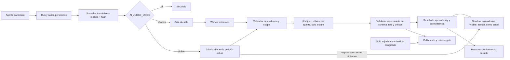

# Plan final del LLM juez para los 26 agentes

**Estado de auditoría:** cerrada para arquitectura y contratos de código; certificación de calidad pendiente de datos humanos y validación operativa.  
**Corte:** 12 de octubre de 2026.  
**Fuente de verdad:** este documento para plan/estado; `MATRIZ_VERIFICACION_JUEZ_26_2026-10-10.md` para auditoría por agente; `ESTADO_IMPLEMENTACION_JUEZ.md` para evidencia cronológica de cambios y verificaciones; `RESULTADOS_E2E_JUEZ_26_2026-10-13.md` para las ejecuciones reales más recientes.

## Objetivo

El juez debe dar un dictamen reproducible, específico del agente y basado en evidencia sobre cada salida de E-NORA. Debe detectar errores factuales, mal uso de métricas, omisiones, riesgo, infracción de permisos y problemas propios del dominio. No ejecuta acciones ni sustituye al consultor. Una evaluación no concluyente se guarda como `no_evaluable`; nunca se transforma en aprobación.

El objetivo final es 26/26 rutas cubiertas, rúbricas versionadas, dataset adjudicado suficiente por agente, validación de candidato, observación shadow, experiencia de revisión usable, controles de privacidad/coste y despliegue gradual. Tener una función de juez o una suite verde no demuestra que el modelo evalúe bien.

## Método de auditoría aplicado

Para cada código activo se contrasta el catálogo de agentes, el prompt y schema de salida, la ruta de ejecución, los datos/herramientas leídos, la persistencia, el contexto congelado que puede ver el juez, la rúbrica, las condiciones de abstención, los efectos laterales, la UX de revisión, la evaluación offline/live y el gate de promoción. Se trazan callers/callees para distinguir una llamada común compartida de rutas funcionales especiales. Se comprueban las pruebas y migraciones contra lo que realmente prueban; un test mock no se presenta como llamada real al proveedor.

La lista maestra procede de `AGENT_EVAL_AGENT_CODES`; los perfiles A19 Arquitecto y A19 Revisión se evalúan como contratos diferentes. Se revisan tanto rutas manuales como orchestrator, reintento, streaming y salidas visuales. Si el snapshot, los recibos, el tenant, la ventana o el artefacto exacto faltan, el agente debe abstenerse o el juez marca el criterio no evaluable.

## Diseño final

**Semántica de ejecución actual:** `shadow` devuelve `queued` y el worker evalúa después; no añade latencia del proveedor a la respuesta del agente. `visible` crea el job durable, pero llama al juez y espera su resultado dentro de la misma petición. La cola permite recuperar/reintentar trabajo si el proceso falla; no vuelve asíncrono el modo visible. Por ello, visible puede aumentar la latencia o devolver un estado de error/no evaluable si vence el timeout. No activar visible para clientes hasta validar límites de latencia, timeout, fallback y presentación de estados en la UX. Si el producto requiere respuesta inmediata del agente y dictamen posterior, hay que implementar un contrato asíncrono con `pending`, consulta de estado y actualización de la interfaz antes de habilitarlo.

### Responsabilidades

- **LLM juez:** puntúa criterios y explica con referencias a evidencia que ya recibió. No llama herramientas, no consulta datos nuevos y no decide si una acción de negocio se ejecuta.
- **Código determinista:** fija identidad/scope/manifest, verifica recibos y hashes, schema, referencias, puntuación, umbral, presupuesto y gates. El modelo no puede inventar IDs ni cambiar la rúbrica.
- **Revisión humana:** etiqueta casos de referencia, adjudica desacuerdos y toma decisiones operativas. Visible mode presenta una evaluación como apoyo revisable, nunca como una acción aprobada.
- **RAG:** la evidencia de la tienda llega desde el snapshot y las herramientas autorizadas del agente; no se vuelve a consultar durante el juicio. El RAG global/metodológico puede aportar estándares aprobados y versionados con citas, separados de hechos de cliente. El RAG de una organización solo entra si el caso incluye esos fragmentos, su audiencia/scope y sus IDs/versiones. Instrucciones dentro de conocimiento recuperado se tratan como datos no confiables. Si no hay referencia metodológica recuperada no se penaliza como hecho inventado.

### Rúbricas y puntuación

Cada contrato usa las dimensiones comunes (fidelidad factual, alcance/privacidad, incertidumbre, seguridad/control humano) y los criterios de dominio definidos en `packages/ai/src/agent-judge.ts`. Cada criterio se marca `evaluable` con score entero 0–4 o `no_evaluable` con score nulo, justificación y evidencia referenciada. Los fallos críticos solo son válidos en criterio crítico evaluable con score 0 o 1. El servidor recalcula resultado, agregados y estado; nunca acepta el agregado propuesto por el LLM como autoridad.

Las rúbricas actuales cubren 26/26 claves y 3–4 criterios de dominio por perfil, además de los criterios comunes. La versión cambia cuando cambia un criterio, peso o instrucción. Una versión nueva exige calibración nueva y un holdout nuevo; los resultados previos no se reinterpretan silenciosamente.

### Casos de referencia por agente

La muestra se estratifica para incluir casos correctos, errores materiales, límites de cobertura, fuentes conflictivas y ausencia legítima de datos. El mínimo de certificación es 50 casos adjudicados por agente, incluyendo al menos 10 positivos y 10 negativos críticos; cubrir cada criterio crítico, no evaluable, error de fuente y caso frontera. Estos mínimos son suelo, no garantía estadística de representatividad: antes de visible se revisa el intervalo de confianza y acuerdo por criterio/segmento, y se amplía la muestra donde no alcance precisión útil.

| Perfil | Casos y evidencias que debe incluir la muestra gold/holdout |
|---|---|
| A01 Llamadas | Transcripción/segmentos anonimizados; nombres/responsables desconocidos; compromiso explícito frente a inferido; tareas duplicadas. |
| A02 Monitor | Métricas con periodo, moneda y denominador; sync fallida/stale; variación real y correlación sin causalidad. |
| A04 Tareas | Backlog abierto/cerrado, hito relacionado, duplicado vigente y lista truncada. |
| A05 Campañas | Evento estacional antes/durante/después; zona horaria; inversión Meta y retorno parcial/fiable; estrategia post-evento; calendario sin redactar piezas. |
| A06 Stock | SKU/variante, stock incompleto, demanda comparable, lead time desconocido y devolución. |
| A08 Conocimiento | Fuentes globales y de cliente, authority/version, top-k truncado y similitud sin duplicidad literal. |
| A09 Copiloto | Pregunta y tienda activas, mensajes/turnos asociados, citas, recibos incompletos y propuesta con efecto que requiere aprobación. |
| A11 Marketing | Brief, claims demostrables/no demostrables, derechos/consentimiento, guardado correcto y guardado fallido. |
| A12 Email | Campaign vs flow, denominadores, zona horaria, atribución de plataforma frente a Shopify y recomendaciones con baja muestra. |
| A13 Shopify | Dos tiendas, null/error vs cero, moneda, stock y tareas ligadas al producto correcto. |
| A14 Meta | Gasto material, conversión/ventana/moneda, ROAS atribuido vs Shopify e inversión sin señal fiable. |
| A15 Imágenes | Bytes del banco Instagram, activo/hash exactos, OCR/elementos visibles, hipótesis estética y activo que cambió de versión. |
| A16 Texto sobre imagen | Brief + original, render final compuesto, slides vecinos ordenados, clipping/contraste/CTA y render que no corresponde al output. |
| A17 Semanal | Prioridad con iniciativa mensual, carga confirmada, backlog truncado, tarea ya completada y criterio de cierre. |
| A18 Mensual | Baseline y ventana comparable, capacidad/owners desconocidos, solape A04/A17 y dependencia estructural. |
| A19 Arquitecto Camino | Baseline/meta, horizonte, moneda, temporada, contexto multiapp, dependencias y metas mensuales sin inventar. |
| A19 Revisión Camino | Camino aprobado/versionado, progreso medido, dato stale, meta alcanzada/retrasada y diff de cambio que exige aprobación. |
| A20 Retención | Cohortes maduras/inmaduras, pedido sin clasificar, consentimiento, margen desconocido y muestra pequeña. |
| A21 Adquisición | Sesiones/conversiones y fuente, CAC/CPA comparable, código de descuento frente a ingreso incremental. |
| A22 Postventa | Tracking ausente/ambiguo, devolución/reembolso, privacidad y contacto repetido. |
| A23 Creatividad Meta | Captura ligada a ad+periodo+cuenta/store; estático vs thumbnail de vídeo; métrica parcial y diseño sin causalidad. |
| A24 Medición Meta | Sin actividad vs tracking roto, sync incompleta, backfill, coverage, `unknown` y bloqueo downstream. |
| A25 Cambios Meta | Change ID/actor/fecha, RPC caído, ventanas inmaduras y aprobación pendiente. |
| A26 Email | HTML hash, email exacto, render desktop/mobile, overflow/contraste y límite de no afirmar inbox/cliente no probado. |
| A27 Planificador mailing | RAG de método con versión/audiencia, fechas locales, cadencia/fatiga, aprendizaje medido y rechazo de copy/draft/envío. |
| A28 Flujos | Trigger/evento observado, consent/exclusiones, volumen, holdout de medición y ausencia de evento. |

Para todo agente se incluyen pares mínimos donde solo cambia un dato determinante, casos de prompt injection en evidencia/conocimiento, errores de herramienta, salidas mal formadas, ejecución parcial y `no_evaluable`. Los casos `synthetic` solo pertenecen a development; calibration/holdout requieren producción anonimizada y privacidad revisada.

## Datos, anonimización y proceso humano

1. Capturar caso desde run/output exactos con snapshot, fecha de corte, versión de agente/prompt/schema/modelo, recibos, fuentes y hashes. La referencia no incluye datos innecesarios ni secretos.
2. Anonimizar antes de guardar; revisar PII, secretos, URLs autenticadas y riesgo de reidentificación. Registrar responsable y resultado de revisión de privacidad.
3. Separar `development`, `calibration` y `holdout`. Una huella de contenido impide que el mismo caso o casi duplicado cruce divisiones. Holdout solo se revela al ejecutor como input ciego, nunca con etiquetas.
4. Dos revisores independientes puntúan la rúbrica completa sin ver notas ajenas ni salida del juez. Un tercer usuario adjudica desacuerdos. Quien creó el caso no revisa/adjudica ese caso; un revisor no puede actuar como adjudicador.
5. Congelar dataset y manifiesto antes del holdout; holdout single-use por versión de rúbrica/modelo según la regla establecida. Cambios de etiquetas, rúbrica o selección requieren un dataset nuevo.
6. Guardar decisión append-only, referencias verificables y auditoría de actor/fecha/request id. Exportar solo gold aprobados, nunca etiquetas parciales.

Los casos visuales de calibración usan referencias privadas por organización, bucket permitido, ruta tenant-scoped, SHA-256, MIME, rol, entidad tipada y fechas/ad IDs cuando aplique. El servidor firma URL de corta duración y descarga desde Supabase propio, limita bytes, valida firma y hash esperado y pasa los mismos bytes al juez. A16 exige input/render/neighbor; A26 dos renders email desktop/mobile tipados; A23 requiere ad y ventana. No se acepta URL externa.

## Gates de certificación y promoción

**Gate de juez por cada agente/perfil:** al menos 50 casos adjudicados (mínimo 10 positivos críticos y 10 negativos críticos), manifest y rúbrica vigentes, cero referencias inválidas, acuerdo de estado ≥92%, puntuación dentro de un punto ≥95%, recall crítico 100%, tasa de falso crítico ≤2%, y análisis de métricas por criterio/segmento sin vacíos relevantes. El threshold de código es el mínimo; el comité de calidad puede exigir más si el intervalo de confianza o distribución lo requiere.

**Gate de agente candidato:** manifest/prompt/model/tools/schema congelados; ejecución real candidate-pinned con fixtures válidos, replay de herramientas exacto y sin side effects; mínimo 10 casos calibration y 3 holdout de release como smoke de esa versión; el resultado debe estar `passed`, ligado al hash exacto del output y a la versión de rúbrica. El smoke 10/3 no sustituye la certificación 50/10 del modelo juez.

**Gate de rollout:** shadow estable en TEST con cobertura de rutas, persistencia, coste, latencia y fallos revisados; aprobación de producto/operaciones; canary por agente/tenant; visible solo tras los gates; rollback inmediato a shadow/off. El juez jamás autoriza por sí mismo enviar campañas, cambiar presupuesto, editar tienda ni mutar Camino.

Los umbrales aprobados están en `evaluateAgentJudgeHoldout`/runtime y en migraciones. Cambiar cualquier umbral requiere versión documentada, pruebas y calibración; no se baja para hacer pasar una muestra pequeña.

## UX de revisión y operación

En `/admin/agentes`, la cola debe mostrar readiness por agente, cobertura por criterio y clase de caso, antigüedad, split, estado de privacidad, revisiones pendientes, adjudicación, modelo/rúbrica y coste previsto. Al abrir un caso: evidencia inmutable visible primero; etiquetas ajenas ocultas; cada criterio con definición, 0–4/No evaluable, justificación, selector de referencias y fallo crítico solo donde aplica; navegación por teclado y guardado idempotente. Adjudicación compara diferencias después de que existan dos revisiones; muestra motivo, permite decisión documentada y exige tercero independiente.

El panel debe distinguir claramente: **desarrollo**, **calibración repetible**, **holdout congelado de un uso**, **certificado**, **shadow** y **visible**. Un indicador no mezcla aprobación del agente con calidad del juez. El panel bloquea la acción y explica qué falta (muestra, positivos/negativos, privacidad, modelo/precio, manifest, provider o permiso); ofrece filtros por agente/código, criterio, periodo y split, paginación estable, estado vacío/error/loading y resumen agregado. Nunca enseña etiquetas gold al candidato ni las respuestas de otros revisores.

Brecha de UX actual: la creación de caso sigue basada en JSON manual; para imágenes se necesita asistente que cargue a bucket privado y cree refs tipadas/hash, selector de entidad/ad/email y periodo, validación antes de subir, previsualización y scrub de metadatos EXIF. Debe reducir errores de carga sin permitir URLs libres. El coste mostrado debe usar el precio real del modelo y número de tokens/imagenes estimado; confirmación por lote y límite administrable.

Brecha adicional de modo visible comprobada en web: las evaluaciones se muestran en la traza de observabilidad para administración, pero no aparece un componente de dictamen en las vistas de trabajo del consultor. Además, la respuesta HTTP solo incluye `judgment` en algunos perfiles; otras rutas específicas persisten el resultado y escriben el paso de traza sin incluir el cuerpo del dictamen. Antes de habilitar visible hay que unificar el envelope de respuesta (o exponer una lectura autenticada y ligada a run/output), presentar estado, resumen, criterio, evidencia y límites de confianza en la vista adecuada para cada perfil, y comprobar permisos de lectura/feedback por tenant. `visible` sigue siendo un estado técnico del runtime, no una UX lista para producción.

Corrección de linaje visual A15/A16 implementada localmente: con el juez activo, el servidor congela una vez los bytes validados, los pasa al candidato y guarda SHA-256 en el snapshot del run; el juez recibe esos mismos bytes. Si la carga/hash falla, el candidato puede seguir con su URL de origen, pero el juicio queda sin evidencia visual y no debe aprobar los criterios visuales. Verificación actual: helper de reutilización probado y typecheck API correcto; falta E2E autenticada con una captura real para demostrar igualdad de hash desde el request del candidato hasta el snapshot y el payload del juez.

## Costes y límites

- La ejecución online limita el juicio a **0,03 USD por caso** (`JUDGE_MAX_COST_USD`) y rechaza modelos sin precio registrado antes de llamar al proveedor. El coste real y tokens se persisten; no se fija un coste ficticio si el proveedor no informa precio conocido.
- Con 26 agentes × 50 casos = 1.300 casos, el techo de una pasada es **39 USD**; los datasets mayores elevan el coste lineal. Una calibración reejecutable cuesta por intento; el holdout solo se consume una vez por manifest protegido.
- Candidato live: presupuesto por turno documentado de hasta 0,25 USD; ejecutar 13 casos × 26 perfiles podría costar hasta **84,50 USD** si cada turno alcanzase el límite, más los juicios. Confirmar costes reales después de medir tokens/modelo.
- Evidencia nueva de A02: un caso sintético alcanzó **1,081286 USD** y 163,566 ms frente al gate del harness de 0,15 USD/45 s; el gate detectó el exceso después de acabar el run. El control de coste de candidatos debe reservar presupuesto antes de la primera llamada y cortar dentro del bucle de modelo/herramientas/reintentos, además de conservar el límite del juez de 0,03 USD. El gate post-run sirve para auditar, no para evitar gasto.
- Shadow permanente puede crecer sin límite agregado aunque cada llamada tenga cap. Antes de habilitar shadow general se requiere presupuesto diario/mensual global y por organización, sampling configurable por perfil, alerta de gasto, pausa automática por umbral y dashboard de costo por 1.000 ejecuciones. No habilitar shadow global hasta implementar y verificar esos límites.
- Registrar P50/P95 de latencia, errores, retries, cola, abstenciones, coste/caso y bytes/token multimodal. El modo shadow no bloquea respuesta del agente; modo visible puede añadir latencia y debe tener timeout/fallback y no hacer fallar el agente.

## Estado verificado al corte

| Área | Estado comprobado | Evidencia / pendiente |
|---|---|---|
| Catálogo y rúbricas | 26/26 con dimensiones comunes + criterios de dominio | Test `agent-judge.test.ts`; no es certificación semántica. |
| Runtime | Queue durable, idempotencia, retry/lease, modos off/shadow/visible y validación posterior | Suite API; despliegue de servicio no probado por este corte. |
| Rutas de generación | Guard AST `agent-judge-route-coverage.test.ts` verifica 26/26 perfiles contra call sites genéricos/especializados e incluye el mapeo dinámico A04/A17/A18. Recuento TEST: 66 juicios durables para 22/26 perfiles. Esta tanda ejecutó los cuatro perfiles restantes con runtime y juez v7: A01 (5 escenarios, un error de juez), A02 (review y latencia 53.980 ms), A08 (review; pasó los checks duros de contadores/muestra) y A19 Revisión (blocked por discrepancia de ventana). | Las cuatro organizaciones sintéticas y sus juicios se eliminan al terminar; no aumenta la cobertura durable. Se completa una ejecución de runtime por cada una de las 26 claves, pero el guard estructural y esos harnesses no equivalen a E2E HTTP autenticadas por perfil. Siguen pendientes esas E2E por endpoint, validación específica de A05, retries, streaming y envelopes. Los hallazgos se registran en `RESULTADOS_E2E_JUEZ_26_2026-10-13.md`; no certifican calidad. |

**Actualización de ejecución A02 (13-oct-2026):** el primer coste de $1.081286 se generó bajo el presupuesto de runtime habitual de $2; los $0.15 iniciales eran solo un límite posterior del harness. Con `maxCostUsd=0.15` aplicado antes de ejecutar, una repetición terminó por timeout del proveedor a los 45 s y registró $0.013826, sin salida ni juicio. Otra repetición previa bajo el mismo límite completó en 39.416 s por $0.042798, pero el juez la aprobó con 3.31/4 pese a que la evidencia de demanda cubría un solo día. El harness ahora suma el coste de runs fallidos al total; API typecheck pasó tras el cambio. La prueba live no crea gold ni aumenta la cobertura durable: TEST sigue en 66/22, con cero casos y cero adjudicaciones.

**Cierre de ejecución de perfiles faltantes (13-oct-2026):** se reconstruyó `@e-nora/ai` antes de revalidar; la ejecución inicial de A19 había importado un `dist` obsoleto v6 y no cuenta como prueba v7. Las pruebas actuales están en `RESULTADOS_E2E_JUEZ_26_2026-10-13.md`. A01 vuelve a exponer un error intermitente del juez y el harness ahora falla ante un dictamen ausente/error; A02 confirma que el hallazgo de stock insuficiente no puede pasar y además excede latencia; A08 ahora antepone contadores deterministas a la muestra larga y verifica su respuesta contra el snapshot; A19 Revisión detecta un fallo crítico de ventana/progreso. Esto cierra la ejecución puntual de 26/26 perfiles, no el E2E HTTP autenticado ni la certificación gold/holdout.

**Actualización de rúbrica v7 (13-oct-2026):** se incorporaron mínimos deterministas por criterio: A02 `prioritization` y A19 Revisión `progress_measurement` deben puntuar 4/4 para permitir `passed`. La finalización del servidor aplica el mínimo aunque la media global sea mayor de 3,2, y el prompt del juez conoce el umbral. AI 262/262, API focalizada 1.111/1.111, typecheck API/web y verificadores de release TEST/PROD correctos. La migración v7 quedó aplicada y registrada en TEST y producción; el release gate exige holdout v7. El código de aplicación v7 aún no se ha desplegado y ambas bases continúan con cero casos/adjudicaciones, así que no hay certificación.
| Candidate runner | Contratos de catálogo, incluido A19 especializado y multimodal, ejecutables en código con fixture candidate-pinned | 26/26 capacidad de contrato; falta prueba real contra versión candidata desplegada y suite válida por perfil. |
| Gold/holdout | 0 casos y 0 adjudicaciones leídos en TEST y PROD | No certificable todavía; requiere personal autorizado para revisar ejemplos reales anonimizados. |
| UX de etiquetado | Revisión ciega, doble revisión y adjudicación existentes | Carga de visuales y creación asistida por formulario tipado pendientes; JSON manual es un cuello de botella de calidad. |
| UX visible para consultor | No comprobada como experiencia usable | Solo hay render de dictámenes en observabilidad admin; faltan envelope uniforme y componentes de resultado en las vistas de los agentes. No activar visible. |
| DB/migraciones | Esquema juez y migraciones visuales reportadas aplicadas en TEST y PROD | Historial Supabase conserva 24 migraciones remotas sin archivo local y versiones MCP diferentes; no correr `db push`/repair sin reconciliar. |
| Activación | `AI_JUDGE_MODE` off por defecto; no certificado ni UX consultor completa | Mantener off; shadow solo tras gates de coste, deploy y E2E; visible añade como gate UX asesor autenticada y uniforme. |

Verificación local de la tanda multimodal: API 1.096/1.096; AI 254/254; `npm run verify` 19/19; typecheck API/web, build API y `git diff --check` correctos. Estas verificaciones prueban contratos/código y seguridad estructural; no prueban llamadas de proveedor en TEST/PROD, calidad humana ni despliegue.

## Plan de implementación hasta estado final

| Fase | Trabajo | Criterio de cierre verificable |
|---|---|---|
| 1. Contratos por agente | **En código.** Rúbricas específicas, parser estricto, no-evaluable, refs y schema multimodal; A19 dos perfiles. | 26/26 rubrics comparadas con catálogo; pruebas de campos críticos/abstención/refs; fixtures candidate-pinned de cada contrato. |
| 2. Cobertura de rutas | **Guard estructural 26/26 implementado** en `agent-judge-route-coverage.test.ts`: analiza calls genéricas, rutas especializadas y el registro dinámico A04/A17/A18. Continúa la integración E2E de endpoints, retries, streaming y envelopes visibles; verificar vínculo output/run/organization en cada familia. | El guard falla si un código activo no mapea a ruta persistida. Cierre de fase aún exige una E2E autenticada por perfil/ruta, persistencia de juicio o `no_evaluable` explicable, y prueba con DB TEST/provider controlado. |
| 3. Dataset usable | Añadir wizard tipado de captura/anonimización, upload visual privado, preview/hashes; registrar privacidad y provenance; formar revisores. | Crear casos reales anonimizados desde cada ruta; 2 revisiones + adjudicación; `get_agent_judge_holdout_coverage` muestra 26 agentes con 50/10/10. |
| 4. Calibración | Ejecutar calibración en split calibración; analizar disagreement por criterio, perfil, severidad y no-evaluable; corregir rubrica/prompt y versionar. | Umbrales estadísticos anteriores superados; reportes con denominadores, intervalos, coste y errores; revisión humana firmada. |
| 5. Holdout de juez | Congelar manifiesto/dataset; ejecutar holdout single-use con modelo candidato; no inspeccionar etiquetas durante iteración. | Gate pasa en los 26 perfiles; manifiesto y reporte persistidos; segunda ejecución rechazada. |
| 6. Release candidate | Ejecutar build desplegable con candidato exacto en TEST; replay de herramientas y artefactos exactos; visual bytes reales; fallos/coste/latencia medidos. | Suite completa pasa 10 calibration + 3 release por perfil sin `no_evaluable` contada como éxito; identidad manifiesto antes/después igual. |
| 7. Shadow controlado | Publicar primero en TEST; budgets global/tenant y sampling; verificar cola, privacidad, observabilidad, fallbacks; canary interno. | E2E remoto por cada perfil, no duplicación, no respuesta bloqueada, coste por periodo dentro del cap, observación aprobada. |
| 8. Visible gradual | Activar por perfil/tenant y volver a shadow/off con feature flag. Formar asesores; mostrar citas, confianza/calidad y feedback. | Aprobación operativa explícita, gates vigentes, SLO/error/coste sostenido y rollback ensayado; revisión continua de deriva y nueva muestra. |

### Trabajo inmediato ya iniciado

La infraestructura, los gates de holdout, las 26 rúbricas, contratos de candidatas, modo shadow/visible, UI de revisión humana y ejecución multimodal están en código; se han aplicado migraciones mencionadas en TEST/PROD, sujeto al drift histórico. El arreglo más reciente habilita visuales en calibration/holdout con refs de Storage y hash/MIME verificados. Se continúa corrigiendo inconsistencias documentales y endureciendo pruebas de bindings visuales. El siguiente bloque de código es coverage E2E de rutas y el wizard de dataset; el siguiente bloque externo es obtener y adjudicar datos humanos. No se habilita producción visible antes de ambos.

### Cambio de versión de rúbrica posterior a la auditoría A05

La prueba HTTP en tienda demo detectó que el juez puede confundir mercado de fechas comerciales con zona horaria IANA de la tienda. Se corrigió A05 y se elevó la versión a `judge-rubrics-v2`; `judge-gold-v1` queda separado y el panel inicia con `judge-gold-v2`. El gate de promoción en TEST y producción exige ahora tanto holdout calibrado v2 como dictamen v2 ligado al output exacto. Al estar ambos holdouts vacíos, no se promociona ninguna candidata. Las ejecuciones live anteriores siguen siendo evidencia histórica, no etiquetas gold.

## Decisiones explícitas

1. No usar fine-tuning ahora: primero gold fiable, rúbricas estables, evaluación repetible y medidas de acuerdo; luego comparar prompt/RAG/modelo con el mismo holdout. Fine-tuning no reemplaza evidencia ni gates.
2. No usar un solo prompt genérico: el núcleo es común, pero cada agente recibe su rúbrica y evidencia tipada del dominio.
3. No dar acceso a herramientas al juez: la lectura se limita al paquete inmutable presentado, lo que favorece auditabilidad, aislamiento y coste predecible.
4. No activar visible con datos de prueba sintéticos ni con 0 casos adjudicados. No rebajar umbrales para declarar éxito.
5. A19 se prueba como dos contratos separados. A15/A16/A23/A26 requieren bytes exactos y metadata tipada; capturas del email no prueban inbox/clientes no incluidos.
