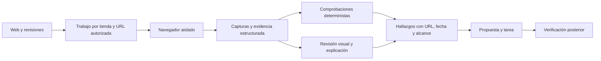

# Plan de organización de E-NORA: canales, recursos, analítica y agentes

**Fecha:** 19 de octubre de 2026, Europe/Madrid.  
**Estado:** propuesta técnica y de producto basada en auditoría; pendiente de ejecución del roadmap.  
**Base revisada:** árbol de trabajo actual sobre HEAD e5021de, con cambios locales previos. La revisión no equivale a certificar el despliegue de ese árbol.

## 1. Decisión recomendada

E-NORA debe ofrecer áreas operativas diferenciadas de **Shopify, Meta y Klaviyo**, con páginas propias para sus recursos, y una sección de **Analítica** para comparar resultados. El dashboard debe resumir decisiones y conducir al recurso exacto donde se resuelven.

Esto encaja con el objetivo del producto: consultar un catálogo, revisar una variante, preparar una promoción, comprobar stock, diseñar un creativo o editar un flow desde el mismo software. La ventaja diferencial está en conectar esas operaciones: que la campaña conozca el stock y el margen, que el creativo abra su landing y que la recomendación tenga una tarea y un resultado comprobable.

Hay una base amplia que reutilizar. La auditoría encuentra **90 páginas web**, componentes de catálogo, inventario, campañas, emails, flows y estudio de creación. Falta cerrar recorridos y distinguir claramente recurso, análisis, borrador y publicación. No hace falta reconstruir el producto desde cero.

### Qué es factible y qué exige condiciones

| Objetivo | Dictamen | Condición principal |
| --- | --- | --- |
| Páginas separadas de catálogo, inventario, promociones y códigos | Viable; parte del contenido ya existe | Separar vistas sobre los mismos objetos y completar operaciones/permisos |
| Gestionar creativos, campañas, conjuntos y anuncios de Meta | Viable de forma progresiva | Permisos efectivos, activos asignados y revisión de la app; la escritura de nuestra UI hoy es dry run |
| Gestionar campañas, flows, emails, plantillas y formularios de Klaviyo | Viable, con restricciones por operación | Contrato de API adecuado, scopes, cuenta y canales habilitados |
| Ver la web y que un agente la revise | Viable | Capturas y navegador aislado; el iframe es una posibilidad condicionada |
| Saber qué SKU reponer para una campaña y cuánto | Viable como decisión calculada y trazable | Disponibilidad por variante, campaña, demanda, proveedor, plazos, entradas y política de seguridad |
| Predecir exactamente lo que venderá Black Friday | No garantizable | Se pueden construir escenarios y evaluar su error; una fecha comercial no demuestra demanda |
| Controlar cualquier app instalada, popup o editor externo | No garantizable | Cada tercero tiene su API, permisos y restricciones |
| Reproducir todas las funciones de los tres administradores | Fuera de un compromiso responsable | La cobertura debe contratarse por recursos y operaciones verificadas |
| Aumentar existencias porque el agente recomienda comprar | Incorrecto | Comprar, recibir mercancía y ajustar stock vendible son operaciones distintas |

## 2. Alcance de la auditoría y cómo interpretar sus resultados

Se revisaron la estructura global, navegación, recursos de los tres canales, APIs y conectores, agente de stock, permisos y aprobaciones, tareas, comunicación, conocimiento, facturación, jobs, observabilidad, CI y alcance móvil. Se usó primero el grafo del código y se confirmaron hallazgos en archivos actuales: el grafo contiene 86 páginas y el árbol actual 90, por lo que no se trató el índice como prueba de actualidad.

**La profundidad no es uniforme:** hay revisión detallada del agente de stock, capacidades de canales y hallazgos transversales; el resto tiene inventario y revisión focal. No se ha leído línea por línea todo el repositorio, ejecutado todas las pantallas ni certificado seguridad, rendimiento o datos de producción. Las credenciales, permisos reales de las cuentas, migraciones aplicadas y versiones activas de agentes quedan como verificaciones de despliegue.

En este trabajo se han creado documentos y evidencia local. Los cambios de interfaz de los turnos anteriores ya estaban en el árbol. Esta auditoría no ejecuta el roadmap ni publica en los proveedores.

### Documentos de respaldo

1. [Shopify: capacidades y límites](./auditoria-canales-2026-10-19/SHOPIFY_CAPACIDADES_Y_LIMITES.md).
2. [Meta y Klaviyo: capacidades y límites](./auditoria-canales-2026-10-19/META_KLAVIYO_CAPACIDADES_Y_LIMITES.md).
3. [Auditoría del agente de stock A06](./auditoria-canales-2026-10-19/AUDITORIA_AGENTE_STOCK.md).
4. [Auditoría transversal del software](./auditoria-canales-2026-10-19/AUDITORIA_TRANSVERSAL_SOFTWARE.md).
5. [Matriz inicial de capacidades efectivas](./auditoria-canales-2026-10-19/MATRIZ_CAPACIDADES_EFECTIVAS.md): implementación frente a scopes y permisos de cada cuenta.
6. [Inventario reproducible de superficies y enlaces](./auditoria-canales-2026-10-19/evidencias/inventario-superficies.json).
7. [Especificación de UI y guía de implementación](./auditoria-canales-2026-10-19/ESPECIFICACION_UI_Y_GUIA_IMPLEMENTACION.md): layouts, componentes, pantallas, estados, responsive y ficha de ticket.

**Antes de implementar una pantalla:** leer la especificación de UI y completar su ficha de recurso, datos, acciones y aceptación. Este plan fija arquitectura y alcance; la guía de UI concreta la presentación y el comportamiento. Los contratos API que todavía no existen deben diseñarse en el ticket, sin inventar datos para dar la pantalla por terminada.

Las fuentes oficiales están enlazadas junto a las afirmaciones de los anexos. Los estados siguientes distinguen **existencia en código**, **funcionalidad parcial**, **trabajo por construir** y **dependencias externas**. Una ruta, un scope declarado o un test unitario no prueban una operación completa en una cuenta real.

## 3. Diagnóstico del producto actual

| Área | Evidencia y situación actual | Brecha que resolver |
| --- | --- | --- |
| Inicio | Dashboard de cliente y consultor; tabs Shopify, Meta y Klaviyo | El resumen y las páginas de canal conviven con destinos parecidos; definir una función única para cada uno |
| Navegación | Analítica contiene Shopify, catálogo, promociones, Meta/campañas y Klaviyo/emails | Gestión del recurso y análisis están mezclados |
| Catálogo | Lista y ficha de producto en /shopify/productos; variantes, stock y previsiones | Falta una página operativa de inventario por variante/ubicación y política de reposición |
| Descuentos | /shopify/promociones lista códigos y descuentos automáticos, con detalle | Separar las tareas de promoción y códigos; las escrituras no están implementadas como recorrido completo |
| Popups | Canal popup en el Studio con diseño y preview | Un diseño local no es un formulario instalado o publicado |
| Web de tienda | URL del negocio y datos del catálogo | No se encontró un recorrido completo de exploración visual, capturas y revisión de storefront |
| Meta | Resúmenes, campañas/detalle, sincronización y lectura de creatividades | Falta biblioteca operativa propia de recursos Meta y conexión del ejecutor de escritura a un flujo real |
| Klaviyo | Analítica, emails/detalle, campañas y constructor de flows en Marketing | Recursos repartidos entre páginas de analítica y secciones de Marketing; falta gestión completa de formularios y nuevas operaciones |
| Studio | Editor común, piezas, imágenes, marca, plantillas y revisión | Debe conservarse; sus artefactos locales necesitan relaciones claras con objetos publicados |
| Stock A06 | Contexto, demanda base, controles de calidad y propuestas de tareas | No calcula reposición integral por campaña; diferencias de frescura/series entre superficies |
| Acciones | Existen aprobación, herramientas y ejecutores específicos | Acreditar controles por acción real; un helper genérico sin callers no protege todo el runtime |
| Documentación | Numerosos planes y auditorías previas | Hay afirmaciones antiguas sobre conectores y APIs; la versión y evidencia deben acompañar cada estado |

Evidencia principal: [navegación](../apps/web/src/components/portal-navigation.ts), [dashboard cliente](../apps/web/src/app/dashboard/client-dashboard.tsx), [dashboard consultor](../apps/web/src/app/dashboard/consultant-desk.tsx), [catálogo](../apps/web/src/app/shopify/productos/page.tsx), [promociones](../apps/web/src/app/shopify/promociones/page.tsx), [plan Meta](../apps/api/src/meta-ad-write-plan.ts), [campañas Klaviyo](../apps/api/src/marketing-klaviyo.ts), [flows](../apps/api/src/marketing-flows.ts).

### No hay evidencia de 404 generalizados

El escaneo de enlaces internos literales no encontró destinos sin página. No cubre enlaces dinámicos, permisos, query params, filtros ni anclas. El problema observado del aviso de stock era **semántico**: llevaba a un resumen de Shopify y no al recurso que el usuario esperaba.

En el turno anterior se corrigió ese aviso para abrir el catálogo filtrado por agotados o stock bajo. Es una mejora provisional; el destino definitivo será Inventario cuando exista la página y su filtro identifique correctamente variante, ubicación y tipo de incidencia. Los contadores agregados actuales no deben suponerse equivalentes al número de productos de otro endpoint sin reconciliar su unidad.

## 4. Navegación propuesta

El menú principal muestra áreas; el submenú muestra las funciones de la plataforma seleccionada. No se despliegan todas las funciones de las tres plataformas a la vez.

```text
Inicio
Canales
  Shopify
    Resumen operativo
    Catálogo de productos
    Colecciones
    Inventario
    Reposición
    Promociones
    Códigos de descuento
    Popups y formularios
    Web y revisiones
    Páginas y contenido
  Meta Ads
    Resumen operativo
    Campañas
    Conjuntos
    Anuncios
    Creativos
    Audiencias
    Medición
    Catálogos y productos publicitarios
  Klaviyo
    Resumen operativo
    Campañas
    Flows
    Emails y mensajes
    Plantillas
    Listas y segmentos
    Perfiles y consentimiento
    Formularios
    Cupones
Analítica
  Negocio y rentabilidad
  Shopify
  Meta Ads
  Klaviyo
  Comparativas e informes
Marketing y Estudio
  Calendario comercial
  Crear contenido
  Revisión de piezas
  Biblioteca de activos
  Marca
Trabajo
Comunicación
Conocimiento
Cartera (consultor)
Configuración
  Integraciones y permisos
```

Este árbol es el mapa objetivo, no una promesa de lanzar todas las entradas a la vez. Una página puede servir lectura útil antes de tener escritura, indicando su alcance. Una función sin implementación no debe aparecer como herramienta operativa habilitada.

### Papel de cada nivel

- **Inicio:** qué necesita atención, por qué, fecha del dato y acción concreta.
- **Canal:** objetos y operaciones de la plataforma; su estado remoto y contexto.
- **Analítica:** resultados y comparaciones. Los ingresos atribuidos no se suman a las ventas del comercio.
- **Marketing y Estudio:** intención comercial, calendario y creación transversal; un solo editor y biblioteca.
- **Configuración:** conexión, credenciales, permisos y resolución de problemas de integración.

La organización de cliente/consultor y el selector de tienda se conservan en todo el recorrido. Una vista de cartera no debe permitir una escritura sin seleccionar el objetivo concreto.

## 5. Páginas de Shopify y alcance funcional

| Página propuesta | Qué debe mostrar | Operaciones por etapas | Estado y dependencia |
| --- | --- | --- | --- |
| /shopify/resumen | Sincronización, recursos y trabajo pendiente | Accesos a áreas y resolución de errores | Reorganizar contenido existente; dejar métricas detalladas en Analítica |
| /shopify/productos | Productos, variantes, imágenes, SKU, estado, precio y relaciones | Primero consulta; después edición de campos soportados | Existe lista/ficha; escribir requiere permisos nuevos y validación |
| /shopify/colecciones | Colecciones y productos asociados | Crear/editar cuando la API lo permita | Vista independiente por construir sobre identidad compartida |
| /shopify/inventario | Variante, ubicación, disponible, reservado/entrante cuando exista, antigüedad y riesgo | Filtrar, investigar, proponer; ajustes autorizados más adelante | Nueva vista; no usar stock agregado de producto como garantía de una talla |
| /shopify/reposicion | Necesidades, proveedores, plazos, entradas y órdenes propuestas | Aprobar propuesta/tarea; registrar confirmaciones y recepciones | Motor y datos nuevos; lectura de compras nativas condicionada a versión/scopes |
| /shopify/promociones | Ofertas automáticas, calendario, productos y condiciones | Crear/editar/activar/desactivar tipos soportados | Separar de códigos manteniendo un solo dominio de descuentos |
| /shopify/descuentos | Códigos, vigencia, requisitos, límites y usos disponibles | Gestionar códigos soportados y lotes donde proceda | Falta recorrido de escritura y write_discounts |
| /shopify/popups | Formularios instalados en la tienda, proveedor, estado y cobertura | Crear propios o abrir operación del proveedor autorizado | Vista unificada; el formulario Klaviyo sigue teniendo una identidad y editor canónico |
| /shopify/web | Página real, capturas, revisiones, hallazgos e historial | Analizar, comparar, proponer cambios y verificar | Nuevo servicio de revisión visual; sección 9 |
| /shopify/paginas | Páginas, artículos y contenido accesible | Cambios acotados con API/permisos y revisión | Por construir; no asumir acceso a cualquier constructor externo |

Extensiones posteriores: pedidos, clientes, fulfillment/devoluciones, ficheros y traducciones, mercados y contenido estructurado. Cada una necesita comprobar qué datos ya se sincronizan, qué UI reutilizar, permisos y alcance de escritura. La auditoría de Shopify detalla sus límites; tener read_returns no demuestra una ingesta completa de devoluciones.

**Límites relevantes verificados:** el TOML actual no declara write_products, write_inventory o write_discounts. La versión por defecto es 2026-07. Shopify añadió órdenes de compra en lectura en 2026-10, lo que abre una fuente futura de entradas, pero no autoriza a prometer creación nativa de compras. [Purchase Order Read API](https://shopify.dev/changelog/posts/purchase-order-read-api).

Las reglas avanzadas, Shopify Functions y extensiones de checkout dependen del tipo de app, API y plan; no se venden como disponibles en todas las tiendas. ShopifyQL requiere revisar también las condiciones de acceso a datos protegidos, además del scope. Véase [anexo Shopify](./auditoria-canales-2026-10-19/SHOPIFY_CAPACIDADES_Y_LIMITES.md).

## 6. Páginas de Meta y alcance funcional

| Página propuesta | Qué debe reunir | Brecha actual / condición |
| --- | --- | --- |
| /meta/resumen | Cuentas/activos, incidencias, recursos y acciones pendientes | Selección efectiva de cuenta y lectura autorizada |
| /meta/campanas | Campañas, objetivo, estado, presupuesto y relaciones | Lista/detalle existente; creación/edición remota pendiente de integración efectiva |
| /meta/conjuntos | Segmentación, presupuesto, calendario y optimización admitidos | Vista propia por construir; validar campos según objetivo y versión |
| /meta/anuncios | Anuncio, conjunto, creativo, estado y revisión | El estado publicado no equivale a aprobado o entregando |
| /meta/creativos | Piezas creadas, assets importados, texto, formatos, versiones, usos y previews | Nueva biblioteca operativa; reutilizar banco/Studio existente |
| /meta/audiencias | Audiencias y estados admitidos | Permisos y condiciones de datos; no prometer exportación de miembros identificados |
| /meta/medicion | Píxel/dataset, eventos disponibles, CAPI y diagnósticos verificables | Comprobar emisor existente y deduplicación antes de añadir otro |
| /meta/catalogos | Catálogo publicitario, conjuntos y correspondencias con productos | Mantener fuente de verdad y evitar dos sincronizadores sobrescribiéndose |

Instagram orgánico debe identificarse como otra superficie del ecosistema Meta, con sus propios permisos y formatos. No se habilita automáticamente por conectar Ads. Leads y comentarios pueden ser extensiones posteriores con permisos y pruebas específicas.

**Estado actual importante:** la ruta de la UI prepara el plan con mode dry_run y executionReady false. Existe un ejecutor en biblioteca, pero ese código por sí solo no completa una publicación desde E-NORA. El default OAuth revisado es de lectura publicitaria. No se ha acreditado en esta auditoría Advanced Access, App Review o Business Verification de la app real.

Secuencia de entrega: biblioteca/importación → preparación y preview → creación remota en pausa → comprobación → activación aprobada → seguimiento. La cuenta, moneda, límites de presupuesto, destinatario y estado remoto deben estar visibles antes de activar.

Matriz de endpoints, permisos y límites: [anexo Meta/Klaviyo](./auditoria-canales-2026-10-19/META_KLAVIYO_CAPACIDADES_Y_LIMITES.md).

## 7. Páginas de Klaviyo y alcance funcional

| Página propuesta | Qué debe reunir | Brecha actual / condición |
| --- | --- | --- |
| /klaviyo/resumen | Cuenta, canales, recursos y acciones pendientes | Separar informe completo de operación diaria |
| /klaviyo/campanas | Campañas remotas, mensajes, audiencia, borrador, programación y estado | Reutilizar servicios actuales; migrar contratos de forma controlada |
| /klaviyo/flows | Flows importados, disparador, acciones, mensajes y estado | Reutilizar constructor; matriz de operaciones por tipo de nodo |
| /klaviyo/emails | Mensajes concretos, contenido, uso en campaña/flow y estado | Lista/detalle ya existen; conservar identidad remota |
| /klaviyo/plantillas | Plantillas HTML/DnD, versiones, preview e importación | Conectar Studio con tipo de plantilla y límites de conversión |
| /klaviyo/audiencias | Listas/segmentos, definiciones, tamaño y procesamiento | Lectura existente parcial; completar escritura con scopes y jobs |
| /klaviyo/perfiles | Perfil, eventos y consentimiento por canal | Falta recorrido propio completo; pertenencia a lista no equivale a consentimiento |
| /klaviyo/formularios | Popup/embed, definición, borrador, estado, publicación y rendimiento | Viable con API actual; requiere nueva revisión y forms:write |
| /klaviyo/cupones | Recursos de cupones usados en mensajes | No confundir con descuentos canjeables de Shopify |

**Cambio de capacidad a incorporar:** la revisión GA de octubre permite nuevas operaciones de formularios y acciones de flows, pero también cambia el modelo de campañas. E-NORA fija 2026-07-15: subir una constante global sin migrar payloads, sincronización y estados puede romper los envíos. El plan exige adaptadores/versionado por recurso y reautorización cuando falten permisos. [Changelog oficial](https://developers.klaviyo.com/en/docs/changelog_).

El editor de flows no debe ofrecer operaciones arbitrarias sobre cualquier nodo: hay exclusiones y la inserción de acciones necesita reconciliación para evitar duplicados. El control de formularios debe preservar definición/versión y detectar conflictos. Los A/B tests tienen limitaciones específicas; no asumir paridad con el editor nativo.

Ampliaciones útiles: sincronizar marca, preview de email del proveedor, traducciones, conversión de plantillas y uso del plan. Algunas exigen plan de pago o cuotas particulares. SMS/push/WhatsApp requieren habilitación y consentimiento por canal; no se activan por tener un perfil. El anexo separa funciones GA de betas y acceso especial.

## 8. Agente de stock: especificación del producto que queremos

### Resultado para la persona

Ejemplo **hipotético**, distinto de los datos reales de una tienda:

> Sudadera Arena · talla M: quedan 30 unidades. Con este escenario terminarías la promoción con 6 y empezarías a perder ventas el 4 de diciembre. Prepara 20 para recibir antes del 27 de noviembre y mantener 10 de seguridad hasta el día 7. El incremento de demanda de la campaña es un supuesto pendiente de validar.

El anexo conserva el cálculo completo: observación el 19-11-2026; demanda 8 + 16 + 14 = 38 unidades hasta el 07-12; necesidad neta con seguridad 10 = 18; MOQ 20 y cajas de 10 → propuesta 20. Sin campaña confirmada, comparables o supuesto explícito no se inventa ese incremento. La fecha prevista de rotura es condicional al escenario.

### Datos y motor necesarios

| Bloque | Datos imprescindibles | Si faltan |
| --- | --- | --- |
| Identidad | Organización, tienda, producto, variante, SKU y ubicación apta | No recomendar sobre un agregado que oculta tallas agotadas |
| Disponibilidad | Cantidad utilizable, timestamp, completitud, reservas según definición de origen | Mostrar desconocido/parcial/antiguo; no sustituir por cero |
| Demanda | Series completas, calendario, agotados históricos y estacionalidad verificable | Baseline limitado o escenario declarado; las ventas limitadas por stock no representan toda la demanda |
| Campaña | Fechas, productos/variantes, canal/mercado, oferta y supuestos | Black Friday general no demuestra que esa tienda haga esa promoción |
| Reposición | Proveedor, plazo, MOQ, múltiplo, seguridad y horizonte | Solicitar/configurar dependencia; evitar cantidad final injustificada |
| Entradas | Pedido/traslado confirmado, cantidad, ETA, estado y recepción parcial | No contar mercancía incierta como disponible segura |
| Decisión | Política versionada, escenario, balance diario y caducidad | La narrativa debe limitarse a lo calculado |

El motor determinista calcula saldo por día, primer día de demanda no atendida, situación antes/durante/después de campaña, pedido límite y cantidad redondeada. El LLM explica el resultado, pide el dato que falta y prioriza tareas; no inventa la aritmética, proveedores o elasticidad del descuento.

### Brechas verificadas de A06

1. Ya recibe demanda base, contexto y controles de frescura; el HTML antiguo no representa toda la lógica actual.
2. No existe una política completa de compra con plazo, seguridad, entradas, MOQ y múltiplos.
3. Hay diferencias entre catálogo, ficha y agente en cómo evalúan inventario antiguo y semanas sin datos.
4. El validador de tareas usa una ventana fija de 14 días en el SQL revisado; puede rechazar una necesidad anticipada válida por campaña o plazo de proveedor.
5. La frescura del análisis cacheado no sustituye la frescura de la fuente de inventario.
6. Hay desfase entre un prompt candidato y el contexto entregado; un archivo SQL o prompt candidato no prueba que esté activo.

El dashboard mostrará hasta tres decisiones de stock accionables, con producto, unidades, fecha condicional y enlace. El detalle técnico y todas las exclusiones viven en Inventario/Reposición. Si falla la sincronización, el resultado principal es resolver ese bloqueo, no un informe extenso sobre campañas genéricas.

El [anexo A06](./auditoria-canales-2026-10-19/AUDITORIA_AGENTE_STOCK.md) define contrato de salida, cálculo, 14 casos de regresión propuestos, backlog y métricas. Se debe evaluar con backtest temporal sin fuga de futuro, comparando contra baseline y midiendo falsas alarmas, sesgo y utilidad de las tareas.

## 9. Ver y revisar la web desde E-NORA

### Producto recomendado

Una página Web con URL, estado de acceso, vista móvil/escritorio, capturas fechadas, últimas revisiones y hallazgos enlazados al elemento observado. El agente puede contrastar anuncio → landing → producto → cesta en recorridos autorizados y comparar versiones.

La revisión visual, SEO, accesibilidad y rendimiento son útiles, pero una captura por sí sola no demuestra conversión o impacto de negocio. Los hallazgos deben distinguir observación, hipótesis y medida comprobada.

### Tres formas de mostrar la web

| Mecanismo | Uso recomendado | Límite |
| --- | --- | --- |
| Captura + estructura DOM/accesibilidad | Primera entrega: evidencia móvil/escritorio, anotaciones e historial | Es una observación fechada; no navegación interactiva en vivo |
| Iframe | Preview complementaria cuando la tienda lo permita | CSP/X-Frame-Options puede impedirlo; el origen distinto limita inspección DOM |
| Navegador remoto aislado con visor | Recorrido real y agente navegando en tareas permitidas | Más coste, sesiones, red y control de acciones; no equivale a incluir el admin del proveedor |

Las restricciones de framing están documentadas en [CSP frame-ancestors](https://developer.mozilla.org/en-US/docs/Web/HTTP/Reference/Headers/Content-Security-Policy/frame-ancestors) y el acceso entre orígenes en [Same-origin policy](https://developer.mozilla.org/en-US/docs/Web/Security/Defenses/Same-origin_policy). La captura es técnicamente viable con herramientas como [Playwright](https://playwright.dev/docs/screenshots).

### Arquitectura de la revisión



Requisitos de implementación: dominios autorizados ligados a la tienda; bloqueo de destinos privados/loopback/link-local y comprobación de redirecciones/subrecursos; límites de tiempo y páginas; aislamiento de sesiones; almacenamiento privado por tenant; retención y eliminación de capturas; protección de datos de clientes; contenido web tratado como entrada no confiable para el agente. Las reglas de red son necesarias para este servicio concreto; referencia de diseño: [OWASP SSRF Prevention](https://cheatsheetseries.owasp.org/cheatsheets/Server_Side_Request_Forgery_Prevention_Cheat_Sheet.html).

Primer alcance: web pública, sin compras reales ni publicación automática. Las previews protegidas exigen un flujo de autorización de sesión específico. Revisar la web y editarla son entregas distintas: la segunda necesita operación API/tema soportada, diff revisable, preview y recuperación.

Para rendimiento, integrar laboratorio Lighthouse/PageSpeed y, si hay datos disponibles, medición de usuarios reales por separado. No presentar una prueba de laboratorio como experiencia de todos los clientes. [PageSpeed Insights API](https://developers.google.com/speed/docs/insights/v5/get-started).

## 10. Modelo compartido para evitar duplicaciones

| Concepto | Identidad que hay que conservar |
| --- | --- |
| Producto | Producto/variante/ubicación del comercio; correspondencias con catálogo Meta/Klaviyo |
| Campaña comercial | Intención, calendario, oferta y productos de E-NORA |
| Campaña Meta | Objeto de entrega publicitaria con ID y jerarquía propios |
| Campaña Klaviyo | Objeto de mensajería con audiencia, mensajes y programación propios |
| Pieza | Artefacto local, documento editable, versión, autor y aprobación |
| Creativo/publicación | Objeto remoto que usa una versión concreta de una pieza |
| Formulario | Recurso único con proveedor y versión; las pantallas Shopify/Klaviyo pueden ser vistas del mismo objeto |
| Descuento/cupón | Regla canjeable del comercio y código distribuido en mensajes, relacionados pero distintos |
| Recomendación | Evidencia y escenario caducables, entidad objetivo, acción y tarea vinculada |

Marketing conserva la campaña comercial y el Studio. Las áreas de canal gestionan sus recursos remotos. No se crean tres editores idénticos, bibliotecas independientes o maestros de stock que discrepen entre sí.

### Capacidad efectiva por operación

Extender el catálogo de capacidades actual a nivel de recurso/acción: lectura, borrador local, borrador remoto, edición, publicación, pausa, cancelación y eliminación, con versión de API, scopes concedidos, rol, plan, conexión y salud. La decisión se calcula en servidor y se comunica a la UI.

Estados de trabajo: borrador local → revisado → aprobado → en ejecución → confirmado remotamente. Deben existir también fallo, resultado desconocido y reconciliación. No marcar como publicado al aceptar un job o preparar un plan.

Cada escritura necesita un objetivo explícito, permiso, control de cambios concurrentes, idempotencia o estrategia equivalente, evidencia de resultado y recuperación aplicable. Las acciones irreversibles no deben anunciar rollback universal.

## 11. Contrato de navegación y migración

1. Crear un registro único de destinos semánticos: inventario afectado, variante, descuento, creativo, anuncio, mensaje, flow y hallazgo web.
2. El destino recibe organización/tienda/activo, entidad, filtro y ancla validados. Un valor desconocido no abre silenciosamente otra tienda.
3. Permisos se revalidan en servidor; un query param nunca concede acceso.
4. Conservar búsqueda, paginación, filtros y retorno. Cambiar de tienda invalida datos de la tienda anterior.
5. Las notificaciones y tareas usan el mismo registro que el menú, los agentes y el copiloto.
6. Si falta acceso o la entidad se eliminó, mostrar motivo y alternativa útil.
7. Los enlaces antiguos conservan contexto mediante redirección o compatibilidad; no borrar rutas por cambiar etiquetas.

| Destino actual | Destino objetivo / propósito |
| --- | --- |
| /dashboard?tab=todo | Inicio ejecutivo y prioridades |
| /dashboard?tab=shopify, meta, klaviyo | Migración a /analitica/shopify, /analitica/meta y /analitica/klaviyo |
| /shopify, /meta, /klaviyo | Conservar durante transición; separar resumen operativo e informe analítico antes de redirigir |
| /shopify/productos y su detalle | Mantener catálogo/ficha; añadir enlaces exactos a inventario y relaciones |
| /shopify/promociones | Separar códigos/automáticas y conservar IDs y rutas antiguas de detalle |
| /marketing?section=flows | Constructor reutilizado desde Klaviyo; una identidad y un historial |
| /marketing?section=campanas | Calendario/intención comercial; abrir campaña remota en su canal |
| /marketing?section=crear y bibliotecas | Studio común con canal y recurso destino explícitos |

Las rutas de analítica propuestas son canónicas del plan. Los anexos pueden mostrar una alternativa como /shopify/analitica; no deben implementarse ambas como copias. En implementación se actualizarán también breadcrumbs, ayuda, permisos de patrones de ruta, themes, insights y navegación móvil.

## 12. Auditoría transversal: prioridades antes de ampliar funciones

Severidad P1 indica trabajo prioritario para consolidar la entrega; no se afirma un incidente real en producción. Evidencia y recorridos en el [informe transversal](./auditoria-canales-2026-10-19/AUDITORIA_TRANSVERSAL_SOFTWARE.md).

| ID | Hallazgo comprobado | Prioridad / cierre |
| --- | --- | --- |
| T-01 | Un webhook Stripe fallido puede convertirse en duplicado sin recuperar emisión pendiente; reintentar email no crea factura ausente | P1: estado del evento, claim atómico, recuperación idempotente y regresiones de mismo event ID |
| T-02 | TypeScript web falla en content-studio.tsx:883; CI revisado no ejecuta el chequeo web | P1: cerrar contrato nullable y gates de superficies entregadas |
| T-03 | UI afirma dirección/fiabilidad de margen cuando solo conoce un contador de costes faltantes | P1: mensaje de completitud coherente con datos |
| T-04 | Helper de mutaciones seguras tiene tests pero no callers runtime revisados | P2: cobertura por acción; verificar guardas específicas existentes |
| T-05 | Registro de auditoría best effort puede perderse tras una operación correcta | P2: política durable para acciones sensibles y alerta de fallos |
| T-06 | No se inventariaron tests en apps/mobile | P2: alcance móvil y pruebas de flujos admitidos |
| T-07 | Workflow uptime puede salir verde por configuración ausente | P2: distinguir omitido/configurado/operativo |
| S-01 | A06/catálogo/ficha no comparten plenamente reglas de frescura y completitud | P1 de stock: contrato y fixtures únicos |
| S-02 | No hay reposición integral y el umbral de tareas es fijo | P1 del objetivo A06: motor y validación alineados |
| N-01 | Se mezclan navegación operativa, informes y tabs por proveedor | P1 de producto: mapa canónico y deep links |
| C-01 | Scopes declarados, catálogo de capacidades y documentación no siempre describen el mismo contrato | P1 antes de nuevas escrituras: capacidad efectiva por operación |

### Cobertura del resto del software

| Área | Base encontrada | Validación necesaria para cierre |
| --- | --- | --- |
| Autenticación y tenants | Validación de usuario, JWT, organización/tienda y RLS en migraciones | Denegación cruzada con roles reales; service role/RPC y revocación |
| Roles, consultor y MFA | Guards de servidor y asignaciones | Cobertura de nuevas rutas y escrituras |
| Integraciones | OAuth, selección, sync y estados; flags y credenciales condicionan disponibilidad | Scopes efectivos, reautorización, error parcial, backfill y reconciliación |
| Tareas/plan/Camino | Planificación, propuestas, aprobación y seguimiento | Recomendación → tarea → resultado sin duplicados ni entidad perdida |
| Copiloto/agentes | Tools, evidencia, permisos, presupuestos y propuestas | Runtime activo, calidad por caso y enlaces correctos |
| Marketing/Studio | Piezas, versiones, diseño y flujos existentes | Estado local/remoto, revisión y publicación probada por proveedor |
| Mensajes y llamadas | Workspace por organización, adjuntos y análisis | Entrega, acceso/retirada, URLs firmadas y acciones revisadas |
| Conocimiento | Contexto global/organización/tienda y reglas | Aislamiento de retrieval, vigencia y citas utilizables |
| Rentabilidad/informes | Costes, indicadores, comparaciones y PDF | Monedas, atribución, cobertura y etiquetas de estimación |
| Notificaciones | Servicio y flujos locales presentes | Deep link, dedup, entrega, preferencias y revocación |
| Administración/cartera | Gestión, observabilidad y controles | Restricción por rol y no filtrar información entre clientes |
| Jobs/infraestructura | Worker, cron, reintentos y heartbeat | Procesos instalados, ejecución real, recuperación y alerta de datos antiguos |
| Móvil | Cliente API y alcance selectivo documentado | Paridad de identidad/permiso/acción; no exigir todos los editores de escritorio |
| Facturación | Firma y persistencia de eventos, suscripciones y facturas | Recuperación, conciliación y eventos fuera de orden; T-01 |

## 13. Roadmap ejecutable por entregas

Ordenar por dependencias y recorridos completos. Los tamaños son orientativos: S = ajuste acotado, M = varios componentes/contratos, L = integración completa, XL = servicio o modelo nuevo. No son estimaciones de calendario.

### Estado de implementación

**F0 cerrada (2026-10-19):** los typechecks API/web pasan y CI ahora incluye web; la prueba Stripe cubre el reintento de `invoice.paid` con el mismo ID y la idempotencia; la UI marca el margen como parcial cuando faltan costes; y la [matriz inicial de capacidades](./auditoria-canales-2026-10-19/MATRIZ_CAPACIDADES_EFECTIVAS.md) separa código, scopes declarados y permisos reales aún no verificados. Evidencia y límites en [cierre F0](./auditoria-canales-2026-10-19/evidencias/F0_CIERRE.md).

**F0 cerrada (2026-10-19):** los typechecks API/web pasan y CI ahora incluye web; la prueba Stripe cubre el reintento de `invoice.paid` con el mismo ID y la idempotencia; la UI marca el margen como parcial cuando faltan costes; y la [matriz inicial de capacidades](./auditoria-canales-2026-10-19/MATRIZ_CAPACIDADES_EFECTIVAS.md) separa código, scopes declarados y permisos reales aún no verificados. Evidencia y límites en [cierre F0](./auditoria-canales-2026-10-19/evidencias/F0_CIERRE.md).

**F1 cerrada (2026-10-19):** se alinearon los avisos y tarjetas de canal con las rutas actuales, se conserva la tienda en los enlaces y la conexión solo en rutas Shopify, y se registró el mapa de destinos. Evidencia en [cierre F1](./auditoria-canales-2026-10-19/evidencias/F1_CIERRE.md). **F2 es la siguiente fase:** Catálogo, Inventario y consistencia de producto/variante/ubicación en pantalla, ficha, agentes y móvil. Las migraciones A14 e Inventario constan aplicadas en TEST y producción; el código de aplicación permanece local, sin despliegue. F3–F9 siguen pendientes. No se ha verificado acceso autenticado real ni operación de escritura en cuentas de proveedores.

| Fase | Entregable y trabajo | Dependencias | Tamaño | Criterio para terminar |
| --- | --- | --- | --- | --- |
| F0 | Cerrar T-01/T-02/T-03 y documentar capacidad real de cada acción existente | Ninguna | M | Regresiones de recuperación; typecheck limpio; etiquetas honestas; matriz inicial probada |
| F1 | Registro de rutas, mapa de recursos, contexto y menú Canales/Analítica | F0 | M | Todos los avisos priorizados abren entidad/filtro correcto con tienda y permiso |
| F2 | Catálogo, Inventario y calidad común de stock | F1 | L | Producto/variante/ubicación coherentes en lista, ficha, agente y móvil; desconocido no es cero |
| F3 | Reposición y A06 por escenario comercial | F2 y datos proveedor/campaña | XL | Ejemplos deterministas, backtest, caducidad y aprobación revalidada; frase útil con cifras trazables |
| F4 | Promociones y códigos separados; escrituras Shopify acotadas | F1 y permisos Shopify | L | Crear draft/propuesta, aprobar, aplicar en tienda de prueba y releer resultado sin duplicar |
| F5 | Biblioteca Meta y jerarquía operativa; publicación en pausa | F1 y acceso Meta verificado | L | Pieza→creativo→anuncio→estado remoto; presupuesto y permisos comprobados |
| F6 | Áreas Klaviyo, migración por revisión, formularios y flows soportados | F1 y scopes/revisión | L/XL | Campaña/flow/formulario probados en cuenta de ensayo; no romper contrato de julio |
| F7 | Web y revisiones, capturas móvil/escritorio y agente con evidencia | F1 y worker aislado | L | URLs autorizadas, capturas correctas, hallazgos verificables, coste/retención controlados |
| F8 | Analítica canónica, atribución y seguimiento de resultados | F2/F4/F5/F6 | L | Una definición de cada métrica; periodos/monedas/fuentes; acciones enlazadas a resultados |
| F9 | Endurecimiento y expansión de capacidades | F0–F8 según recurso | Continuo | Recorridos por rol, pruebas negativas, recuperación, accesibilidad y carga verificadas |

F5/F6/F7 pueden avanzar en paralelo cuando F1 y sus permisos estén resueltos. F3 no se desbloquea solo con un nuevo prompt. Publicación Meta y cambios de scopes pueden tener una dependencia externa sin duración garantizada.

### Primer bloque de trabajo recomendado

1. Corregir los tres P1 transversales y ampliar CI a web/worker/móvil según alcance.
2. Convertir el inventario de acciones en un registro de capacidades efectivas.
3. Acordar el mapa de rutas de este documento y migrar sin romper enlaces.
4. Entregar Inventario útil con sus filtros y calidad coherente.
5. Completar datos y motor A06; después transformar su salida y evaluar.
6. Completar descuentos, Meta, Klaviyo y Web por recorridos con criterio de aceptación.

## 14. Qué significa “función terminada”

Cada ficha de backlog debe incluir: problema del usuario, recurso y proveedor, ruta, contrato/API/revisión, datos requeridos, scopes y roles, lectura, edición, aprobación, ejecución, resultado, error y recuperación; además de prueba y evidencia.

Una entrega se acepta cuando:

- Login → conexión → sincronización → recurso → propuesta → aprobación → acción → confirmación → auditoría funciona con el rol previsto.
- La cuenta sin permisos y la conexión degradada producen un estado correcto con siguiente paso.
- Dos organizaciones y varias tiendas no mezclan datos ni acciones.
- Filtros y enlaces se pueden abrir desde dashboard, tarea, notificación, copiloto y recurso.
- Un reintento o cambio concurrente no duplica efectos ni anuncia éxito desconocido.
- Fecha del análisis y fecha de los datos se ven por separado.
- Web/móvil cubren su alcance y existe verificación de teclado, pantalla pequeña y estados vacíos.

Pruebas con proveedores se ejecutarán en tiendas/cuentas de ensayo autorizadas. La aprobación de una propuesta no sustituye confirmar el resultado en el sistema remoto.

## 15. Verificación realizada en esta auditoría

| Comprobación | Resultado | Alcance |
| --- | --- | --- |
| Inventario de páginas y enlaces literales | 90 páginas, 1 route handler Next; 0 href literales sin ruta encontrada | No valida query/ancla, enlaces dinámicos, permisos o navegador |
| Tests locales conectores/navegación | 69 correctos, 0 fallos | Catálogo, activación, mutaciones simuladas, Meta y destinos de insights |
| Tests locales stock/calendario | 14 correctos, 0 fallos | Evidencia, forecast y calendario; no previsión comercial completa |
| Typecheck web | Fallo TS2322 en content-studio.tsx:883:43 | Bloqueo real de tipado; no se ha corregido en la auditoría |
| APIs externas | Documentación oficial contrastada y fuentes guardadas | Sin verificar scopes o ejecución autenticada de cuentas de producción |
| Revisión transversal | Hallazgos estáticos con archivos y líneas | Sin cobros, migraciones, seeds, envíos o publicaciones de reproducción |

Los **83 tests focalizados** no equivalen a la suite completa del software. Los conteos de archivos de test no expresan cobertura. Logs: [tests](./auditoria-canales-2026-10-19/evidencias/tests-conectores-navegacion.txt), [typecheck](./auditoria-canales-2026-10-19/evidencias/typecheck-web.txt). El anexo de stock conserva su comando y resultado.

Queda por certificar antes de considerar la reorganización lista para producción: recorridos completos en navegador, permisos efectivos por cuenta, políticas/migraciones desplegadas, pruebas negativas de tenant/rol, jobs y alertas reales, accesibilidad, carga, recuperación y evaluación de los modelos activos. Este conjunto ya está incorporado como criterios de cierre, sin presentarlo como validado.

## 16. Resultado esperado del proyecto

El propietario entra en Inventario y sabe qué variante necesita atención; abre la recomendación y entiende cantidades, fechas y supuestos. Desde una promoción consulta los productos afectados; desde un creativo revisa la landing; desde un email identifica su campaña/flow; desde una alerta llega a la acción correcta.

Ese recorrido integrado es el alcance defendible de E-NORA. La cobertura crecerá por funciones comprobadas, con las APIs, datos y permisos que cada cuenta tenga realmente.
