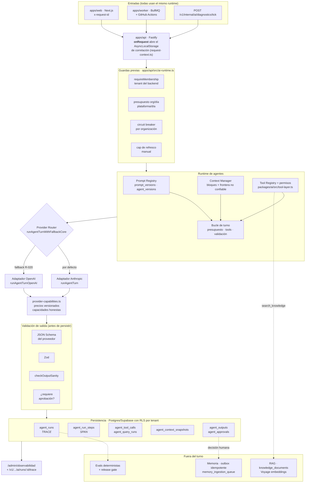

# AI Architecture — E-NORA / NORA

**Estado:** fases 0 a 10 cerradas (la 5 por decisión). Documento vivo.
**Diagnóstico de partida:** [AI_INFRASTRUCTURE_AUDIT.md](AI_INFRASTRUCTURE_AUDIT.md)

Este documento describe la arquitectura **real**, no la deseada. Lo que todavía no existe
está marcado como pendiente y con la fase en la que llega.

---

## 1. Principio de diseño

Toda ejecución de IA atraviesa una capa común. Ningún componente de la aplicación habla
directamente con un SDK de proveedor.

Esto ya se cumplía antes de este trabajo y se mantiene como invariante: los únicos `import`
de `@anthropic-ai/sdk` y `openai` de todo el monorepo están en
[`packages/ai/src/index.ts`](../../packages/ai/src/index.ts) (líneas 7-8). Si un fichero
nuevo importa un SDK de proveedor, es un error de arquitectura.

## 2. Vista general

## 3. Adaptadores de proveedor

El contrato común es el tipo `AgentTurnResult` de
[`packages/ai/src/index.ts`](../../packages/ai/src/index.ts). Un adaptador debe devolverlo
entero; el resto de la aplicación no ve nunca la forma de la respuesta de un SDK.

| Campo                                                         | Significado                                                                |
| ------------------------------------------------------------- | -------------------------------------------------------------------------- |
| `provider` / `model`                                          | Quién atendió el turno **de verdad**, no lo configurado                    |
| `inputTokens` / `outputTokens`                                | Siempre numéricos: los dos proveedores los reportan                        |
| `cacheReadTokens` / `cacheCreationTokens` / `reasoningTokens` | `number` si el proveedor lo reportó, `null` si no. **Nunca 0 por defecto** |
| `estimatedCostUsd`                                            | `null` si el modelo no está tarifado                                       |
| `costBasis`                                                   | `priced` \| `unknown_model` — por qué el coste vale lo que vale            |
| `pricingVersion`                                              | Tarifa aplicada, para poder auditar el pasado                              |
| `stopReason`                                                  | Crudo, tal como lo devuelve el proveedor                                   |
| `modelCalls` / `toolCallCount`                                | Trabajo real del turno                                                     |

### La regla que gobierna este contrato

**`null` significa "no lo sabemos". `0` significa "lo sabemos y es cero".** No son
intercambiables, y confundirlos fue el defecto más caro que encontró el audit: con
`estimateCostUsd` devolviendo `0` para un modelo desconocido, una ejecución cara pasaba por
gratis, los topes de presupuesto dejaban de morder y el panel facturaba de menos sin avisar.

Lo mismo aplica a las capacidades en
[`provider-capabilities.ts`](../../packages/ai/src/provider-capabilities.ts): un valor
`unknown` es una respuesta legítima y preferible a un `false` inventado.

### Capacidades gestionadas por el proveedor

Toda la inferencia corre en Anthropic y OpenAI. Por tanto, y sin adornos:

- **Cuantización**: `provider_managed`. No la controlamos.
- **KV cache**: `provider_managed`. No lo controlamos ni tenemos telemetría de él.
- **Prompt caching**: es **otra cosa** distinta del KV cache. Lo declaramos en Anthropic
  (`cache_control`), es automático en OpenAI, y de ambos leemos lo que reportan.

## 4. Correlación

Cada ejecución nace con:

| Campo                | Origen                                                                                                        |
| -------------------- | ------------------------------------------------------------------------------------------------------------- |
| `trace_id`           | `x-request-id` de la petición, o el `tick_id` del orquestador, o el propio `run_id` cuando no hay origen HTTP |
| `root_run_id`        | El propio `run_id` (hoy todas las ejecuciones son raíz)                                                       |
| `parent_run_id`      | `null` — no hay subagentes todavía                                                                            |
| `parallel_group_id`  | El `tick_id` de la pasada del orquestador                                                                     |
| `deployment_version` | `GIT_SHA`                                                                                                     |

El transporte es un `AsyncLocalStorage`
([`request-context.ts`](../../apps/api/src/request-context.ts)), abierto por un hook
`onRequest` de Fastify y por el wrapper del orquestador. Se eligió así para no añadir un
parámetro a ~20 funciones de agente y toda su cadena de llamadas.

**No se metió en `AuthContext`**, que era la alternativa obvia: `resolveAuthContext` está
cacheado, así que la segunda petición del mismo usuario heredaría el `request_id` de la
primera. Una correlación falsa es peor que ninguna.

## 5. Estados de terminación

`agent_runs.status` distingue por qué acabó una ejecución:

| Estado            | Significado                                                              |
| ----------------- | ------------------------------------------------------------------------ |
| `succeeded`       | Salida válida y persistida                                               |
| `rejected_output` | El modelo respondió, pero la salida no pasó schema o `checkOutputSanity` |
| `budget_exceeded` | Corte deliberado por presupuesto (`budget_max_*` dice contra qué límite) |
| `timeout`         | El proveedor no respondió a tiempo                                       |
| `failed`          | Fallo real, no clasificado                                               |
| `cancelled`       | Reservado; no hay cancelación todavía                                    |

## 6. Git worktrees (práctica de desarrollo, no runtime)

Cuando dos agentes de codificación trabajen a la vez sobre este monorepo, cada uno en su
worktree: `node_modules`, `.next` y el estado de `supabase/migrations` no toleran dos
procesos a la vez. **El producto no ejecuta git**; esto no es una dependencia del runtime.

---

## 7. Plan de fases y estado

El orden del encargo se respeta, con un ajuste que conviene explicar: **la fase 2 (usage:
tokens, costes, latencia, errores) se adelantó y se fusionó con la fase 1**. El motivo es
que el defecto del coste (`0` para modelo desconocido) y la ausencia de `provider`/`model`
son el mismo bug — el registro no representaba la realidad técnica — y arreglar uno sin el
otro dejaba el panel igual de poco fiable.

| Fase  | Alcance                                                                 | Estado                                                      |
| ----- | ----------------------------------------------------------------------- | ----------------------------------------------------------- |
| 0     | Audit real                                                              | ✅ [AI_INFRASTRUCTURE_AUDIT.md](AI_INFRASTRUCTURE_AUDIT.md) |
| 1 + 2 | Adaptadores + fundamentos de run/trace + tokens/costes/latencia/errores | ✅ ver abajo                                                |
| 3     | Prompt / skill / context tracking                                       | ✅ ver "fases 3 a 10"                                       |
| 4     | Tools + permisos + eventos de seguridad                                 | ✅ ver abajo                                                |
| 5     | Subagentes, paralelo, background/headless                               | ✅ cerrada por decisión, con criterio de reapertura         |
| 6     | Memoria: consolidación y procedencia                                    | ✅ ver "fases 3 a 10"                                       |
| 7     | Evals + feedback humano                                                 | ✅ ver "fases 3 a 10"                                       |
| 8     | Propuestas de mejora + CI/CD de agentes                                 | ✅ ver "fases 3 a 10"                                       |
| 9     | UI de observabilidad                                                    | ✅ detalle de traza en `/admin/observabilidad`              |
| 10    | Hardening, retención, rendimiento, RLS, documentación                   | ✅ ver "fases 3 a 10"                                       |

### Qué entregaron las fases 3 a 10 (2026-09-23)

Una migración ([`20261108090000`](../../supabase/migrations/20261108090000_ai_30_fases_3_6_7_8.sql)),
ninguna tabla nueva.

- **Fase 3.** `AgentTurnResult` devuelve `systemPromptHash` (SHA-256 del prompt de sistema
  **efectivo**), `declaredTools` y `contextTruncated`; `agentRunCompletionFields` los lleva a
  `agent_runs`. `prompt_code`/`prompt_version` se copian de `agent_versions` con un trigger
  al insertar, así los seis puntos que crean runs lo heredan sin tocarse. El detalle de traza
  pinta prompt@versión + hash, contexto completo/recortado y tools declaradas/usadas.
  _No se hizo:_ `loaded_skills` (hoy sería siempre igual a `prompt_code`) ni el % de uso de
  ventana (`contextWindowMax` sigue en `null` a propósito hasta verificarlo por modelo).
- **Fase 5 — cerrada por decisión.** Headless ya existía (HTTP, worker, tick interno). Las
  columnas de jerarquía están listas. Subagentes y encolar runs **no se construyen**: con 175
  runs reales ningún agente se acerca al techo (ver "Fiabilidad"). Se reabre cuando un agente
  roce las 16 llamadas, el contexto se acerque a la ventana o un turno dure minutos.
- **Fase 6.** `knowledge_documents.superseded_by`: al ingerir una versión nueva de la misma
  fuente, la anterior queda `superseded` **y apunta a quien la sustituyó**. _No se hizo:_
  `expires_at` ni `confidence` — no hay ningún productor que sepa rellenarlos.
- **Fase 7.** `agent_approvals.reason_category` (incorrecto, sin evidencia, irrelevante,
  incompleto, duplicado, otro), elegible al rechazar en `/agentes`. `admin_agent_quality_stats`
  da por agente@versión: correctas, aprobadas/rechazadas y runs con contexto recortado.
- **Fase 8.** `admin_ai_failure_clusters` agrupa fallos técnicos (mensaje sin ids ni números)
  y rechazos humanos (por categoría) por agente@versión: es el _failure cluster_ del audit, y
  se ve en la tarjeta "Calidad" de `/admin/observabilidad`. La propuesta de cambio sigue
  siendo humana. `scripts/assert-ai-tests-not-weakened.mjs` falla si bajan los asserts de
  `packages/ai`, aparecen `skip` o se reduce el dataset de evals respecto a `HEAD`.
  `npm run verify` ejecuta todas las guardas, que desde que se retiraron los workflows de
  GitHub Actions no corría nadie.
- **Fase 10.** Funciones nuevas con `search_path` fijado y registradas en la guarda de
  hardening; las de panel solo ejecutables por `service_role`. Retención de eventos de
  seguridad y cierre de runs colgados ya existían. La guarda de idempotencia vuelve a verde
  (excepción documentada para `20261106090000`).

### Qué entregó la fase 1 (verificable)

1. **[`provider-capabilities.ts`](../../packages/ai/src/provider-capabilities.ts)** — fuente
   única de precios (versionados) y capacidades. `estimateCostUsd` devuelve `number | null`.
2. **`AgentTurnResult` ampliado** — proveedor y modelo reales, uso con `null` honesto,
   `costBasis`, `pricingVersion`, `stopReason`.
3. **[Migración `20260909130000`](../../supabase/migrations/20260909130000_ai_30_trazabilidad_ejecuciones.sql)** —
   17 columnas nuevas en `agent_runs`, `estimated_cost_usd` y `cache_read_tokens` pasan a
   nullable, estados `timeout`/`cancelled`, 5 índices. **Ninguna tabla nueva.**
4. **[`request-context.ts`](../../apps/api/src/request-context.ts)** — correlación por
   `AsyncLocalStorage`.
5. **`agentRunCompletionFields` / `agentRunTraceFields`** — los seis puntos que abrían y
   cerraban un run repetían el mismo literal; ahora lo que el runtime sabe llega entero a la
   fila o no llega a ninguna.
6. **[`eval-cost-gate.ts`](../../apps/api/src/eval-cost-gate.ts)** — un escenario cuyo coste
   no se puede medir ya no pasa el gate de coste.
7. **Tests** — 78 en `@e-nora/ai`, 255 en `@e-nora/api`, en verde.

### Cambio de especificación deliberado

El test `estimateCostUsd devuelve 0 para un modelo desconocido` afirmaba lo contrario de lo
que ahora hace el sistema. **No se relajó para que pasara**: se reescribió porque el
comportamiento que fijaba era el defecto. El test nuevo
(`estimateCostUsd devuelve null para un modelo sin precio conocido, no 0`) es más estricto,
no menos.

### Qué entregó la fase 4 (los dos P0 del audit)

1. **[`security-events.ts`](../../packages/ai/src/security-events.ts)** — tipos de evento,
   severidades y un colector con tope. `emit` es síncrono (corre en el camino caliente);
   `drain` se vacía una vez por turno.
2. **[Migración `20260909140000`](../../supabase/migrations/20260909140000_ai_30_eventos_de_seguridad.sql)** —
   `public.ai_security_events` con RLS restringida a `platform_admin` y consultor asignado.
   Solo metadatos: nunca el texto que provocó el evento.
3. **Emisión desde donde ya se detectaba.** `serializeUntrustedContextBlocks` y
   `serializeUntrustedToolResult` dejan de tirar el contador de patrones neutralizados; una
   herramienta pedida fuera del catálogo deja constancia. La persistencia va en un `finally`,
   así que un turno que muere por presupuesto no se lleva por delante la evidencia.
4. **`sanitizeForTelemetry()`**
   ([`observability`](../../packages/observability/src/index.ts)) — puerta única antes de
   escribir `agent_tool_calls.input`/`.output`, que iban en crudo. Acota **antes** de
   redactar, porque `redactSensitive` no tiene límite de profundidad y aquí la entrada es la
   salida de una herramienta.
5. **`GIT_SHA` en producción** — `deploy/docker-compose.prod.yml` lo pasa desde `IMAGE_TAG`,
   que ya era el SHA del commit. Sin cambios en Dockerfiles ni en el workflow.
6. **`untrusted-context.test.ts` entra en CI.** Existía y **nunca se ejecutaba**: no estaba
   en el script `test` de `packages/ai`. Era la suite de la frontera de seguridad.

### Qué entregaron las fases 4bis y 9

1. **El motor de permisos ya corre.** `buildAgentTools` llama a `authorizeTool` en vez de
   filtrar a mano; toda denegación emite `permission_denied`.
2. **LangGraph fuera.** `runOperationThroughLangGraph` construía un grafo de **un solo nodo**
   que se limitaba a invocar la operación: ni estado, ni reanudación, ni ramas. Se retiraron
   el módulo, la variable `AI_ORCHESTRATION_MODE` y las dependencias `@langchain/*`. El punto
   de enganche queda documentado en el código por si algún día hace falta un grafo de verdad.
3. **Detalle de traza en `/admin/observabilidad`.** Al abrir una ejecución se piden sus
   cuatro tablas y se pinta: proveedor y modelo reales (marcando cuándo actuó el fallback),
   motivo de terminación, coste con su base, presupuesto aplicado, uso reportado por el
   proveedor, correlación copiable, controles de seguridad, cascada de fases, herramientas y
   consultas SQL. Sin endpoint nuevo: `platform_admin` tiene membresía sintética a todas las
   organizaciones, así que la ruta por organización sirve tal cual.

### Qué queda compartido entre los dos bucles de turno

`runAgentTurn` (Anthropic) y `runAgentTurnOpenAI` eran ~285 y ~267 líneas casi idénticas. Lo
que de verdad diverge entre proveedores resultó ser poco: cómo se construye la petición, de
dónde se lee el uso, y la forma de los mensajes de herramienta. Todo lo demás eran **dos
copias de la misma regla**, y una regla en dos copias se arregla en una sola — ya pasó: el
`?? 0` del coste estaba corregido en un camino y no en el otro.

| Compartido             | Qué regla concentra                                                                       |
| ---------------------- | ----------------------------------------------------------------------------------------- |
| `buildTurnUserText`    | La declaración de que el tenant lo resuelve el backend — aislamiento entre organizaciones |
| `createTurnAccounting` | Tokens, `null` vs `0` en caché, freno de presupuesto, última ronda                        |
| `executeModelToolCall` | Qué se hace con una tool desconocida y con una que revienta: las dos emiten evento        |
| `parseTurnOutput`      | JSON → Zod → sanidad, antes de que nada llegue al dominio                                 |
| `turnPricingFields`    | Coste, base del coste y versión de tarifa van siempre juntos                              |
| `requestWithoutTools`  | La última llamada del turno se sirve sin herramientas                                     |

**No hay interfaz de "driver de proveedor"**: sería una abstracción de seis métodos con dos
implementaciones para esconder las pocas diferencias que sí son reales, y esas diferencias es
mejor verlas.

### Fiabilidad: lo que el diagnóstico sobre producción destapó (2026-09-09)

Con 175 ejecuciones reales y 2 organizaciones, los datos contradijeron la intuición de que
hacían falta subagentes: el agente más cargado usa 10 de las 16 llamadas al modelo
disponibles y 74,6k tokens de una ventana de ~200k. **Ningún agente está contra el techo.**
Lo que sí había eran tres defectos, y ninguno se arreglaba con más agentes.

| Defecto                                                                    | Causa                                                                                                                                     | Arreglo                                                                                                                             |
| -------------------------------------------------------------------------- | ----------------------------------------------------------------------------------------------------------------------------------------- | ----------------------------------------------------------------------------------------------------------------------------------- |
| 18 de 175 ejecuciones eternas en `running`, la más antigua del 19 de julio | Si el proceso muere a mitad de turno, la fila queda sin estado terminal y nadie la cierra                                                 | `private.reap_stalled_agent_runs`, en la pasada de retención. Se marcan `timeout` con `latency_ms` a `null`: no medimos su duración |
| Latencias de 6 y 8,5 minutos                                               | Las herramientas de una misma ronda se ejecutaban en serie (`for … await`) aunque el modelo las pide juntas **porque son independientes** | Ejecución concurrente con tope de 4. El presupuesto se comprueba una vez con la ronda entera contada, antes de lanzar nada          |
| 61 de 65 fallos por saldo de Anthropic agotado                             | El fallback R-020 estaba escrito y probado, pero `OPENAI_API_KEY` **nunca se declaró en `docker-compose.prod.yml`**                       | Variables cableadas + `describeProviderRedundancy` avisando al arrancar + `classifyProviderError`                                   |

El tercero es el que importa: no era un fallo de código sino de operación, y era invisible.
Siete días de ejecuciones muertas sin una sola línea que dijera "el fallback no puede entrar
porque no está configurado". Ahora la API lo grita al arrancar.

**Cuándo tocarán subagentes**, entonces: cuando un agente roce las 16 llamadas de forma
habitual, cuando el contexto se acerque a la ventana, cuando hagan falta ramas realmente
independientes con presupuesto propio, o cuando un catálogo de herramientas no quepa en un
prompt — el candidato natural ahí es `a09_copiloto_consultor`, con 20 tools declaradas. La
infraestructura de correlación ya está lista para ese día.

### Lo que sigue abierto

1. **Árbol de subagentes en el panel.** Las columnas existen y el detalle ya sabría pintarlo,
   pero no hay subagentes que mostrar: hasta que exista el primero, la vista se degrada a la
   plana. Con datos reales hoy sí existe una relación parecida — los runs que comparten
   `parallel_group_id` en una pasada del orquestador —, pero enseñarla es una vista distinta,
   no ésta.
