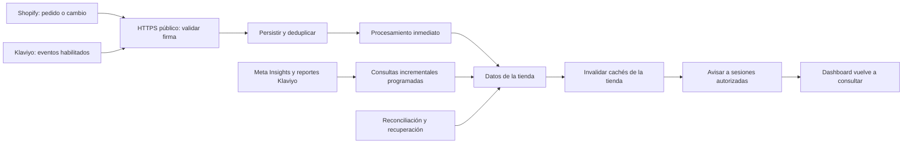

# Auditoría de integraciones y actualización automática

**Actualización posterior:** se ha implementado y probado la corrección en local/TEST.
Consulta el [resultado de implementación y pasos pendientes de producción](2026-10-26-integraciones-implementacion.md).
Los hallazgos siguientes conservan el estado observado antes de esas correcciones.

Fecha: 26 de octubre de 2026. Revisión de código y comprobaciones de solo lectura. Las horas indicadas usan Europe/Madrid.

**Veredicto: el sistema todavía no cumple «entra un pedido y lo veo sin actualizar».** Shopify tiene recepción firmada y almacenamiento de eventos, pero el procesamiento se retrasa por diseño y el dashboard no recibe sus cambios. Meta y Klaviyo funcionan mediante consultas programadas, con frecuencias demasiado bajas para ese objetivo. Hay además incidencias de datos y permisos verificadas.

## Qué hace el módulo y qué se ha comprobado

El SaaS conecta cuentas de tiendas mediante OAuth o claves privadas, importa datos a Supabase y sirve métricas calculadas al navegador. Un worker con BullMQ y Redis ejecuta las sincronizaciones y procesa los webhooks de Shopify.

Se asume un SaaS con varias tiendas, pedidos concurrentes y ráfagas de eventos; la continuidad debe sostenerse con el navegador cerrado. No se ha supuesto que cada pedido produzca un único webhook.

Se revisaron conexión y permisos, renovación de tokens, registro y recepción de webhooks, cola, reintentos, escritura de pedidos e inventario, sincronización de Meta/Klaviyo, cachés, consultas del dashboard, estados del módulo y vigilancia operativa. Se consultaron las bases TEST ES IA y E-NORA, el Redis local y los endpoints de salud locales y públicos. Se ejecutaron 76 pruebas existentes: todas pasan.

No se cambiaron conexiones, credenciales, suscripciones, datos de negocio ni configuración de producción. Los únicos archivos añadidos son este informe y su evidencia local.

## Estado observado

| Capa | Resultado |
| --- | --- |
| API local | `/health` y `/health/ready`: HTTP 200; Supabase y Redis disponibles |
| API pública | Misma comprobación: HTTP 200; eso no acredita que las conexiones con proveedores funcionen |
| Worker local | Un consumidor en cada cola, heartbeat reciente y procesador de Shopify activo |
| Recepción de webhooks | Cero filas en `private.webhook_events` en las dos bases consultadas en el momento de la revisión |
| Shopify local | Una conexión activa; última sincronización el 25/10 a las 12:15, Madrid |
| Meta local | Conexión activa; última sincronización el 25/10 a las 12:13, Madrid |
| Klaviyo local | Dos cuentas activas; última sincronización el 25/10 a las 13:43, Madrid. Ambas sin métrica de conversión seleccionada |
| Shopify producción | Una conexión en error: el proveedor rechazó el permiso guardado |
| Meta producción | Dos conexiones en error; registros del 26/10 devuelven `Error validating application. Application has been deleted.` |
| Klaviyo producción | No hay conexiones de ese proveedor en la base consultada |

La base usada por `.env.local` es TEST ES IA; la de producción es distinta. Los estados anteriores no mezclan ambas. Un access token vencido de Shopify/Klaviyo, por sí solo, no demuestra desconexión: hay renovación mediante refresh token. No se ejecutó esa renovación durante esta auditoría.

## Hallazgos que hay que corregir

### 1. P1 — La pantalla abierta no se actualiza cuando llegan datos

**Qué ocurre:** `ClientPulse` obtiene ventas, Meta y Klaviyo mediante `useCachedQuery`. El hook consulta al montar o al cambiar la URL; no programa una nueva consulta cuando transcurren sus 30 segundos de frescura. Tampoco hay suscripción a cambios de datos. Dejar la página abierta mantiene las cifras antiguas indefinidamente, aunque la base cambie. Integraciones usa el mismo hook y su consulta temporal tras OAuth solo espera la creación inicial de una tienda.

**Corrección mínima:** escuchar la finalización de sincronizaciones/eventos de la organización y tienda, agrupar avisos e invalidar las consultas afectadas. Añadir recuperación al volver el foco o la red y una consulta periódica de respaldo. Reutilizar metadatos públicos con RLS; no publicar los payloads de `private.webhook_events` al navegador.

**Evidencia:** [use-cached-query.ts](../../apps/web/src/lib/use-cached-query.ts), [client-pulse.tsx](../../apps/web/src/app/dashboard/client-pulse.tsx), [shared.tsx](../../apps/web/src/app/integraciones/shared.tsx), [hub.tsx](../../apps/web/src/app/integraciones/hub.tsx). La publicación `supabase_realtime` no tiene tablas en la base TEST consultada.

### 2. P1 — Las cachés del servidor también ocultan pedidos nuevos

**Qué ocurre:** Shopify guarda una copia calculada durante 60 segundos y otra capa que sirve la última respuesta mientras recalcula, con una ventana adicional de 600 segundos. El procesador de webhooks no invalida esas copias. Incluso un refetch del navegador puede recibir la respuesta anterior; la primera consulta a una copia envejecida inicia el recálculo, pero devuelve la copia vieja.

**Corrección mínima:** invalidar o versionar ambas capas por tienda después de confirmar las escrituras, y después notificar a la pantalla. Añadir solo un temporizador en React no cierra este circuito.

**Evidencia:** [shopify-metrics.ts](../../apps/api/src/shopify-metrics.ts), [shopify-metrics.ts](../../apps/api/src/shopify-metrics.ts), [shopify-metrics.ts](../../apps/api/src/shopify-metrics.ts), [swr-cache.ts](../../apps/api/src/swr-cache.ts), [shopify-webhook-handler.ts](../../apps/api/src/shopify-webhook-handler.ts).

### 3. P1 — El callback local de Shopify no es accesible desde Shopify

**Qué ocurre:** `.env.local` configura el callback OAuth en `http://localhost:4000`; el código deriva de su origen la URL `/v1/shopify/webhooks`. Shopify no puede entregar eventos a ese localhost. No se encontró una configuración local de recepción pública y no hay eventos persistidos que acrediten entregas.

**Corrección mínima:** usar una URL HTTPS pública de desarrollo que dirija a la API local, con aplicación y base de pruebas separadas; comprobar después las suscripciones que realmente existen en Shopify. El dashboard puede seguir en localhost. Para servicio continuo, API, worker y Redis deben estar alojados y encendidos permanentemente.

**Evidencia:** [shopify-webhooks.ts](../../apps/api/src/shopify-webhooks.ts). El archivo de entorno se leyó filtrando los secretos; no se copia su contenido en el informe. Cero eventos no demuestra por sí solo que no existan suscripciones remotas.

### 4. P1 — Shopify procesa diez eventos por minuto y se bloquea tras importaciones largas

**Qué ocurre:** el receptor guarda el evento y devuelve 200, pero no inicia su aplicación. Un job cada minuto llama al drenaje con límite diez. Comparte una cola y concurrencia global uno con las importaciones completas. Si entran cien eventos, se necesitan al menos diez tandas, incluso sin errores; una importación en curso impide procesarlos mientras dure.

**Corrección mínima:** despertar el procesamiento al persistir un evento y separar su consumo de las importaciones largas. Mantener el barrido periódico como recuperación, con límites de concurrencia compatibles con la base. Medir edad del evento más antiguo y latencia hasta su aplicación.

**Evidencia:** [worker.ts](../../apps/worker/src/worker.ts), [worker.ts](../../apps/worker/src/worker.ts), [shopify-queue-worker.ts](../../apps/api/src/shopify-queue-worker.ts), [shopify-webhook-handler.ts](../../apps/api/src/shopify-webhook-handler.ts).

### 5. P1 — Meta y Klaviyo se consultan demasiado poco; cambiar solo el cron no basta

**Qué ocurre:** Meta se consulta a las 00:17 UTC una vez al día; Klaviyo a las :43 cada seis horas. No hay receptores de webhooks de estos proveedores en la API revisada. Además, Meta identifica una pasada por día y Klaviyo por bloques de seis horas; las pasadas ya completadas se omiten. Programarlas cada cinco minutos manteniendo esas claves no traería datos nuevos en cada ejecución.

**Corrección mínima:** definir consultas incrementales frecuentes para métricas recientes y una pasada más lenta para catálogo/histórico. Cambiar conjuntamente periodicidad e identificación de cada ejecución, conservando la deduplicación de sus reintentos. Evaluar webhooks de Klaviyo solo después de confirmar elegibilidad y permisos de la app.

**Evidencia:** [repeatable-jobs.ts](../../apps/worker/src/repeatable-jobs.ts), [meta-sync.ts](../../apps/api/src/meta-sync.ts), [meta-sync.ts](../../apps/api/src/meta-sync.ts), [klaviyo-sync.ts](../../apps/api/src/klaviyo-sync.ts), [klaviyo-sync.ts](../../apps/api/src/klaviyo-sync.ts), [server.ts](../../apps/api/src/server.ts).

### 6. P1 — Hay conexiones de producción averiadas ahora mismo

**Qué ocurre:** las dos conexiones Meta de producción registran rechazo porque la aplicación asociada fue eliminada. Shopify también solicita reautorización porque rechazó el permiso guardado. Los jobs siguen existiendo, pero repetir una consulta no restablece permisos inválidos.

**Corrección mínima:** confirmar la aplicación vigente de cada proveedor y reautorizar las cuentas afectadas contra ella. A continuación verificar cuentas seleccionadas, un sync reciente correcto y, en Shopify, suscripciones reales. No se debe prometer conexión perpetua ante revocaciones del propietario o eliminación de una app.

**Evidencia:** consultas de solo lectura a `integration_connections` e `integration_sync_runs` de producción, conservadas en [evidence.json](../../tmp/integrations-audit-2026-10-26/evidence.json). No se ha intentado reconectar ni modificar esas cuentas.

### 7. P1 — Klaviyo no puede guardar audiencias de campañas en TEST

**Qué ocurre:** `upsertRows` usa el conflicto `campaign_id,audience_type,external_audience_id`, pero la tabla real no tiene una restricción única con esas columnas. Las últimas pasadas fallaron con `there is no unique or exclusion constraint matching the ON CONFLICT specification`.

**Corrección mínima:** comprobar y resolver duplicados existentes, y alinear una restricción única con la clave usada por el sync mediante una migración. Verificar la escritura contra una base de pruebas; un mock de HTTP no detecta esta incompatibilidad.

**Evidencia:** [klaviyo-sync.ts](../../apps/api/src/klaviyo-sync.ts), índices reales en `evidence.json` y registros fallidos del 25/10. La migración de convergencia cambia columnas, pero no crea esta unicidad: [migración](../../supabase/migrations/20260911140000_klaviyo_convergencia_esquema.sql).

### 8. P1 — Klaviyo queda «connected» aunque fallen bloques y falte la conversión

**Qué ocurre:** las dos cuentas activas de TEST tienen `conversion_metric_id = null`; las series de flows registran `conversion_metric_missing` y el reconciliador omite informes de conversión. Separadamente, el error de audiencias se registra en una fila de bloque, pero su catch no lo añade a `skipped`. Al final el sync general marca éxito y limpia el error de la conexión. Un bloque posterior correcto puede convertirse en el último estado visible y ocultar la avería anterior.

**Corrección mínima:** pedir la selección de la métrica de compra adecuada por cuenta, sin adivinarla; mostrar explícitamente «datos de conversión pendientes». Acumular los fallos de todos los bloques y conservar una salud parcial hasta que cada bloque requerido se recupere. No convertir datos ausentes en cero ingresos confirmados.

**Evidencia:** [klaviyo-sync.ts](../../apps/api/src/klaviyo-sync.ts), [klaviyo-sync.ts](../../apps/api/src/klaviyo-sync.ts), [klaviyo-sync.ts](../../apps/api/src/klaviyo-sync.ts), [integrations.ts](../../apps/api/src/integrations.ts). La ausencia de métrica está verificada por SQL; no implica que el catálogo entero haya dejado de sincronizarse.

### 9. P1 — Un webhook antiguo puede sobrescribir un pedido o inventario más reciente

**Qué ocurre:** los handlers hacen upsert sin comprobar que la fecha del proveedor sea posterior a la guardada. Shopify no garantiza el orden de entrega. Caso concreto: se aplica un pedido cancelado y después llega retrasado un payload previo sin cancelación; el segundo puede borrar el estado correcto. Ordenar por `received_at` no resuelve el orden de origen. En inventario, el trigger local sustituye `updated_at` por `now()`, por lo que tampoco sirve como versión del proveedor.

**Corrección mínima:** aplicar una comparación atómica por versión/fecha externa antes de reemplazar el estado. Reutilizarla también para impedir que un sync antiguo pise un webhook reciente. Guardar una fecha externa propia para inventario y probar ambas órdenes de entrega.

**Evidencia:** [shopify-webhook-handler.ts](../../apps/api/src/shopify-webhook-handler.ts), [shopify-webhook-handler.ts](../../apps/api/src/shopify-webhook-handler.ts). Se inspeccionaron los triggers reales de ambas tablas: no existe una protección de orden en TEST. Es un defecto identificado por el flujo de código y esquema; no se provocó sobre pedidos reales.

### 10. P1 — Meta puede quedar fuera de todas las pasadas tras un reinicio

**Qué ocurre:** el reconciliador selecciona solo conexiones `connected` o `error` y las cambia a `syncing` antes de trabajar. Si muere el proceso en ese punto, las siguientes pasadas ya no la seleccionan. Existe recuperación de `syncing` antiguo en el botón manual, pero no en ese reconciliador automático.

**Corrección mínima:** recuperar estados `syncing` con lease vencido antes de seleccionar el trabajo, comprobando que no pertenezcan a una pasada activa. Persistir el trabajo de las ejecuciones manuales, en lugar de depender de una promesa en memoria de la API.

**Evidencia:** [meta-sync.ts](../../apps/api/src/meta-sync.ts), [meta.ts](../../apps/api/src/meta.ts). Este escenario se verificó por código; no se reinició producción para provocarlo.

### 11. P1 — El registro de webhooks puede fallar sin cambiar la salud de Shopify

**Qué ocurre:** el registro se lanza en segundo plano tras OAuth. Los `userErrors` y excepciones se registran, pero no se devuelve un resultado agregado ni se guardan las suscripciones confirmadas. El reenvío existente es manual; no hay un job periódico que compruebe y repare suscripciones eliminadas o una URL antigua. Por tanto, «connected» no demuestra recepción operativa.

**Corrección mínima:** registrar resultado por topic y URL, comprobar suscripciones al conectar y periódicamente, y reparar solo las que falten o apunten a otro destino. Distinguir una duplicada válida de un permiso denegado.

**Evidencia:** [shopify.ts](../../apps/api/src/shopify.ts), [shopify-webhooks.ts](../../apps/api/src/shopify-webhooks.ts), [shopify-webhooks.ts](../../apps/api/src/shopify-webhooks.ts). Shopify documenta que puede eliminar suscripciones creadas por Admin API tras fallos continuados de entrega.

### 12. P1 — Una conexión todavía no resuelta puede hacer perder un webhook aceptado

**Qué ocurre:** `resolveConnectionContext` descarta los errores de lectura y exige que ya exista `shopify_stores`. Si la base falla temporalmente o llega un pedido mientras la primera importación aún no creó la tienda, el receptor devuelve 200 `ignored_unknown_connection` sin guardar el evento. Shopify lo considera entregado y la recuperación dependerá de otro sync. El handler de inventario también retorna sin reintentar si todavía no existen el artículo o la ubicación.

**Corrección mínima:** separar una conexión desconocida de un error temporal, devolver error reintentable en este último caso y conservar eventos válidos de conexiones en inicialización para resolverlos después. Los estados de baja deben seguir excluidos.

**Evidencia:** [shopify-webhook-handler.ts](../../apps/api/src/shopify-webhook-handler.ts), [shopify-webhook-handler.ts](../../apps/api/src/shopify-webhook-handler.ts), [shopify-webhook-handler.ts](../../apps/api/src/shopify-webhook-handler.ts).

### 13. P1 — Los reintentos se agotan pronto y la alerta vigila el estado anterior

**Qué ocurre:** el drenaje admite cinco intentos; no usa `next_retry_at` ni backoff por evento. Una caída de unos minutos puede agotarlos y dejar el evento en `failed`, fuera de selección futura. El chequeo de backlog solo busca `received`, aunque el circuito actual escribe `queued` y `processing`; puede omitir la cola real. Tampoco se encontró el job de ese chequeo registrado en el worker ni en el crontab versionado; no se afirma que no exista un monitor externo adicional.

**Corrección mínima:** reintentos espaciados para errores transitorios, estado explícito para agotados con recuperación operable, y alertas por edad de `queued`, leases de `processing` y fallos agotados. Programar y comprobar la vigilancia y su canal de aviso.

**Evidencia:** [shopify-webhook-handler.ts](../../apps/api/src/shopify-webhook-handler.ts), [ops-health-check.ts](../../apps/api/src/ops-health-check.ts), [worker.ts](../../apps/worker/src/worker.ts), [e-nora.crontab](../../ops/vps/e-nora.crontab).

## Comprobaciones y límites

- **76 pruebas existentes correctas.** Cubren cifrado, OAuth, scopes, clientes HTTP, límites de concurrencia, claves de sincronización, contratos, payloads, estados de ingesta y parte de la observabilidad. No demuestran entrega real de un pedido hasta un dashboard abierto.
- **Falta la aceptación completa del circuito.** Debe incluir pedido real de prueba, duplicado, entrega fuera de orden, caída de base/worker, reinicio, recuperación y pantalla abierta; también aislamiento entre organizaciones. Las ráfagas deben medirse antes de fijar una garantía de latencia.
- Se comprobaron los avisos de seguridad de Supabase TEST. RLS sin políticas en tablas privadas usadas por el servidor no es, por sí solo, una exposición. Los demás avisos necesitan revisión de permisos y funciones específica; no se convierten en vulnerabilidades confirmadas de esta auditoría.
- Se consultaron metadatos del flujo de logs de Supabase y el ledger persistido de sincronizaciones. No se inspeccionaron todos los logs históricos ni se reprodujeron sus errores sobre cuentas reales.
- No se inspeccionó el código desplegado dentro del VPS, ni su crontab instalado, ni las configuraciones privadas de los portales de proveedores. La comparación de código corresponde al workspace; la de errores y salud corresponde a los servicios y bases consultados.
- No se consultó el inventario remoto de suscripciones Shopify con las credenciales de E-NORA, ni se verificó la elegibilidad de su app Klaviyo para system webhooks. Esas dos comprobaciones quedan pendientes de la fase de activación. No se creó una conexión pública a localhost.

## Diseño recomendado para cumplir el objetivo

Este diagrama es una propuesta; no describe una función ya implantada. El dato debe seguir llegando aunque no haya ningún navegador abierto.

| Proveedor | Mecanismo recomendado | Objetivo propuesto, pendiente de medir |
| --- | --- | --- |
| Shopify | Webhooks firmados y procesados al recibirlos; reconciliación frecuente de cambios recientes | Reflejar el pedido en segundos desde la entrega del proveedor, sin recargar la página |
| Meta | Insights incremental frecuente; webhooks solo para cambios soportados que se validen para esta app | Consultar métricas recientes cada 5–15 min según cuota y carga; no prometer un ROAS definitivo instantáneo |
| Klaviyo | System webhooks cuando cuenta/app lo permitan; consultas periódicas de reportes y recuperación | Eventos en segundos desde su entrega; reportes con cadencia independiente según límites de API |

Orden de ejecución: reparar cuentas y esquema; habilitar recepción HTTPS de pruebas; separar y acelerar el procesamiento Shopify; cerrar invalidación de cachés y actualización del navegador; ajustar cadencias y claves de Meta/Klaviyo; activar recuperación y alertas; ejecutar la aceptación completa con medición de latencia y carga.

## Documentación contrastada

- [Shopify: verificar entregas](https://shopify.dev/docs/apps/build/webhooks/verify-deliveries): firma, respuesta rápida, duplicados, reintentos y posible eliminación de suscripciones. [Shopify: webhooks](https://shopify.dev/docs/apps/build/webhooks): ausencia de orden garantizado y necesidad de reconciliación.
- [Klaviyo: Webhooks API](https://developers.klaviyo.com/en/reference/webhooks_api_overview): distingue webhooks de flows y de sistema; limita acceso a determinados clientes/partners y exige permisos de webhooks para OAuth. No se presupone que todas las cuentas puedan habilitarlos.
- [Klaviyo: procesar system webhooks](https://developers.klaviyo.com/en/docs/working_with_system_webhooks): firma, lotes, reintentos, desactivación y recuperación de eventos por API.
- Las páginas oficiales de Meta Insights y referencia de webhooks devolvieron HTTP 429 durante la consulta. Se verificó el mecanismo actual en el código de E-NORA; queda pendiente confirmar los topics y permisos de webhooks de la app Meta antes de diseñar su suscripción. No se asigna un SLA oficial de frescura a sus métricas.

**Conclusión operativa:** hay una base de integración útil y un worker funcionando, pero falta completar la entrega hasta la pantalla, corregir pérdidas y retrasos, y reparar conexiones concretas. La auditoría está terminada; las correcciones y su prueba real todavía no están implementadas.
