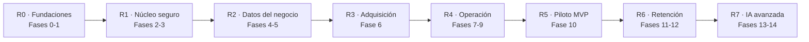
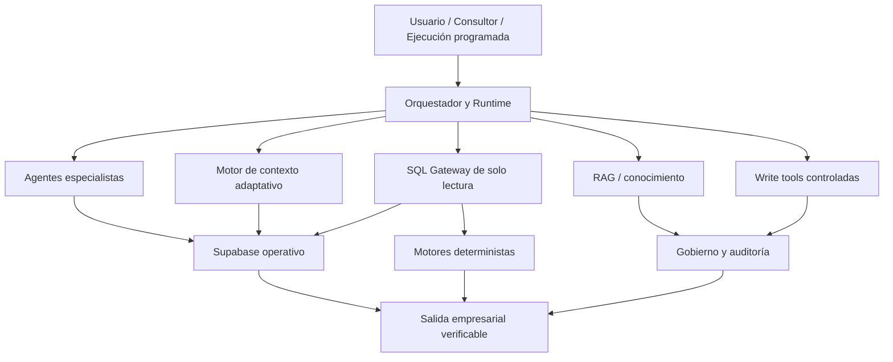

# ECOMSCALING IA

> **Objetivo global vigente:** este roadmap ejecuta el contrato de
> [`docs/OBJETIVO_SAAS_PILOTO_Y_CRITERIOS_DE_TERMINADO.md`](../docs/OBJETIVO_SAAS_PILOTO_Y_CRITERIOS_DE_TERMINADO.md).
> Shopify es la integración operativa del piloto; Meta Ads, Klaviyo e Instagram deben quedar activables
> posteriormente mediante contratos, adaptadores, feature flags y estados honestos, sin rediseños.

## Roadmap Técnico Maestro de Implementación

**Ámbitos:** Base de datos · Backend · Frontend · Integraciones · Agentes IA · Seguridad · QA · Despliegue



> **Versión 0.1 · Julio 2026 · Documento vivo**

Objetivo: transformar el briefing funcional y la arquitectura validada en un plan de construcción ejecutable por fases y con criterios de aceptación verificables.

# Control del documento

| **Elemento**           | **Definición**                                                                                                                                                 |
|------------------------|----------------------------------------------------------------------------------------------------------------------------------------------------------------|
| Propósito              | Referencia única para ordenar la construcción de EcomScaling IA y evitar implementar módulos aislados sin dependencias, seguridad o criterios de finalización. |
| Fuentes consolidadas   | Briefing técnico; DBML v0.2; matriz y helpers RLS; auditorías Shopify GraphQL, Meta/Instagram y Klaviyo; Documento Maestro de Agentes v0.2.                    |
| Regla de actualización | Toda decisión que cambie alcance, contrato de datos, permisos, API externa, agente o release debe reflejarse aquí y en el registro de decisiones.              |
| Estado                 | Plan de ejecución previo al inicio de migraciones de producción.                                                                                               |

# Índice

1. [Decisiones arquitectónicas de partida](#1-decisiones-arquitectónicas-de-partida)
2. [Estrategia de construcción y releases](#2-estrategia-de-construcción-y-releases)
3. [Arquitectura de repositorio y entornos](#3-arquitectura-de-repositorio-y-entornos)
4. [Roadmap fase por fase](#4-roadmap-fase-por-fase)
5. [Mapa de migraciones de base de datos](#5-mapa-de-migraciones-de-base-de-datos)
6. [Plan de backend por dominios](#6-plan-de-backend-por-dominios)
7. [Plan de frontend por módulos](#7-plan-de-frontend-por-módulos)
8. [Integraciones y sincronización](#8-integraciones-y-sincronización)
9. [Runtime de agentes y contexto empresarial](#9-runtime-de-agentes-y-contexto-empresarial)
10. [Seguridad, RLS, privacidad y auditoría](#10-seguridad-rls-privacidad-y-auditoría)
11. [Testing, observabilidad y calidad](#11-testing-observabilidad-y-calidad)
12. [Despliegue, piloto y operación](#12-despliegue-piloto-y-operación)
13. [Primeras tareas de programación](#13-primeras-tareas-de-programación)
14. [Definition of Done global](#14-definition-of-done-global)

# Resumen ejecutivo

El desarrollo no debe comenzar creando las aproximadamente noventa tablas del modelo completo ni construyendo primero una interfaz visual desconectada. Se trabajará mediante vertical slices: cada release incorpora las migraciones estrictamente necesarias, servicios backend, pantallas frontend, seguridad y pruebas de un flujo empresarial completo.

> **Decisión central**  
> El primer objetivo de producto no es “tener toda la arquitectura creada”, sino disponer de un núcleo multi-tenant seguro y de un primer recorrido completo: cliente activo → conexión Shopify → sincronización → métricas → dashboard → alerta/tarea → supervisión del consultor.

# 1. Decisiones arquitectónicas de partida

| **Área**                | **Decisión recomendada**                                                                             | **Motivo**                                                                                 |
|-------------------------|------------------------------------------------------------------------------------------------------|--------------------------------------------------------------------------------------------|
| Organización del código | Monorepo TypeScript con aplicaciones separadas para web, API y worker.                               | Comparte contratos y tipos sin mezclar procesos web, integraciones y jobs.                 |
| Frontend                | Next.js con componentes React y un sistema de diseño propio.                                         | Portal cliente y panel consultor comparten UI, autenticación y navegación.                 |
| Backend                 | API Node.js/Fastify con contratos Zod/OpenAPI.                                                       | Control central de permisos, integraciones, agentes, idempotencia y errores.               |
| Jobs                    | Worker independiente con cola persistente; BullMQ + Redis como opción por defecto.                   | Shopify, Meta y Klaviyo necesitan rate limits, reintentos, programación y procesos largos. |
| Base de datos           | Supabase/PostgreSQL mediante migraciones SQL versionadas.                                            | Auth, RLS, Storage, pgvector y PostgreSQL en un único sistema.                             |
| Acceso desde frontend   | Supabase Auth en cliente; operaciones de negocio sensibles a través de API.                          | El navegador nunca recibe service role ni tokens externos.                                 |
| Integraciones           | Conectores aislados por proveedor con adaptadores y DTOs internos.                                   | Evita que la estructura de Shopify, Meta o Klaviyo contamine el dominio de la aplicación.  |
| IA                      | Runtime codificado y auditable; agentes con SQL Gateway de lectura y tools de escritura controladas. | Contexto amplio sin permitir DDL/DML libre ni acceso a credenciales.                       |
| Entrega                 | Releases verticales con feature flags y pilotos controlados.                                         | Permite validar valor real antes de completar fases posteriores.                           |

## 1.1 Principios no negociables

- Toda tabla de negocio pertenece a una organización y toda operación resuelve organization_id desde la identidad autenticada, nunca desde un valor libre enviado por el modelo o el navegador.

- Las migraciones son la única fuente de verdad de Supabase. dbdiagram sirve para arquitectura visual, no para editar producción manualmente.

- Los cálculos de ventas, beneficio, ROAS, CAC, recurrencia, stock y forecasts son deterministas; la IA interpreta los resultados y propone acciones.

- Las credenciales de Shopify, Meta y Klaviyo permanecen cifradas en el schema private y solo el backend/worker puede acceder a ellas.

- Cada fase incluye backend, frontend, base de datos, seguridad, pruebas y observabilidad. Una pantalla sin flujo real no se considera terminada.

- No se habilitan escrituras autónomas de alto impacto desde agentes durante el MVP. Se utilizan propuestas, borradores y aprobación humana.

# 2. Estrategia de construcción y releases

El proyecto se organiza en ocho releases empresariales. Dentro de cada release existen fases técnicas secuenciales. Las fases 0-10 entregan el MVP; las fases posteriores amplían retención, planificación, RAG y análisis de contenido.

| **Release**            | **Contenido** | **Resultado visible**                                                               |
|------------------------|---------------|-------------------------------------------------------------------------------------|
| R0 · Fundaciones       | Fases 0-1     | Repositorio reproducible, entornos, contratos, CI y decisiones cerradas.            |
| R1 · Núcleo seguro     | Fases 2-3     | Login, organizaciones, roles, RLS, portal y panel consultor vacíos pero operativos. |
| R2 · Datos del negocio | Fases 4-5     | Shopify conectado, datos sincronizados, motor financiero y dashboard inicial.       |
| R3 · Adquisición       | Fase 6        | Meta conectado, ROAS/inversión/creativos y comparación con break-even.              |
| R4 · Operación         | Fases 7-9     | Alertas, tareas, llamadas, agente analista y plan estratégico.                      |
| R5 · Piloto MVP        | Fase 10       | Aplicación endurecida y validada con clientes reales.                               |
| R6 · Retención         | Fases 11-12   | Klaviyo, campañas, stock avanzado y Fathom.                                         |
| R7 · IA avanzada       | Fases 13-14   | Consultor IA con contexto adaptativo, RAG, Instagram y creatividades.               |

## 2.1 Orden de dependencias

1.  Identidad, organización, suscripción y RLS antes de cualquier dato de Shopify o Meta.

2.  Conectores y workers antes del dashboard: la interfaz no debe depender de datos simulados como arquitectura permanente.

3.  Métricas deterministas antes de alertas, agentes o recomendaciones.

4.  Alertas y tareas antes del Consultor IA, porque el producto promete acciones y seguimiento, no solo respuestas.

5.  Runtime de agentes y trazabilidad antes de desplegar el primer agente en producción.

6.  Piloto MVP antes de Klaviyo, stock avanzado, Instagram y RAG general.

# 3. Arquitectura de repositorio y entornos

## 3.1 Estructura recomendada del monorepo

La siguiente estructura evita un backend monolítico y permite compartir contratos sin duplicarlos:

```text
ecomscaling-ia/
├── apps/
│ ├── web/  # Next.js: portal cliente + panel consultor
│ ├── api/  # Fastify: negocio, OAuth, agentes y RPCs
│ └── worker/  # Jobs, sincronizaciones, alertas y cálculos
├── packages/
│ ├── contracts/  # Zod schemas, DTOs y eventos internos
│ ├── db/  # Repositorios, tipos generados y helpers
│ ├── domain/  # Reglas de negocio y motores deterministas
│ ├── integrations/  # Shopify, Meta, Klaviyo, Fathom
│ ├── ai/  # Runtime de agentes, tools, prompts y evaluaciones
│ ├── ui/  # Design system compartido
│ ├── observability/  # Logs, métricas, tracing y errores
│ └── config/  # ESLint, TSConfig, env schemas
├── supabase/
│ ├── migrations/
│ ├── seed.sql
│ └── tests/
├── docs/
│ ├── architecture/
│ ├── api/
│ ├── agents/
│ └── decisions/
└── .github/workflows/
```

## 3.2 Entornos

| **Entorno** | **Uso**                                                                               | **Reglas**                                                                 |
|-------------|---------------------------------------------------------------------------------------|----------------------------------------------------------------------------|
| Local       | Desarrollo con Supabase CLI, API, worker y Redis locales.                             | Seeds sintéticos; nunca copiar tokens ni datos reales.                     |
| Preview     | Cada pull request despliega web/API contra una base de datos aislada o de desarrollo. | Feature flags; pruebas automáticas; sin clientes reales.                   |
| Staging     | Replica funcional de producción para OAuth, jobs y QA end-to-end.                     | Cuentas sandbox/test y secretos independientes.                            |
| Producción  | Clientes activos de EcomScaling.                                                      | Migraciones aprobadas, backups, alertas, auditoría y rollback documentado. |

## 3.3 Configuración inicial obligatoria

- Gestor de paquetes, workspace y pipeline de tareas del monorepo.

- TypeScript estricto, ESLint, Prettier, lint de SQL y convención de commits.

- Validación tipada de variables de entorno; el proceso falla al arrancar si falta una variable requerida.

- GitHub Actions: lint, typecheck, unit tests, tests SQL/RLS, build y smoke test.

- Gestión de secretos separada por entorno; prohibición de secrets en `.env.example`, logs o frontend.

- Feature flags para conexiones, agentes y módulos no disponibles para todos los clientes.

- Registro de decisiones arquitectónicas mediante ADRs antes de decisiones irreversibles.

# 4. Roadmap fase por fase

> **Cómo leer cada fase**  
> Cada fase contiene el objetivo empresarial, migraciones, backend, worker/jobs, frontend, seguridad, pruebas y Definition of Done. Una fase no se cierra si falta cualquiera de esos bloques.

## Fase 0 — Cierre de alcance y contratos

Convertir los documentos existentes en contratos implementables y eliminar ambigüedades antes de escribir tablas o pantallas.

| Bloque | Trabajo de la fase |
| --- | --- |
| Base de datos | - Congelar el DBML como v0.2 y mantener una lista explícita de tablas MVP, Fase 2 y Fase 3.<br>- Añadir al modelo conceptual las tablas del runtime de agentes antes del primer agente.<br>- Definir invariantes: organization_id, moneda, timezone, porcentajes, periodos y fuentes de métricas. |
| Backend/API | - Definir contratos Zod/OpenAPI para identidad, organización, conexión, métricas, tareas, llamadas y planes.<br>- Crear catálogo de errores y política de idempotencia.<br>- Definir eventos internos: integration.connected, sync.completed, metric.calculated, alert.opened, task.created, call.summary.approved. |
| Worker/jobs | - Diseñar tipos de job, estados, reintentos, backoff, deduplicación y dead-letter policy. |
| Frontend | - Cerrar mapa de navegación del portal cliente y panel consultor.<br>- Prototipar en baja fidelidad los flujos principales: acceso, conexión, dashboard, tareas, llamada y plan. |
| IA/agentes | - Congelar catálogo v0.2 de agentes; cerrar A01 Analista de llamadas y A02 Monitor/diagnóstico a nivel funcional. |
| Seguridad | - Matriz rol → organización → tabla → operación; clasificación de datos y retención. |
| Pruebas | - Crear matriz de aceptación del briefing y dataset sintético de una tienda. |
| Definition of Done | - No quedan campos ambiguos para el primer vertical slice.<br>- Existe un documento de contratos y un registro de decisiones.<br>- Se ha definido exactamente qué entra y qué no entra en MVP. |

## Fase 1 — Fundaciones de código y entrega continua

Disponer de un proyecto reproducible, verificable y desplegable antes de implementar negocio.

| Bloque | Trabajo de la fase |
| --- | --- |
| Base de datos | - Inicializar Supabase local y estructura de migraciones; habilitar extensiones necesarias en migración separada.<br>- Configurar generación de tipos TypeScript desde PostgreSQL. |
| Backend/API | - Crear API Fastify con healthcheck, validación de env, error handler, request-id y logging estructurado.<br>- Implementar middleware para validar JWT de Supabase y construir AuthContext. |
| Worker/jobs | - Crear proceso worker, conexión a cola, healthcheck y job de prueba idempotente. |
| Frontend | - Crear Next.js, design tokens, layout base, manejo de errores, loading y sesión.<br>- Configurar cliente Supabase únicamente para autenticación y funcionalidades RLS autorizadas. |
| IA/agentes | - Crear package ai vacío con interfaces comunes, sin integrar todavía un LLM en producción. |
| Seguridad | - Secret scanning, dependencia automatizada, headers de seguridad y CORS restrictivo. |
| Pruebas | - Unit test de healthchecks, test de build de cada app y smoke test CI. |
| Definition of Done | - Clonar + instalar + arrancar local funciona con un único comando.<br>- CI bloquea merges con errores de lint, tipos, test o build.<br>- Ningún secreto aparece en cliente o repositorio. |

## Fase 2 — Núcleo multi-tenant, Auth y RLS

Construir la frontera de seguridad que condiciona toda la aplicación.

| Bloque | Trabajo de la fase |
| --- | --- |
| Base de datos | - Migraciones de profiles, organizations, organization_members, consultant_assignments, service_subscriptions, audit_logs y notifications.<br>- Helpers RLS y policies de núcleo; triggers de updated_at y creación de profile.<br>- Seeds: platform_admin, consultor, dos organizaciones y usuarios de prueba. |
| Backend/API | - Servicios de onboarding, activación/suspensión, membresías y asignaciones.<br>- AuthContext resuelve user_id, platform_role, organization_id activa y organizaciones autorizadas.<br>- Endpoints del consultor para activar clientes y asignar consultores. |
| Worker/jobs | - Job diario para revisar expiración de suscripciones y desactivar acceso cuando corresponda. |
| Frontend | - Login, recuperación de acceso, selección de organización si aplica y pantallas de cuenta inactiva.<br>- Panel consultor: listado mínimo de clientes y estado.<br>- Portal cliente: shell autenticado sin módulos de datos. |
| IA/agentes | - Los agentes todavía no se ejecutan; se define el contrato de identidad que recibirán. |
| Seguridad | - Tests RLS cliente A vs cliente B, consultor asignado/no asignado y platform admin.<br>- Revocar acceso anon/authenticated al schema private. |
| Pruebas | - pgTAP o tests SQL para SELECT/INSERT/UPDATE por rol; Playwright para login y bloqueo. |
| Definition of Done | - Un usuario de A no puede leer ni modificar B.<br>- Un consultor solo ve organizaciones asignadas.<br>- Suspender organización o membresía corta el acceso inmediatamente. |

## Fase 3 — App shell, diseño y navegación

Crear la experiencia común sin simular todavía métricas inexistentes.

| Bloque | Trabajo de la fase |
| --- | --- |
| Base de datos | - Sin tablas de negocio nuevas; preferencias de usuario solo si son necesarias. |
| Backend/API | - Endpoint de bootstrap que devuelve perfil, organización activa, permisos y feature flags. |
| Worker/jobs | - Sin jobs nuevos. |
| Frontend | - Design system: tipografía, colores, botones, formularios, tablas, cards, badges, skeletons, estados vacíos y modales.<br>- Portal cliente: Dashboard, Tareas, Mi Camino, Mis Llamadas, Planificación y Contenido con estados “aún no conectado”.<br>- Panel consultor: Clientes, alertas, tareas, planes, llamadas, conocimiento y configuración.<br>- Responsive y accesibilidad desde el inicio. |
| IA/agentes | - Componente visual reservado para Consultor IA sin conexión real. |
| Seguridad | - Ocultar rutas y acciones según permisos, sin confiar únicamente en la UI. |
| Pruebas | - Storybook o catálogo visual; pruebas de navegación, accesibilidad y responsive. |
| Definition of Done | - El cliente puede navegar por el producto y entiende qué debe conectar.<br>- No hay datos ficticios presentados como reales.<br>- Los componentes reutilizables cubren los módulos siguientes. |

## Fase 4 — Integración Shopify end-to-end

Conectar una tienda y mantener productos, variantes, inventario y pedidos sincronizados de forma fiable.

| Bloque | Trabajo de la fase |
| --- | --- |
| Base de datos | - Migraciones integration_connections, private.integration_credentials, integration_sync_runs, private.webhook_events.<br>- Migraciones Shopify: stores, products, variants, inventory_items, locations, inventory snapshots, orders, order_items, refunds y refund_items.<br>- Índices de external_id, fechas y organization_id. |
| Backend/API | - OAuth Shopify con state, callback, offline token cifrado y selección de tienda.<br>- Conector GraphQL tipado, paginación, clasificación de errores y mapeadores API → DTO interno.<br>- Endpoints: conectar, estado, desconectar, lanzar resync y consultar última sincronización. |
| Worker/jobs | - Bulk import inicial; jobs incrementales; webhooks de productos, inventario, pedidos, refunds, app/uninstalled y privacidad.<br>- Reconciliación periódica y backfill; rate limit y reintentos. |
| Frontend | - Wizard Conectar Shopify, estado de permisos, progreso de importación, última actualización y errores accionables.<br>- Pantalla de productos/inventario de validación para el consultor. |
| IA/agentes | - Sin agente. Los datos se preparan para futuros análisis. |
| Seguridad | - Cifrado de tokens, validación HMAC, idempotencia de webhooks y scopes mínimos. |
| Pruebas | - Fixtures GraphQL, paginación, webhook duplicado, pedido editado, refund y multiubicación.<br>- Prueba de desconexión y borrado/retención acordada. |
| Definition of Done | - Una tienda real de prueba se conecta sin intervención técnica.<br>- Importación inicial y actualización incremental son repetibles.<br>- El dashboard puede consultar datos normalizados, no payloads crudos. |

## Fase 5 — Motor financiero y Dashboard MVP

Transformar datos de Shopify y configuración manual en KPIs fiables, especialmente beneficio neto estimado por pedido.

| Bloque | Trabajo de la fase |
| --- | --- |
| Base de datos | - Migraciones financial_settings, fixed_expenses, shipping_cost_rules, metric_targets, product_costs y métricas diarias Shopify.<br>- Vistas o tablas derivadas para periodos 7/30/90 días con calculation_version y data freshness. |
| Backend/API | - Motor puro de ventas, AOV, clientes, recurrencia, costes de producto, envío, gastos fijos y beneficio.<br>- Servicios para configuración financiera y validación de coherencia margen/coste.<br>- Endpoints de dashboard con periodo, comparación y fuente. |
| Worker/jobs | - Job diario e incremental para recalcular métricas afectadas por pedidos, refunds, costes o configuración. |
| Frontend | - Onboarding financiero guiado; tablas editables de costes, envíos y gastos fijos.<br>- Dashboard Shopify: facturación, pedidos, AOV, recurrencia, clientes, stock crítico, beneficio estimado y fecha de actualización.<br>- Estados de dato incompleto y explicación de fórmula. |
| IA/agentes | - Sin recomendaciones generativas. Se preparan explicaciones deterministas de datos faltantes. |
| Seguridad | - RLS sobre configuración manual; auditoría de cambios que alteren beneficio. |
| Pruebas | - Golden fixtures con cálculos conocidos; refunds, moneda, coste faltante, envío gratis y pedidos de prueba. |
| Definition of Done | - Las cifras se reconcilian con una cuenta real dentro de tolerancias documentadas.<br>- Cada KPI muestra periodo, fuente, freshness y limitaciones.<br>- No se muestra beneficio como fiable cuando faltan inputs críticos. |

## Fase 6 — Integración Meta Ads y adquisición

Mostrar inversión, ROAS y rendimiento de anuncios/creatividades con atribución explícita.

| Bloque | Trabajo de la fase |
| --- | --- |
| Base de datos | - Migraciones Meta business accounts, pages, asset tokens, ad accounts, campaigns, ad sets, ads, creatives, assets, insight rows, action metrics, calculated metrics y report runs. |
| Backend/API | - OAuth Meta, descubrimiento de activos y selección de cuenta publicitaria.<br>- Cliente Graph API/Marketing API, mapeo de estados y parser de nomenclatura versionado.<br>- Servicio canónico de compra/ROAS configurable por cuenta y ventana de atribución. |
| Worker/jobs | - Sync de estructura; informes Insights asíncronos; reintentos y recolección por nivel/periodo.<br>- Cálculo versionado de hook rate, hold rate, canonical ROAS y CAC. |
| Frontend | - Wizard Meta, selector de activos, estado de permisos y última actualización.<br>- Dashboard: gasto, ROAS 7/30, break-even, CAC, rankings de campañas/anuncios/creativos y breakdown visible. |
| IA/agentes | - Todavía no genera ideas; se valida la evidencia que usará el futuro agente. |
| Seguridad | - Tokens de activos en private; revisión de permisos y reautorización. |
| Pruebas | - Atribución, actions arrays, report async, combinaciones de breakdown, creative dinámico y rate limits. |
| Definition of Done | - Las cifras clave se comparan con Ads Manager y la discrepancia queda explicada.<br>- El usuario sabe qué ventana de atribución y action_type se utiliza.<br>- No se presenta hook/hold como campo nativo si es cálculo propio. |

## Fase 7 — Motor de alertas, tareas y notificaciones

Convertir métricas en acciones concretas y seguimiento operativo.

| Bloque | Trabajo de la fase |
| --- | --- |
| Base de datos | - Migraciones alert_rule_templates, organization_alert_rules, alerts, tasks, task_status_history, task_comments y notifications.<br>- Índice/fingerprint para deduplicar alertas y constraints de estados. |
| Backend/API | - Motor de reglas determinista y catálogo de reglas MVP.<br>- Servicios de tareas, cambios de estado, comentarios, visibilidad y RPCs seguras.<br>- Permisos diferenciados cliente/consultor. |
| Worker/jobs | - Evaluaciones programadas: ROAS bajo, stock cero con visitas, recurrencia, campaña mensual y tareas vencidas.<br>- Cierre/reapertura de alertas e idempotencia. |
| Frontend | - Cola priorizada, filtros, detalle, comentarios, cambio de estado e historial.<br>- Panel consultor multi-cliente con semáforo, tareas estancadas y alertas activas.<br>- Centro de notificaciones. |
| IA/agentes | - A02 puede generar explicación o borrador futuro, pero las primeras reglas son deterministas. |
| Seguridad | - Cliente no puede ver comentarios internos ni cambiar campos reservados.<br>- Auditar creación, descarte y cambio de prioridad. |
| Pruebas | - Cada trigger con fixture positivo/negativo; deduplicación; 14 días pendiente; aislamiento. |
| Definition of Done | - Una anomalía real genera una única alerta y una tarea accionable.<br>- Cliente y consultor observan el mismo estado con permisos distintos.<br>- No hay spam por reevaluaciones repetidas. |

## Fase 8 — Llamadas y primer agente: Analista de llamadas

Introducir IA en un flujo delimitado, revisable y con trazabilidad completa.

| Bloque | Trabajo de la fase |
| --- | --- |
| Base de datos | - Migraciones calls, transcript versions, summaries, call_task_links.<br>- Añadir agent_definitions, agent_versions, prompt_versions, agent_runs, agent_run_steps, agent_tool_calls, agent_context_snapshots, agent_outputs, agent_approvals y agent_query_runs. |
| Backend/API | - Carga de Loom URL y transcripción; ejecución del agente A01; validación JSON Schema.<br>- Tools para leer plan/tareas y guardar resumen/tareas propuestas.<br>- Flujo de aprobación, edición, publicación y creación de tareas. |
| Worker/jobs | - Job IA con timeout, reintento seguro y límites de tokens/coste. |
| Frontend | - Formulario de llamada, editor de transcripción, estado de procesamiento y revisión lado a lado.<br>- Editor del resumen “QUÉ HEMOS VISTO” y lista de tareas con responsable/fecha.<br>- Vista cliente solo después de aprobación. |
| IA/agentes | - Prompt versionado, output estructurado, grounding en transcripción, plan y tareas.<br>- Dataset de llamadas sintéticas/reales anonimizadas y rúbrica de evaluación. |
| Seguridad | - La transcripción nunca cruza organización; PII minimizada; publicación requiere consultor. |
| Pruebas | - Hallucination checks, extracción de responsable/fecha, duplicados de tareas, edición y rechazo. |
| Definition of Done | - El agente produce un borrador útil, editable y trazable.<br>- Ninguna tarea se publica sin aprobación.<br>- Ejecución registra modelo, prompt, tools, contexto, tokens, latencia y resultado. |

## Fase 9 — Mi Camino y conexión operativa

Transformar el plan del consultor en un roadmap vivo conectado con tareas y KPIs.

| Bloque | Trabajo de la fase |
| --- | --- |
| Base de datos | - Migraciones strategic_plans, phases, milestones, milestone_task_links e internal_notes.<br>- Campos de baseline/target KPI mediante tabla específica o snapshots versionados. |
| Backend/API | - CRUD versionado del plan; activación de fases; completar hitos; cálculo de progreso.<br>- Reglas de visibilidad y endpoints de vista consultor/cliente. |
| Worker/jobs | - Recalcular progreso y notificar desbloqueos cuando corresponda. |
| Frontend | - Editor de plan para consultor; timeline visual para cliente; hitos bloqueados, activos y completados.<br>- Enlace entre hito, tareas y comparación KPI inicial/actual. |
| IA/agentes | - A01 puede proponer cambios, nunca aplicarlos automáticamente. |
| Seguridad | - Notas internas solo consultor/admin; cliente no controla completado de hitos. |
| Pruebas | - Orden de fases, progreso, permisos, vínculo tarea-hito y versionado. |
| Definition of Done | - Ricardo puede crear un plan completo sin SQL ni soporte técnico.<br>- El cliente ve progreso real, no un porcentaje manual desconectado. |

## Fase 10 — Hardening, piloto MVP y lanzamiento controlado

Validar el producto con clientes reales y corregir el sistema antes de ampliar alcance.

| Bloque | Trabajo de la fase |
| --- | --- |
| Base de datos | - Revisión de índices, planes de consulta, retención y backups.<br>- Migraciones de corrección solo después de pruebas de staging. |
| Backend/API | - Rate limiting, timeouts, circuit breakers, endpoints de soporte y exportación de diagnóstico.<br>- Runbooks de OAuth, resync, token expirado y fallos de jobs. |
| Worker/jobs | - Dashboards de colas, dead-letter handling, replay seguro y límites por proveedor/cuenta. |
| Frontend | - Onboarding final, centro de integraciones, mensajes de error comprensibles, feedback y soporte.<br>- Telemetría de funnel y uso. |
| IA/agentes | - Evaluación A01 con consultor; no activar agentes adicionales sin superar quality gate. |
| Seguridad | - Pentest básico, revisión RLS completa, privacidad, borrado, backup/restore y auditoría. |
| Pruebas | - E2E completos; carga; caos controlado de APIs; regresión; UAT con Ricardo. |
| Definition of Done | - 2-5 clientes piloto completan conexión y uso semanal.<br>- Métricas, alertas y tareas son confiables.<br>- Existen runbooks, monitoreo y rollback. |

## Fase 11 — Klaviyo y retención

Incorporar email marketing con reporting agregado y sin copiar PII innecesaria.

| **Bloque**         | **Trabajo de la fase**                                                                                                                                                      |
|--------------------|-----------------------------------------------------------------------------------------------------------------------------------------------------------------------------|
| Base de datos      | • Migraciones Klaviyo accounts, lists/segments snapshots, flows/actions/messages, campaigns/messages/audiences, forms, metrics, report runs/values y daily account metrics. |
| Backend/API        | • OAuth PKCE, revisión API versionada, selección de conversion metric y endpoints de estado.                                                                                |
| Worker/jobs        | • Sincronización programada de metadatos y Reporting API; webhooks solo como optimización.                                                                                  |
| Frontend           | • Wizard Klaviyo; flows/campañas/forms; % revenue por email; alertas de flow sin envíos y popup bajo.                                                                       |
| IA/agentes         | • Preparar evidencia para agente de campañas; todavía no enviar campañas.                                                                                                   |
| Seguridad          | • Sin perfiles/email por defecto; tokens cifrados y scopes mínimos.                                                                                                         |
| Pruebas            | • Reporting vs UI Klaviyo, rate limits, refresh token y métricas duplicadas.                                                                                                |
| Definition of Done | • Cifras reconciliadas con Klaviyo y alertas basadas en reporting fiable.                                                                                                   |

## Fase 12 — Planificación de stock, campañas y Fathom

Automatizar anticipación operativa y reducir el trabajo manual entre llamadas.

| Bloque | Trabajo de la fase |
| --- | --- |
| Base de datos | - Migraciones suppliers, product_supply_settings, stock_forecasts, marketing_campaigns y campaign_products.<br>- Campos/webhook de Fathom dentro de calls e integration tables. |
| Backend/API | - Motor de forecast determinista; servicio de campaña planificada y validación de stock.<br>- Webhook Fathom → transcript → A01. |
| Worker/jobs | - Forecast programado, alertas con seis semanas, campaña mensual día 1 y reconciliación Fathom. |
| Frontend | - Configuración proveedor/lead time/stock seguridad; previsión y recomendaciones.<br>- Calendario de campañas con producto, oferta, fecha, estado y stock. |
| IA/agentes | - Agente de campañas y explicación de stock en modo propuesta. |
| Seguridad | - Webhooks firmados; escritura de campaña solo como borrador. |
| Pruebas | - Estacionalidad, lead time, año anterior, campaña-stock y llamadas automáticas. |
| Definition of Done | - El sistema anticipa reposición y campañas con suficiente antelación y evidencia. |

## Fase 13 — Consultor IA, SQL Gateway y RAG

Crear el chat transversal con contexto profundo y adaptativo de cada empresa.

| Bloque | Trabajo de la fase |
| --- | --- |
| Base de datos | - Migraciones knowledge_documents/chunks, ai_conversations/messages y runtime de agentes ya creado.<br>- Vistas analíticas autorizadas y auditoría agent_query_runs. |
| Backend/API | - Orquestador de intención; SQL Gateway SELECT/WITH con AST validation, RLS, timeout, límites y tablas permitidas.<br>- Tools de métricas, planes, tareas, llamadas, campañas y forecasts.<br>- Ingesta documental, chunking, embeddings, retrieval y citas. |
| Worker/jobs | - Procesamiento de documentos, embeddings, evaluaciones programadas y tareas largas. |
| Frontend | - Chat contextual global; fuentes, periodos, datos usados, propuestas y aprobación.<br>- Panel consultor para gestionar conocimiento y revisar ejecuciones. |
| IA/agentes | - A00 orquestador, A02 diagnóstico, A04 tareas, A05 campañas y A06 stock.<br>- Contexto ampliable por niveles; nunca se limita artificialmente si la consulta necesita histórico. |
| Seguridad | - El backend fija organization_id; SQL solo lectura; schema private bloqueado; tools de escritura validadas. |
| Pruebas | - SQL adversarial, cross-tenant, grounding, fuentes, abstención, coste, latencia y regresión de prompts. |
| Definition of Done | - El Consultor IA responde con evidencia real y metodología.<br>- Puede ampliar contexto sin cruzar organizaciones ni ejecutar SQL de escritura. |

## Fase 14 — Instagram y análisis avanzado de creatividades

Detectar patrones de contenido y proponer nuevas hipótesis basadas en rendimiento real.

| Bloque | Trabajo de la fase |
| --- | --- |
| Base de datos | - Migraciones Instagram accounts, snapshots, account/media insights, media y follower winners. |
| Backend/API | - Descubrimiento mediante conexión Meta; endpoints de ranking y patrones.<br>- Parser de nomenclatura Meta estabilizado y librería de ángulos/formatos. |
| Worker/jobs | - Sincronización de media/insights y refresco de URLs; agregados 30/90 días. |
| Frontend | - Rankings Instagram, ganadores manuales, comparación de formatos y creatividades Meta.<br>- Ideas generadas con evidencia y selección del consultor. |
| IA/agentes | - A07 Meta creative analyst y A08 Instagram analyst.<br>- Diferenciar correlación, hipótesis y causalidad. |
| Seguridad | - No copiar datos personales de audiencia; permisos Meta revisados. |
| Pruebas | - Diferentes tipos de media, métricas ausentes, carruseles, URLs caducadas y creatividad dinámica. |
| Definition of Done | - Las recomendaciones citan posts/anuncios, periodo y métricas; no inventan seguidores por publicación. |

# 5. Mapa de migraciones de base de datos

Las migraciones deben ser pequeñas, ordenadas, revisables y asociadas a una fase. El esquema completo no se ejecuta en un único archivo. Orden orientativo:

| **N.º** | **Migración**             | **Fase** | **Contenido**                                                         |
|---------|---------------------------|----------|-----------------------------------------------------------------------|
| 0001    | extensions_and_schemas    | F1       | Extensiones, schemas public/private y permisos base.                  |
| 0002    | enums_core                | F2       | Enums de identidad, organizaciones, integración y operación.          |
| 0003    | core_identity             | F2       | profiles, organizations, memberships, assignments, subscriptions.     |
| 0004    | core_rls_helpers          | F2       | Funciones auxiliares de acceso y roles.                               |
| 0005    | core_rls_policies         | F2       | Policies y tests de aislamiento.                                      |
| 0006    | audit_notifications       | F2       | audit_logs y notifications.                                           |
| 0010    | integration_core          | F4       | connections, private credentials, sync runs, webhooks.                |
| 0011    | shopify_catalog_inventory | F4       | stores, products, variants, inventory items/locations/snapshots.      |
| 0012    | shopify_orders_refunds    | F4       | orders, line items, refunds y refund items.                           |
| 0013    | financial_configuration   | F5       | financial settings, expenses, shipping rules, targets, costs.         |
| 0014    | shopify_daily_metrics     | F5       | store/product/traffic metrics y vistas.                               |
| 0020    | meta_assets               | F6       | business, pages, accounts, campaigns, ad sets, ads, creatives/assets. |
| 0021    | meta_insights             | F6       | insight rows, action metrics, calculated metrics, report runs.        |
| 0030    | alerts_tasks              | F7       | rules, alerts, tasks, history, comments.                              |
| 0040    | calls_and_agent_runtime   | F8       | calls, transcripts, summaries, agent runtime y approvals.             |
| 0050    | strategic_plans           | F9       | plans, phases, milestones, links y notes.                             |
| 0060    | klaviyo                   | F11      | cuenta, audiencias, flows, campañas, forms y reporting.               |
| 0070    | planning                  | F12      | suppliers, forecasts, marketing campaigns y products.                 |
| 0080    | knowledge_ai_chat         | F13      | knowledge, chunks, conversations y messages.                          |
| 0090    | instagram                 | F14      | accounts, media, insights, snapshots y follower winners.              |

> **Regla de migraciones**  
> Cada migración debe tener prueba de aplicación desde cero y, cuando sea razonable, rollback o procedimiento de corrección. No se editan migraciones ya aplicadas en producción: se crea una nueva.

# 6. Plan de backend por dominios

| **Dominio**        | **Responsabilidad**                                                                     | **Entrada** |
|--------------------|-----------------------------------------------------------------------------------------|-------------|
| Identity & tenancy | Autenticación, organización activa, membresías, asignaciones, suscripciones y permisos. | F2          |
| Integrations core  | OAuth, tokens, sync state, webhooks, rate limits e idempotencia.                        | F4          |
| Shopify connector  | GraphQL, bulk operations, catálogo, inventario, pedidos, refunds.                       | F4          |
| Metrics engine     | Cálculos financieros, snapshots, periodos, freshness y versiones.                       | F5          |
| Meta connector     | Activos, Insights async, atribución y métricas calculadas.                              | F6          |
| Operations         | Reglas, alertas, tareas, comentarios, notificaciones y auditoría.                       | F7          |
| Calls              | Transcripciones, resúmenes, revisión, publicación y tareas.                             | F8          |
| Strategic plans    | Planes, fases, hitos, progreso y notas internas.                                        | F9          |
| Klaviyo connector  | OAuth, reporting, flows, campaigns, forms y métricas.                                   | F11         |
| Planning           | Forecast, proveedores, campañas y validación de stock.                                  | F12         |
| Agent runtime      | Runs, steps, tools, context, outputs, approvals y SQL Gateway.                          | F8/F13      |
| Knowledge/RAG      | Ingesta, chunks, embeddings, retrieval, citations y versionado.                         | F13         |

## 6.1 Convenciones backend

- Controllers validan entrada y autenticación; services coordinan casos de uso; repositories encapsulan SQL; connectors encapsulan APIs externas.

- Ningún connector devuelve directamente payloads externos al frontend. Convierte a DTOs internos versionados.

- Cada operación sensible registra request_id, user_id, organization_id, entidad, resultado y error.

- Idempotency keys obligatorias en OAuth callbacks, webhooks, syncs, creación de tareas por reglas y publicación de salidas IA.

- Los endpoints de lectura aceptan periodos y filtros explícitos; no existen consultas “trae todo” sin límites.

- Los jobs son reentrantes: volver a ejecutarlos no duplica entidades ni corrompe estados.

# 7. Plan de frontend por módulos

| **Módulo**                 | **Componentes**                                                                          | **Fase**      |
|----------------------------|------------------------------------------------------------------------------------------|---------------|
| Autenticación y onboarding | Login, estado de suscripción, organización activa, conexión guiada e inputs financieros. | F2-F5         |
| Dashboard                  | KPIs, comparativas, freshness, fuentes, estados incompletos y navegación a detalle.      | F5-F6         |
| Tareas y alertas           | Cola, filtros, prioridad, estado, comentarios, historial y panel consultor.              | F7            |
| Mis Llamadas               | Listado, reproducción/enlace, resumen, tareas y revisión consultor.                      | F8            |
| Mi Camino                  | Timeline, progreso, fases/hitos y editor consultor.                                      | F9            |
| Integraciones              | Shopify, Meta, Klaviyo, Instagram y estado de sincronización.                            | F4/F6/F11/F14 |
| Planificación              | Stock, proveedores, forecasts, campañas y calendario.                                    | F12           |
| Consultor IA               | Chat, fuentes, contexto, propuestas, aprobaciones y feedback.                            | F13           |
| Análisis de contenido      | Rankings, patrones, creatividades, Instagram y ganadores manuales.                       | F14           |
| Panel consultor            | Clientes, semáforo, tareas, alertas, planes, llamadas, conocimiento y auditoría.         | F2-F14        |

## 7.1 Estados obligatorios de cada pantalla

- Loading con skeleton y sin saltos de layout.

- Empty state que indica la acción siguiente.

- No conectado y permisos insuficientes.

- Sincronización en curso, parcial, fallida y desactualizada.

- Datos incompletos que impiden un cálculo fiable.

- Error recuperable con retry y error no recuperable con soporte.

- Contenido visible para cliente frente a nota interna del consultor.

- Desktop y móvil; teclado, contraste y lectores de pantalla.

# 8. Integraciones y sincronización

| **Proveedor** | **Importación inicial**                                      | **Incremental**                                   | **Reconciliación**                     | **Riesgo principal**                                         |
|---------------|--------------------------------------------------------------|---------------------------------------------------|----------------------------------------|--------------------------------------------------------------|
| Shopify       | Bulk GraphQL de catálogo, inventario y pedidos.              | Webhooks + consultas puntuales.                   | Jobs por updated_at y conteos.         | Pedidos >60 días, rate limits, privacidad y multiubicación. |
| Meta          | Descubrimiento de activos + estructura + Insights.           | Sync programado; webhooks limitados según objeto. | Reportes asíncronos por periodo/nivel. | Atribución, actions arrays, permisos y límites.              |
| Klaviyo       | Cuenta, listas, segmentos, flows, campañas, forms y metrics. | Programado; webhooks como optimización.           | Reporting API por periodos.            | Revision API, conversion metric y rate limits.               |
| Instagram     | Cuenta profesional, media e insights disponibles.            | Programado por fecha/media.                       | Refresco de media URLs y snapshots.    | Métricas variables y límites por tipo de contenido.          |
| Fathom        | No aplica: eventos futuros.                                  | Webhook al terminar llamada.                      | Job de recuperación si falla webhook.  | Firma, duplicados y transcripción incompleta.                |

# 9. Runtime de agentes y contexto empresarial

Los agentes se introducen después de disponer de datos fiables y motores deterministas. El runtime común se crea en Fase 8, aunque el Consultor IA con SQL Gateway y RAG se active en Fase 13.



*Arquitectura del contexto adaptativo y herramientas controladas.*

## 9.1 Tablas del runtime que deben existir antes de A01

| **Tabla**               | **Responsabilidad**                                                    |
|-------------------------|------------------------------------------------------------------------|
| agent_definitions       | Identidad estable del agente y finalidad empresarial.                  |
| agent_versions          | Configuración versionada: modelo, tools y límites.                     |
| prompt_versions         | System prompts y plantillas con checksum.                              |
| agent_runs              | Ejecución principal, organización, usuario, estado, coste y resultado. |
| agent_run_steps         | Pasos del grafo o workflow.                                            |
| agent_tool_calls        | Tool, argumentos validados, resultado y error.                         |
| agent_context_snapshots | Contexto utilizado y fuentes, sin secretos.                            |
| agent_outputs           | Salida estructurada y versión de schema.                               |
| agent_approvals         | Aprobación, rechazo, edición y actor humano.                           |
| agent_query_runs        | SQL analítico, tablas, duración y filas devueltas.                     |

## 9.2 Política de contexto

- El contexto es adaptativo: puede crecer desde la entidad actual hasta el histórico completo autorizado cuando la pregunta lo requiera.

- El backend construye la lista de organizaciones y tablas permitidas; el modelo no puede ampliarla.

- El SQL Gateway admite SELECT/WITH, valida AST, fuerza RLS/organization_id, aplica timeout y limita filas.

- Las herramientas de escritura son casos de uso explícitos: create_task_draft, propose_campaign, request_approval, publish_summary.

- Toda respuesta muestra fuentes, periodo, freshness, datos faltantes y limitaciones.

# 10. Seguridad, RLS, privacidad y auditoría

| **Control**    | **Implementación mínima**                                                          |
|----------------|------------------------------------------------------------------------------------|
| RLS            | Policies por organization_id y rol; pruebas cliente A/B y consultor asignado.      |
| Schema private | Sin grants a anon/authenticated; service role solo en backend/worker.              |
| Tokens         | Cifrado en reposo, rotación, expiración y nunca en logs/prompts.                   |
| OAuth          | state/PKCE cuando aplique, redirect URIs cerradas y scopes mínimos.                |
| SQL Gateway    | Solo lectura, allowlist, AST validation, timeout, limit y auditoría.               |
| PII            | Minimización, hashes para recurrencia y ausencia de perfiles Klaviyo en MVP.       |
| Auditoría      | Cambios financieros, tareas, planes, aprobaciones y accesos sensibles.             |
| Retención      | Política por payloads, transcripciones, agent runs, logs y datos de integraciones. |
| Backups        | PITR/backup, prueba de restauración y procedimiento de incidente.                  |

# 11. Testing, observabilidad y calidad

## 11.1 Pirámide de pruebas

| **Nivel**         | **Qué cubre**                                                    | **Herramienta orientativa**         |
|-------------------|------------------------------------------------------------------|-------------------------------------|
| Unitarias         | Motores, parsers, validaciones, mapeadores y prompts auxiliares. | Vitest.                             |
| Integración DB    | Migraciones, repositories, constraints y RLS.                    | PostgreSQL local + pgTAP/SQL tests. |
| Contract tests    | Respuestas simuladas Shopify/Meta/Klaviyo y DTOs.                | Fixtures + mock server.             |
| Worker tests      | Idempotencia, retry, backoff, deduplicación y dead-letter.       | Cola local + fake timers.           |
| E2E               | Login, conexión, dashboard, tareas, llamadas y planes.           | Playwright.                         |
| IA evals          | Grounding, schema, extracción, fuentes, seguridad y regresión.   | Datasets versionados + scoring.     |
| Carga/resiliencia | Syncs, dashboards y fallos de API.                               | k6 o equivalente.                   |

## 11.2 Observabilidad desde Fase 1

- Logs JSON con request_id, organization_id, user_id, integration, job_id y agent_run_id cuando corresponda.

- Métricas: latencia API, errores, profundidad de cola, edad de jobs, rate limits, sync freshness, queries lentas, tokens y coste IA.

- Tracing entre web → API → worker → proveedor externo → PostgreSQL.

- Alertas operativas: sync fallido repetido, token expirado, cola bloqueada, RLS denial anómalo, coste IA y datos desactualizados.

- Panel interno de salud por organización para soporte y consultor.

# 12. Despliegue, piloto y operación

| **Componente** | **Despliegue recomendado**                         | **Notas**                                                  |
|----------------|----------------------------------------------------|------------------------------------------------------------|
| Web            | Vercel o plataforma equivalente.                   | Preview por PR y variables públicas separadas.             |
| API            | Contenedor en Railway/Render/servicio equivalente. | Escalado independiente, healthcheck y secrets.             |
| Worker         | Servicio persistente separado del API.             | No depender de funciones serverless para jobs largos.      |
| Redis          | Servicio gestionado.                               | Colas, locks y rate-limit coordination.                    |
| Supabase       | Proyecto staging y producción.                     | Migraciones por CI y backups.                              |
| Storage        | Supabase Storage o R2/S3 según requisitos.         | Grabaciones no se copian si Loom/Fathom URL es suficiente. |

## 12.1 Estrategia de piloto

1. Seleccionar una tienda de prueba controlada y ejecutar todo el flujo Shopify/Meta.

2. Incorporar 2-5 clientes con perfiles distintos, no todos simultáneamente.

3. Comparar manualmente dashboard contra Shopify y Ads Manager durante dos ciclos.

4. Registrar discrepancias, datos faltantes, preguntas y tareas que sí generan valor.

5. No iniciar R6/R7 hasta que el núcleo MVP sea usado semanalmente y soporte fallos reales.

# 13. Primeras tareas de programación

> **Orden inmediato**  
> Las siguientes tareas son el backlog inicial. No se comienza por Shopify ni por las pantallas del dashboard hasta completar el núcleo técnico y de seguridad.

| **ID** | **Tarea**                                                         | **Fase** |
|--------|-------------------------------------------------------------------|----------|
| P0-01  | Crear monorepo, apps web/api/worker y packages compartidos.       | F1       |
| P0-02  | Configurar TypeScript estricto, lint, format, test, build y CI.   | F1       |
| P0-03  | Configurar Supabase local, schemas y carpeta de migraciones.      | F1       |
| P0-04  | Crear env schema y separación de secretos por aplicación.         | F1       |
| P0-05  | Implementar healthchecks, logging y request-id.                   | F1       |
| P0-06  | Escribir migraciones core identity y seeds de dos organizaciones. | F2       |
| P0-07  | Implementar helpers y policies RLS; tests A vs B.                 | F2       |
| P0-08  | Implementar AuthContext y endpoint bootstrap.                     | F2       |
| P0-09  | Crear login, shell cliente y shell consultor.                     | F2-F3    |
| P0-10  | Construir design system mínimo y estados de datos.                | F3       |
| P0-11  | Crear integración core, cifrado y modelo de sync jobs.            | F4       |
| P0-12  | Implementar OAuth Shopify en sandbox.                             | F4       |
| P0-13  | Implementar import inicial de shop/products/variants/inventory.   | F4       |
| P0-14  | Añadir pedidos/refunds y reconciliación.                          | F4       |
| P0-15  | Crear motor financiero con fixtures y dashboard Shopify.          | F5       |

## 13.1 Primera demostración interna aceptable

La primera demo que merece enseñarse no es un mockup. Debe permitir:

- Iniciar sesión como consultor y crear/activar una organización.

- Iniciar sesión como cliente y ver únicamente su organización.

- Conectar una tienda Shopify de prueba.

- Visualizar progreso y última sincronización.

- Ver productos, stock, pedidos y cuatro KPIs básicos calculados.

- Cambiar un dato de configuración financiera y observar el recálculo auditado.

# 14. Definition of Done global

| **Dimensión**  | **Criterio obligatorio**                                                    |
|----------------|-----------------------------------------------------------------------------|
| Funcional      | El flujo cumple el briefing y los casos de aceptación aprobados.            |
| Datos          | Migraciones versionadas, constraints, índices y ownership por organización. |
| Backend        | Entrada validada, errores tipados, idempotencia y auditoría.                |
| Frontend       | Responsive, accesible, loading/empty/error y permisos coherentes.           |
| Seguridad      | RLS y pruebas cross-tenant; sin secretos ni PII innecesaria.                |
| Testing        | Unit, integración y E2E relevantes pasan en CI.                             |
| Observabilidad | Logs, métricas, trazas y alertas permiten diagnosticar el flujo.            |
| Documentación  | Contrato, ADR, runbook y cambios del roadmap actualizados.                  |
| Operación      | Despliegue, rollback/replay y soporte definidos.                            |

## 14.1 Riesgos que deben vigilarse

| **Riesgo**                               | **Impacto**                                 | **Mitigación**                                               |
|------------------------------------------|---------------------------------------------|--------------------------------------------------------------|
| Construir el esquema completo de una vez | Complejidad muerta y migraciones difíciles. | Migraciones por fase y vertical slice.                       |
| Dashboard antes de reconciliar APIs      | Pérdida de confianza del cliente.           | Comparación contra interfaces oficiales y freshness visible. |
| Agentes antes de motores deterministas   | Recomendaciones con cifras inventadas.      | Motores y vistas canónicas primero.                          |
| Acceso multi-tenant defectuoso           | Incidente crítico de privacidad.            | RLS, constraints y tests A/B desde F2.                       |
| Demasiadas infraestructuras              | Coste y debugging fragmentado.              | Monorepo, API/worker claros y herramientas mínimas.          |
| Automatización autónoma prematura        | Acciones incorrectas en negocio real.       | Borradores y aprobación hasta quality gates.                 |
| Dependencia de webhooks                  | Pérdida silenciosa de datos.                | Reconciliación periódica siempre.                            |

# Documentos internos de referencia

- EcomScaling IA — Briefing Técnico de Producto.

- Modelo de base de datos EcomScaling v0.2 y paquete RLS.

- Guía técnica Shopify GraphQL Admin API.

- Guía técnica Meta Ads e Instagram API.

- Guía técnica Klaviyo API.

- Documento Maestro de Agentes y Automatizaciones v0.2.

> **Próxima decisión ejecutiva**  
> Aprobar este roadmap como orden de trabajo y comenzar por Fase 0/Fase 1. El primer entregable de programación debe ser el repositorio reproducible con CI, Supabase local y el esqueleto web/API/worker; no una integración externa ni un agente.
